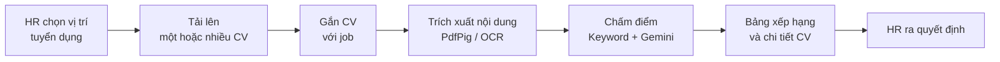
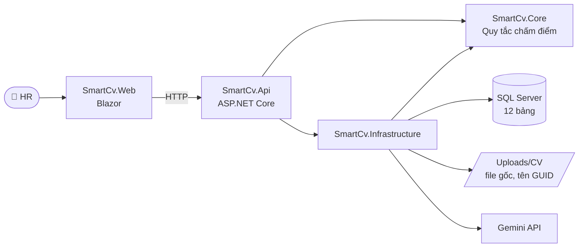

<div align="center">

# 🤖 AI CV SCREENING

**Hệ thống sàng lọc và xếp hạng CV ứng dụng trí tuệ nhân tạo**

Quản lý hồ sơ · Đánh giá ứng viên · Xếp hạng theo vị trí · So sánh phiên bản prompt


[Chức năng](#chuc-nang) · [Công nghệ](#cong-nghe) · [Cài đặt](#cai-dat) · [Chạy dự án](#chay-du-an) · [Đóng góp](#github)

</div>

---

> [!NOTE]
> **Trạng thái hiện tại:** Backend đã có solution, cấu hình kết nối SQL Server, cấu hình Gemini qua User Secrets và hai API kiểm tra kết nối. Các chức năng nghiệp vụ còn lại trong tài liệu này được mô tả **theo thiết kế**, chưa có nghĩa là đã lập trình xong.

## 📌 Mục lục

1. [Tổng quan](#tong-quan)
2. [Chức năng chính](#chuc-nang)
3. [Cách chấm điểm và đo độ chính xác](#cham-diem)
4. [Công nghệ sử dụng](#cong-nghe)
5. [Kiến trúc và cấu trúc thư mục](#kien-truc)
6. [Dữ liệu và lưu trữ CV](#du-lieu)
7. [Danh sách API](#api)
8. [Cài đặt môi trường](#cai-dat)
9. [Cấu hình SQL Server và Gemini](#cau-hinh)
10. [Build, chạy và kiểm thử](#chay-du-an)
11. [Quy trình làm việc với GitHub](#github)
12. [Phân công công việc](#phan-cong)
13. [Lưu ý và xử lý lỗi thường gặp](#loi-thuong-gap)

---

<a id="tong-quan"></a>

## 1. 🎯 Tổng quan

**AI CV Screening** hỗ trợ bộ phận nhân sự khi phải xử lý nhiều hồ sơ ứng viên. Hệ thống quản lý CV và vị trí tuyển dụng, chấm mức độ phù hợp theo tiêu chí của từng vị trí, xếp hạng ứng viên để HR tham khảo, đồng thời đo được độ chính xác của từng phiên bản system prompt.

> [!IMPORTANT]
> AI chỉ **hỗ trợ** sàng lọc. Quyết định tuyển dụng cuối cùng thuộc về **HR**.

### Luồng nghiệp vụ



1. HR chọn vị trí tuyển dụng. Giai đoạn 1 dùng 5 job nhập sẵn; giai đoạn 2 có trang quản lý job.
2. HR tải lên một hoặc nhiều CV.
3. HR gắn CV với vị trí phù hợp. Một CV có thể gắn với nhiều vị trí.
4. Hệ thống trích xuất nội dung, sau đó chấm điểm dưới nền bằng từ khóa kết hợp Gemini API.
5. HR xem bảng xếp hạng và chi tiết đánh giá, rồi tự đưa ra quyết định.
6. HR gán nhãn Đạt/Không đạt cho một bộ CV để so sánh chất lượng giữa các phiên bản prompt.

---

<a id="chuc-nang"></a>

## 2. ✨ Chức năng chính

> Các chức năng dưới đây mô tả phạm vi sản phẩm. Phần nào đã lập trình xong được ghi ở mục [Phân công](#phan-cong).

### Giai đoạn 1: ba trang chính

| Trang | Chức năng |
|---|---|
| 📤 **Tải CV** | Kéo thả nhiều file PDF, PNG, JPG/JPEG. Báo lỗi khi sai định dạng, file quá lớn hoặc file trùng (so mã hash SHA-256). Chọn job cho CV, bấm chấm điểm và xem tiến độ. |
| 📊 **Kết quả** | Lọc theo job, xem bảng xếp hạng có màu theo mức đánh giá. Xem chi tiết từng CV: kỹ năng đạt, kỹ năng thiếu, nhận định của AI. Hiển thị trạng thái lỗi và biểu đồ số CV theo mức. |
| 🧠 **System prompt** | Sửa prompt và lưu thành phiên bản mới (không ghi đè bản cũ). Xem lịch sử, kích hoạt một phiên bản, chạy đánh giá, so sánh tỷ lệ đúng giữa các phiên bản và xem những CV mà AI đánh giá khác HR. |

### Giai đoạn 2: các trang mở rộng (đề xuất, cần chốt với quản lý)

| Mã | Trang / phần | Chức năng |
|---|---|---|
| M1 | Tổng quan | Số CV, số job, số CV đang chấm, phân bố mức đánh giá |
| M2 | Quản lý vị trí tuyển dụng | Thêm, sửa, ngừng tuyển job; quản lý kỹ năng và từ khóa |
| M3 | Ứng viên và kho CV | Tìm kiếm, xem file CV, xem các job đã ứng tuyển |
| M4 | Gán nhãn HR | Tạo bộ CV đánh giá, gán nhãn Đạt/Không đạt |
| M5 | Lịch sử lượt chấm | Xem lại lượt chấm, prompt đã dùng, trạng thái và lỗi |
| M6 | Đăng nhập, phân quyền | Tài khoản HR và quản trị viên (cần thêm bảng `Users`) |
| M7 | Xuất báo cáo | Xuất bảng xếp hạng ra Excel hoặc PDF |
| M8 | CV trùng, phân cụm | Làm sau cùng nếu còn thời gian |
| M9 | Triển khai | Đưa web lên máy chủ của công ty |

---

<a id="cham-diem"></a>

## 3. 🧮 Cách chấm điểm và đo độ chính xác

### Điểm cuối

```text
FinalScore = 30% × KeywordScore + 70% × AiScore
```

Nếu gọi AI bị lỗi, hệ thống ghi `ScoreSource = KeywordOnly` và **hiển thị rõ** điều này trên giao diện, không âm thầm dùng mỗi điểm keyword.

### Mức đánh giá

| Điểm cuối | Mức đánh giá |
|:---:|---|
| ≥ 85 | 🟢 **Rất phù hợp** |
| 70 – < 85 | 🔵 **Phù hợp** |
| 55 – < 70 | 🟡 **Tiềm năng** |
| < 55 | 🔴 **Chưa phù hợp** |

**Ngưỡng Đạt** mặc định là `FinalScore ≥ 70`. Ngưỡng được lưu riêng cho từng lượt chạy.

### Độ chính xác của prompt (so với nhãn HR)

```text
Tỷ lệ đúng (%) = Số CV mà AI kết luận Đạt/Không đạt giống HR / Tổng số CV có nhãn × 100
```

Ví dụ: với 50 CV có nhãn, prompt A đúng 35 CV (**70%**), prompt B đúng 40 CV (**80%**).

Ngoài tỷ lệ đúng, hệ thống báo thêm hai chỉ số:

- **Bỏ sót**: HR đánh giá Đạt nhưng AI đánh giá Không đạt.
- **Chọn nhầm**: HR đánh giá Không đạt nhưng AI đánh giá Đạt.

> [!TIP]
> Để so sánh công bằng, chỉ đổi **nội dung prompt**. Giữ nguyên bộ CV, nhãn HR, model, temperature, trọng số và ngưỡng. Chỉ số này đo mức trùng khớp với nhãn HR; nó không phải thước đo duy nhất về chất lượng tuyển dụng.

---

<a id="cong-nghe"></a>

## 4. 🧰 Công nghệ sử dụng

| Thành phần | Công nghệ | Trạng thái |
|---|---|---|
| Backend | C#, ASP.NET Core Web API (.NET 10 LTS) | ✅ Đã khởi tạo |
| Truy cập dữ liệu | Entity Framework Core, SQL Server Provider | ✅ Đã cấu hình kết nối |
| Cơ sở dữ liệu | Microsoft SQL Server (`SmartCvDb`) | ✅ Đã kết nối · ⏳ Bảng tạo ở A2 |
| AI | Google Gemini API | ✅ Đã cấu hình, có API kiểm tra |
| Giao diện | Blazor (Razor, HTML, CSS) | ⏳ Tạo ở B2 |
| Đọc PDF | PdfPig | ⏳ Dự kiến (A7) |
| OCR | Tesseract cho .NET (eng + vie) | ⏳ Dự kiến (A7) |
| Chạy nền | BackgroundService hoặc Hangfire | ⏳ Dự kiến (A11) |
| Biểu đồ | Chart.js | ⏳ Dự kiến (B11) |
| Kiểm thử | xUnit | ✅ Đã có project |
| Quản lý mã nguồn | Git, GitHub (nhánh + Pull Request) | ✅ Đang áp dụng |

> Trước khi cài một thư viện mới, kiểm tra giấy phép và mức độ cập nhật của thư viện đó.

---

<a id="kien-truc"></a>

## 5. 🏗️ Kiến trúc và cấu trúc thư mục



| Project | Vai trò |
|---|---|
| `SmartCv.Api` | Điểm khởi chạy, cấu hình HTTP, controllers |
| `SmartCv.Core` | Quy tắc chấm điểm và các class dữ liệu cốt lõi. **Không phụ thuộc** project nào khác |
| `SmartCv.Infrastructure` | EF Core / SQL Server, đọc PDF/OCR, gọi Gemini |
| `SmartCv.Tests` | Kiểm thử tự động (xUnit) |
| `SmartCv.Web` | Giao diện Blazor *(tạo ở B2)* |

```text
AI-CV-Screening/
├── .github/                        # Mẫu Issue, Pull Request
├── database/                       # Script SQL (SmartCvDb.sql), ERD
├── docs/                           # Tài liệu dự án
├── src/
│   ├── SmartCv.Api/
│   │   ├── Controllers/            # API controllers (HealthController, ...)
│   │   ├── Properties/launchSettings.json
│   │   ├── Program.cs              # Cấu hình và khởi chạy API
│   │   └── appsettings.json        # Cấu hình KHÔNG nhạy cảm
│   ├── SmartCv.Core/               # Nghiệp vụ cốt lõi
│   └── SmartCv.Infrastructure/
│       ├── Gemini/                 # GeminiOptions và tích hợp Gemini
│       ├── Persistence/            # SmartCvDbContext
│       └── DependencyInjection.cs  # Đăng ký dịch vụ
├── tests/
│   └── SmartCv.Tests/              # xUnit tests
├── .gitignore
├── CONTRIBUTING.md
├── global.json                     # Khóa phiên bản .NET SDK
├── SmartCv.slnx                    # Solution .NET
└── README.md
```

---

<a id="du-lieu"></a>

## 6. 🗃️ Dữ liệu và lưu trữ CV

Database gồm **12 bảng**, thiết kế theo ERD ký hiệu Chen. Bản chuẩn là [`database/SmartCvDb.sql`](database/SmartCvDb.sql).

| Bảng | Mục đích |
|---|---|
| `Candidates` | Ứng viên |
| `Jobs` | Vị trí tuyển dụng |
| `JobSkills` | Kỹ năng của job (bắt buộc / ưu tiên) |
| `JobSkillAliases` | Các từ khóa tương đương của một kỹ năng |
| `Cvs` | File CV và nội dung trích xuất |
| `Applications` | CV ứng tuyển vào job |
| `PromptVersions` | Các phiên bản system prompt |
| `EvaluationSets` | Bộ CV dùng để đánh giá prompt |
| `HrLabels` | Nhãn Đạt/Không đạt do HR gán |
| `EvaluationRuns` | Một lượt chấm (Screening hoặc PromptTest) |
| `Evaluations` | Kết quả chấm của từng hồ sơ trong một lượt |
| `EvaluationSkills` | Kỹ năng đạt / thiếu của từng kết quả |

**Ràng buộc quan trọng**

- Tại một thời điểm chỉ có **một** prompt đang dùng (UNIQUE có lọc trên `PromptVersions(IsActive)`).
- Các cột UNIQUE: `Cvs(FileHash)`, `Applications(CvId, JobId)`, `Evaluations(RunId, ApplicationId)`.
- `KeywordWeight + AiWeight = 1`. Prompt đã chạy thì không sửa nữa, mà lưu thành phiên bản mới.
- Ngày giờ lưu theo **UTC**, khi hiển thị thì cộng 7 giờ.

**Nguyên tắc lưu trữ CV**

- File gốc lưu trên máy chủ và được đổi tên theo GUID, ví dụ `Uploads/CV/2026/11/<GUID>.pdf`.
- SQL Server lưu tên file gốc, đường dẫn, mã hash SHA-256, nội dung trích xuất, ngày tải và trạng thái xử lý.
- Thư mục `Uploads/` nằm trong `.gitignore`. **Không đưa CV thật lên GitHub.**
- Hiện chưa có cơ chế xóa CV tự động; sẽ bổ sung khi công ty có quy định.

---

<a id="api"></a>

## 7. 🔌 Danh sách API

### ✅ Đã triển khai (chỉ chạy ở môi trường Development)

| Phương thức | Endpoint | Mô tả |
|:---:|---|---|
| `GET` | `/api/health/database` | Kiểm tra kết nối SQL Server |
| `GET` | `/api/health/gemini` | Kiểm tra API key và model Gemini (không tốn lượt sinh nội dung) |

### ⏳ Dự kiến

> Danh sách này là định hướng thiết kế, **chưa được chốt** (C2). Có thể điều chỉnh khi lập trình.

| Phương thức | Endpoint | Mô tả |
|:---:|---|---|
| `POST` | `/api/cvs/upload` | Tải một hoặc nhiều CV |
| `POST` | `/api/applications` | Gắn CV với job |
| `GET` | `/api/jobs` | Danh sách job |
| `POST` | `/api/scoring/start` | Bắt đầu chấm điểm |
| `GET` | `/api/scoring/progress` | Xem tiến độ chấm |
| `GET` | `/api/jobs/{id}/ranking` | Bảng xếp hạng theo job |
| `GET` | `/api/applications/{id}` | Chi tiết kết quả của một hồ sơ |
| `GET` `POST` | `/api/prompts` | Xem hoặc tạo phiên bản prompt |
| `POST` | `/api/prompts/{id}/activate` | Kích hoạt phiên bản prompt |
| `POST` | `/api/hr-labels` | Nhập nhãn HR |
| `POST` | `/api/evaluations/run` | Chạy đánh giá prompt |
| `GET` | `/api/evaluations/compare` | So sánh hai phiên bản prompt |

---

<a id="cai-dat"></a>

## 8. ⚙️ Cài đặt môi trường

### 8.1. Yêu cầu

- [x] Windows và **.NET 10 SDK**
- [x] **SQL Server** (Express hoặc Developer) và công cụ kết nối (extension *SQL Server (mssql)* cho VS Code, hoặc SSMS)
- [x] **Git**
- [x] **VS Code** (kèm *C# Dev Kit*) hoặc Visual Studio
- [x] **Gemini API key** lấy từ [Google AI Studio](https://aistudio.google.com)
- [ ] *(Khi làm OCR)* Tesseract và dữ liệu ngôn ngữ `eng`, `vie`

Kiểm tra môi trường:

```powershell
dotnet --version   # 10.0.xxx
git --version
```

### 8.2. Clone repository

```powershell
git clone https://github.com/TuyetAnh0101/AI-CV-Screening.git
cd AI-CV-Screening
```

> [!NOTE]
> Chỉ chạy được Backend từ nhánh `main` sau khi Pull Request cấu hình hạ tầng (A1) đã được gộp. Trước thời điểm đó, chuyển sang nhánh của A1:
> ```powershell
> git fetch
> git switch feature/A1-config-infrastructure
> ```

---

<a id="cau-hinh"></a>

## 9. 🔐 Cấu hình SQL Server và Gemini

> Mọi lệnh dưới đây chạy từ thư mục gốc `AI-CV-Screening`.

### 9.1. Chuẩn bị database

1. Cài SQL Server và ghi lại **tên instance** trên máy, ví dụ `localhost\SQLEXPRESS`.
2. Tạo database **rỗng**:
   ```sql
   CREATE DATABASE SmartCvDb;
   ```
3. Kiểm tra tài khoản Windows đang dùng có quyền truy cập database. Database phải ở trạng thái `ONLINE` và `MULTI_USER`.

> [!WARNING]
> Theo kế hoạch, các bảng được tạo bằng **EF Core Migration** (A2). **Không chạy** `SmartCvDb.sql` vào `SmartCvDb`, vì migration sau đó sẽ báo trùng bảng. Nếu cần một bản để đối chiếu, chạy script vào database khác tên, ví dụ `SmartCvDb_Script`. Không chạy lệnh cập nhật schema khi nhóm chưa thống nhất.

### 9.2. Cấu hình User Secrets

Thông tin nhạy cảm (API key, chuỗi kết nối) được lưu bằng **User Secrets**. Dữ liệu này nằm ở `%APPDATA%\Microsoft\UserSecrets\`, tức là **ngoài repo**, nên Git không thể commit nhầm. Mỗi thành viên tự đặt giá trị trên máy của mình.

```powershell
# Chỉ chạy nếu SmartCv.Api.csproj chưa có <UserSecretsId>
dotnet user-secrets init --project src/SmartCv.Api

# Chuỗi kết nối – thay TEN_SERVER bằng tên instance trên máy bạn
dotnet user-secrets set "ConnectionStrings:SmartCvDb" "Server=TEN_SERVER;Database=SmartCvDb;Trusted_Connection=True;TrustServerCertificate=True" --project src/SmartCv.Api

# Gemini API key
dotnet user-secrets set "Gemini:ApiKey" "YOUR_GEMINI_API_KEY" --project src/SmartCv.Api

# Kiểm tra lại
dotnet user-secrets list --project src/SmartCv.Api
```

> [!CAUTION]
> `YOUR_GEMINI_API_KEY` chỉ là giá trị minh họa. **Không** để lộ key thật trong ảnh chụp terminal, Issue, Pull Request hay README. Nếu key đã lộ, hãy **thu hồi key đó trong AI Studio rồi tạo key mới**. Xóa commit chứa key là chưa đủ, vì lịch sử Git vẫn còn giữ nó.

### 9.3. Cấu hình không nhạy cảm

Các giá trị này nằm trong `src/SmartCv.Api/appsettings.json`:

```json
"Gemini": {
  "Model": "gemini-3.1-flash-lite",
  "Temperature": 0.2,
  "MaxCvCharacters": 12000,
  "MaxRetries": 2
}
```

Mỗi thành viên nên tự kiểm tra xem API key của mình có dùng được model này không. Cách nhanh nhất là gọi `/api/health/gemini`.

---

<a id="chay-du-an"></a>

## 10. 🚀 Build, chạy và kiểm thử

### 10.1. Restore và build

```powershell
dotnet restore
dotnet build
```

### 10.2. Chạy API

```powershell
dotnet run --project src/SmartCv.Api --launch-profile https
```

Theo `launchSettings.json` hiện tại, API chạy tại:

| Giao thức | URL |
|---|---|
| HTTPS | `https://localhost:7269` |
| HTTP | `http://localhost:5156` |

> Port có thể khác tùy nhánh bạn đang dùng. Luôn lấy URL mà terminal in ra ở dòng `Now listening on:`.

Kiểm tra kết nối:

```http
GET https://localhost:7269/api/health/database
GET https://localhost:7269/api/health/gemini
```

Kết quả mong đợi:

```json
{ "status": "OK", "server": "localhost\\SQLEXPRESS", "database": "SmartCvDb" }
{ "status": "OK", "model": "gemini-3.1-flash-lite", "key": "AIza...xxxx" }
```

Nếu Windows chưa tin chứng chỉ HTTPS dùng khi phát triển:

```powershell
dotnet dev-certs https --trust
```

Muốn dừng API, nhấn `Ctrl + C` trong terminal.

### 10.3. Chạy kiểm thử

```powershell
dotnet test
```

> Project hiện chỉ có bài kiểm thử xUnit cơ bản. Unit test cho phần tính điểm và tỷ lệ đúng sẽ được viết ở A18.

---

<a id="github"></a>

## 11. 🌿 Quy trình làm việc với GitHub

- 🚫 **Không push trực tiếp** vào `main`.
- 🌱 Mỗi tính năng làm trên một nhánh riêng: `feature/<mã-việc>-<mô-tả>`, ví dụ `feature/A4-upload-cv`. Nhánh sửa lỗi đặt tên `fix/<mô-tả>`.
- 👀 Mỗi Pull Request phải được **thành viên còn lại review** trước khi merge.

```powershell
# 1. Tạo nhánh từ main mới nhất
git switch main
git pull origin main
git switch -c feature/<mã-việc>-<mô-tả>

# 2. Làm việc, sau đó kiểm tra trước khi commit
git status
git add .
git diff --cached --name-only    # xem lại danh sách file sẽ commit
git grep -n "AIza"               # phải KHÔNG có kết quả

# 3. Commit và đẩy lên GitHub
git commit -m "feat(A4): mô tả ngắn gọn"
git push -u origin feature/<mã-việc>-<mô-tả>
```

Sau đó tạo Pull Request vào `main` trên GitHub, ghi rõ đã thay đổi gì và cách kiểm tra. Quy định chi tiết xem tại [CONTRIBUTING.md](CONTRIBUTING.md).

---

<a id="phan-cong"></a>

## 12. 👥 Phân công công việc

| Thành viên | Vai trò | Phạm vi |
|---|---|---|
| Bạn A | Backend và AI | A1 – A18 |
| Bạn B | Giao diện và kiểm thử | B1 – B18 |
| Cả nhóm | Phối hợp | C1 – C5 |

### Thứ tự thực hiện giai đoạn 1

| Bước | Nội dung | Mã việc |
|:---:|---|---|
| 1 | Thiết kế | C1, C2, C3, B1 |
| 2 | Dựng nền | A1 – A3, B2 |
| 3 | Trang tải CV | A4 – A8, B3 – B5 |
| 4 | Trang kết quả | A9 – A13, B6 – B10 |
| 5 | Trang prompt | A14 – A17, B12 – B16 |
| 6 | Hoàn thiện | C4, A18, B11, B17, B18, C5 |

> Cập nhật tên thành viên và tiến độ vào bảng trên khi nhóm đã thống nhất chính thức.

---

<a id="loi-thuong-gap"></a>

## 13. 🛠️ Lưu ý và xử lý lỗi thường gặp

| Hiện tượng | Cách kiểm tra / xử lý |
|---|---|
| `A network-related or instance-specific error` | Kiểm tra tên instance. Mở `services.msc` xem dịch vụ **SQL Server (…)** có đang chạy không. |
| `Cannot open database "SmartCvDb"` | Database chưa được tạo (xem mục 9.1), hoặc tài khoản không có quyền. |
| `The certificate chain was issued by an authority that is not trusted` | Thêm `TrustServerCertificate=True` vào chuỗi kết nối. |
| Database báo `SINGLE_USER` | Kiểm tra các phiên đang kết nối. Chỉ đổi sang `MULTI_USER` khi bạn có quyền và hiểu việc đó ảnh hưởng gì tới các phiên khác. |
| `OptionsValidationException` khi khởi động | Chưa đặt User Secrets, hoặc gõ sai tên khóa. Tên đúng là `Gemini:ApiKey` và `ConnectionStrings:SmartCvDb`. |
| Gemini trả về `400` / `403` | API key sai, đã bị thu hồi, hoặc dự án Google chưa bật Gemini API. |
| Gemini trả về `404` | Tên model không còn đúng. Kiểm tra lại trên AI Studio rồi sửa `Gemini:Model`. |
| Lỗi chứng chỉ HTTPS | Chạy `dotnet dev-certs https --trust`. |
| `dotnet build` có cảnh báo `NU1902` / `NU1903` | Package có lỗ hổng bảo mật. Nâng lên bản đã vá; **không tắt cảnh báo** để che lỗi. |
| Thiếu bảng nghiệp vụ | Kiểm tra migration hoặc script đã được nhóm thống nhất chưa. Không tự ý xóa hay tạo lại database đang dùng chung. |

### 🔒 Bảo mật và dữ liệu

- Không commit Gemini API key, mật khẩu, chuỗi kết nối chứa bí mật, file `.env` hoặc User Secrets.
- Không commit thư mục build (`bin/`, `obj/`) hay CV thật trong `Uploads/`.
- Luôn xem lại `git diff --cached` trước khi commit.
- Chỉ dùng CV mà nhóm có quyền xử lý. Hạn chế ghi thông tin cá nhân vào log và dữ liệu mẫu.
- Khi thay đổi cấu hình chung, schema hoặc API contract, báo cho cả nhóm và cập nhật tài liệu.

---

<div align="center">

**AI CV Screening** · Built with .NET & Gemini

*Tài liệu được cập nhật theo tiến độ phát triển của nhóm.*

[⬆ Về đầu trang](#-ai-cv-screening)

</div>
