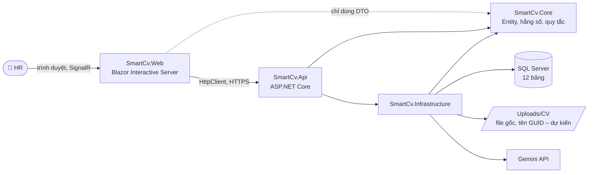
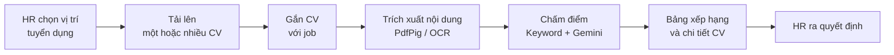

<div align="center">

# 🤖 SmartCv – AI CV Screening

**Hệ thống sàng lọc và xếp hạng CV ứng dụng trí tuệ nhân tạo**

Quản lý hồ sơ · Chấm điểm Keyword + AI · Xếp hạng theo vị trí · So sánh phiên bản prompt


</div>

---

> [!NOTE]
> **Trạng thái hiện tại (sau A4 và B2):** Backend đã có solution, cấu hình SQL Server và Gemini qua User Secrets, các API kiểm tra kết nối, **12 Entity, EF Core Migration `InitialCreate`, dữ liệu nền 5 job nạp tự động qua Migration `SeedJobs`, bộ dữ liệu demo**, **API `POST /api/cvs/upload` nhận một hoặc nhiều file** (mới nhận file, chưa kiểm tra và chưa lưu) và **API đọc job `GET /api/jobs`**. Giao diện **SmartCv.Web (Blazor)** đã có bố cục chung, menu, service gọi API và trang chủ hiện danh sách job thật; ba trang Tải CV, Kết quả, System prompt **mới là khung**. Các chức năng nghiệp vụ còn lại (kiểm tra/lưu CV, chấm điểm, xếp hạng, quản lý prompt) được mô tả **theo thiết kế** và **chưa được lập trình**.

## 📌 Mục lục

1. [Giới thiệu](#gioi-thieu)
2. [Mục tiêu và phạm vi](#muc-tieu)
3. [Chức năng](#chuc-nang)
4. [Công nghệ sử dụng](#cong-nghe)
5. [Kiến trúc và cấu trúc thư mục](#kien-truc)
6. [Cơ sở dữ liệu](#co-so-du-lieu)
7. [Quy trình xử lý CV và chấm điểm](#cham-diem)
8. [Cài đặt môi trường](#cai-dat)
9. [Cấu hình SQL Server và User Secrets](#cau-hinh)
10. [Tạo database và nạp dữ liệu](#database)
11. [Build, chạy và kiểm thử](#chay-du-an) – gồm [giao diện SmartCv.Web](#web)
12. [Danh sách API](#api)
13. [Kết quả nghiệm thu A2, A3, A4, B2](#nghiem-thu-a2)
14. [Lộ trình phát triển](#lo-trinh)
15. [Quy trình làm việc với Git](#git)
16. [Xử lý lỗi thường gặp và bảo mật](#loi-thuong-gap)

---

<a id="gioi-thieu"></a>

## 1. 🎯 Giới thiệu

**SmartCv** hỗ trợ bộ phận nhân sự (HR) khi phải xử lý nhiều hồ sơ ứng viên. Hệ thống quản lý CV và vị trí tuyển dụng, chấm mức độ phù hợp theo tiêu chí của từng vị trí bằng cách kết hợp **so khớp từ khóa** và **Google Gemini**, xếp hạng ứng viên để HR tham khảo, đồng thời đo được độ chính xác của từng phiên bản system prompt so với nhãn do HR gán.

Đây là dự án nhóm sinh viên, phát triển theo từng mã công việc (A – Backend/AI, B – Giao diện/kiểm thử, C – Phối hợp).

> [!IMPORTANT]
> AI chỉ **hỗ trợ** sàng lọc. Quyết định tuyển dụng cuối cùng thuộc về **HR**.

---

<a id="muc-tieu"></a>

## 2. 🧭 Mục tiêu và phạm vi

**Mục tiêu**

- Giảm thời gian đọc CV thủ công bằng cách chấm điểm và xếp hạng tự động theo từng vị trí.
- Cho HR thấy lý do của từng điểm số: kỹ năng đạt, kỹ năng thiếu, nhận định của AI.
- Đo và so sánh chất lượng các phiên bản prompt bằng tỷ lệ đúng so với nhãn HR.

**Phạm vi giai đoạn 1**

- Ba trang chính: **Tải CV**, **Kết quả**, **System prompt**.
- Định dạng CV: PDF (có chữ hoặc scan) và ảnh PNG, JPG/JPEG.
- Dùng 5 vị trí tuyển dụng nhập sẵn; trang quản lý job thuộc giai đoạn 2.

**Ngoài phạm vi giai đoạn 1:** đăng nhập/phân quyền, xuất báo cáo, phân cụm CV, triển khai lên máy chủ (xem [Giai đoạn 2](#lo-trinh)).

---

<a id="chuc-nang"></a>

## 3. ✨ Chức năng

### 3.1. ✅ Đã triển khai

| Mã | Nội dung |
|---|---|
| A1 | Solution .NET 10 gồm 4 project; kết nối SQL Server; cấu hình Gemini qua User Secrets, kiểm tra cấu hình khi khởi động; 2 API kiểm tra kết nối |
| A2 | 12 Entity, hằng số trạng thái, một `SmartCvDbContext`, 12 Fluent API Configuration, Migration `InitialCreate` khớp `database/SQL.sql` |
| A3 | Dữ liệu nền 5 Jobs, 29 JobSkills, 52 JobSkillAliases (`JobSeedData` + `HasData`) nạp tự động qua Migration `SeedJobs`; tách dữ liệu demo sang `seed_demo.sql` (282 dòng); script kiểm tra `check_jobs.sql`; unit test dữ liệu nền |
| A4 | API `POST /api/cvs/upload` nhận một hoặc nhiều file qua `multipart/form-data`, trả thông tin từng file với trạng thái `Received`; giới hạn số file và dung lượng request đọc từ `appsettings.json`; hợp đồng dùng chung `CvUploadResponse` cho giao diện Blazor. Bảo mật: giới hạn 201 MiB chỉ cho endpoint này, Rate Limiting (429), endpoint chỉ bật ở Development cho đến khi có xác thực (M6). **Chưa** kiểm tra định dạng/dung lượng/file trùng (A5), **chưa** lưu file và ghi bảng `Cvs` (A6) |
| A (tiền đề B2) | API `GET /api/health`, `GET /api/jobs` (`activeOnly`), `GET /api/jobs/{id}` (404 khi không có); hợp đồng dùng chung `JobDto`, `JobSkillDto` |
| B2 | Dự án **SmartCv.Web** (Blazor Web App, Interactive Server): bố cục sidebar + thanh trên cùng, menu 4 mục (thu thành ☰ dưới 768px), huy hiệu trạng thái API, component dùng chung (`PageHeader`, `ErrorAlert`, `LoadingIndicator`, `ApiStatusBadge`), service gọi API (`HealthApiClient`, `JobApiClient`, `CvApiClient`) trả `ApiResult<T>` với thông báo lỗi tiếng Việt. Trang chủ hiện 5 job thật từ API; trang Tải CV, Kết quả, System prompt **mới là khung** cho B3–B16 |

### 3.2. ⏳ Dự kiến – giai đoạn 1 (chưa lập trình)

| Trang | Chức năng |
|---|---|
| 📤 **Tải CV** | Kéo thả nhiều file PDF, PNG, JPG/JPEG. Báo lỗi khi sai định dạng, file quá lớn hoặc file trùng (so mã hash SHA-256). Chọn job cho CV, bấm chấm điểm và xem tiến độ. |
| 📊 **Kết quả** | Lọc theo job, xem bảng xếp hạng có màu theo mức đánh giá. Xem chi tiết từng CV: kỹ năng đạt, kỹ năng thiếu, nhận định của AI. Hiển thị trạng thái lỗi và biểu đồ số CV theo mức. |
| 🧠 **System prompt** | Sửa prompt và lưu thành phiên bản mới (không ghi đè bản cũ). Xem lịch sử, kích hoạt một phiên bản, chạy đánh giá, so sánh tỷ lệ đúng giữa các phiên bản và xem những CV mà AI đánh giá khác HR. |

### 3.3. 💡 Đề xuất – giai đoạn 2 (cần chốt với quản lý)

| Mã | Trang / phần | Chức năng |
|---|---|---|
| M1 | Tổng quan | Số CV, số job, số CV đang chấm, phân bố mức đánh giá |
| M2 | Quản lý vị trí tuyển dụng | Thêm, sửa, ngừng tuyển job; quản lý kỹ năng và từ khóa |
| M3 | Ứng viên và kho CV | Tìm kiếm, xem file CV, xem các job đã ứng tuyển |
| M4 | Gán nhãn HR | Tạo bộ CV đánh giá, gán nhãn Đạt/Không đạt |
| M5 | Lịch sử lượt chấm | Xem lại lượt chấm, prompt đã dùng, trạng thái và lỗi |
| M6 | Đăng nhập, phân quyền | Tài khoản HR và quản trị viên (cần thêm bảng `Users`) |
| M7 | Xuất báo cáo | Xuất bảng xếp hạng ra Excel hoặc PDF |
| M8 | CV trùng, phân cụm | Làm sau cùng nếu còn thời gian |
| M9 | Triển khai | Đưa web lên máy chủ của công ty |

---

<a id="cong-nghe"></a>

## 4. 🧰 Công nghệ sử dụng

Phiên bản lấy theo các file `.csproj` và `global.json` hiện tại.

| Thành phần | Công nghệ / package | Trạng thái |
|---|---|---|
| Nền tảng | .NET SDK 10 (`global.json`: `10.0.xxx`, `rollForward: latestFeature`) | ✅ |
| Backend | ASP.NET Core Web API (`net10.0`), `Microsoft.AspNetCore.OpenApi` 10.0.14 | ✅ |
| Truy cập dữ liệu | `Microsoft.EntityFrameworkCore.SqlServer` 10.0.* (hiện phân giải 10.0.14) | ✅ |
| Migration | `Microsoft.EntityFrameworkCore.Design` 10.0.*, công cụ `dotnet-ef` | ✅ |
| Cơ sở dữ liệu | Microsoft SQL Server, database `SmartCvDb` | ✅ |
| AI | Google Gemini API (gọi qua `HttpClient`, cấu hình `GeminiOptions`) | ✅ Đã cấu hình · ⏳ Chấm điểm ở A10 |
| Kiểm thử | xUnit 2.9.3, `Microsoft.NET.Test.Sdk` 17.14.1, coverlet 6.0.4, `Microsoft.AspNetCore.Mvc.Testing` 10.0.14 | ✅ |
| Giao diện | Blazor Web App (`net10.0`), chế độ **Interactive Server** cho mọi trang, Bootstrap có sẵn trong mẫu | ✅ Khung B2 · ⏳ Chức năng B3–B16 |
| Đọc PDF / OCR | PdfPig, Tesseract cho .NET (`eng` + `vie`) | ⏳ A7 |
| Chạy nền | BackgroundService hoặc Hangfire | ⏳ A11 |
| Biểu đồ | Chart.js | ⏳ B11 |
| Mã nguồn | Git, GitHub (nhánh + Pull Request) | ✅ |

> Trước khi cài một thư viện mới, kiểm tra giấy phép và mức độ cập nhật của thư viện đó.

---

<a id="kien-truc"></a>

## 5. 🏗️ Kiến trúc và cấu trúc thư mục



| Project | Vai trò |
|---|---|
| `SmartCv.Api` | Điểm khởi chạy, cấu hình HTTP, controllers |
| `SmartCv.Core` | Entity, hằng số trạng thái và quy tắc nghiệp vụ. **Không phụ thuộc** project nào khác |
| `SmartCv.Infrastructure` | EF Core / SQL Server, cấu hình Gemini; sau này thêm đọc PDF/OCR, gọi Gemini |
| `SmartCv.Tests` | Kiểm thử tự động (xUnit) |
| `SmartCv.Web` | Giao diện Blazor (B2). Chỉ tham chiếu `SmartCv.Core` (dùng chung DTO), **không** tham chiếu Infrastructure, **không** kết nối database: mọi dữ liệu lấy qua `SmartCv.Api` |

```text
AI-CV-Screening/
├── database/
│   ├── SQL.sql                         # Thiết kế CSDL gốc (C2) – chỉ dùng để đối chiếu
│   ├── seed_demo.sql                   # Dữ liệu demo 9 bảng (282 dòng), trọng số 30/70 – chạy tay, tùy chọn
│   ├── check_jobs.sql                  # Kiểm tra dữ liệu nền 5 job / 29 kỹ năng / 52 từ khóa
│   ├── migration_InitialCreate.sql     # Script SQL sinh từ Migration InitialCreate
│   ├── migration_SeedJobs.sql          # Script SQL sinh từ Migration SeedJobs
│   ├── update_seed_weights_30_70.sql   # Chỉ dùng cho DB đã seed bằng bản cũ 40/60
│   ├── erdplus.png                     # Sơ đồ ERD
│   └── README.md
├── src/
│   ├── SmartCv.Api/
│   │   ├── Controllers/HealthController.cs   # 2 API kiểm tra kết nối
│   │   ├── Endpoints/
│   │   │   ├── CvEndpoints.cs                # POST /api/cvs/upload: giới hạn dung lượng riêng, chỉ bật ở Development
│   │   │   ├── CvUploadEndpointOptions.cs    # CvUpload:Endpoint (bật/tắt, giới hạn tần suất)
│   │   │   ├── CvUploadRateLimiting.cs       # Rate Limiting cho API tải CV (429)
│   │   │   └── JobEndpoints.cs               # GET /api/health, /api/jobs, /api/jobs/{id}
│   │   ├── Properties/launchSettings.json
│   │   ├── CvUpload.http                     # Thử API tải CV bằng REST Client
│   │   ├── Program.cs                        # Đăng ký dịch vụ, pipeline (UseRateLimiter)
│   │   ├── appsettings.json                  # Cấu hình KHÔNG nhạy cảm (Gemini, CvUpload); API tải CV tắt mặc định
│   │   └── appsettings.Development.json      # Bật API tải CV khi phát triển
│   ├── SmartCv.Core/
│   │   ├── Constants/StatusValues.cs         # Giá trị khớp các ràng buộc CHECK
│   │   ├── Contracts/                        # Hợp đồng dùng chung với Blazor: CvUploadResponse, JobDto
│   │   ├── Entities/                         # 12 Entity
│   │   ├── Options/CvUploadOptions.cs        # Giới hạn tải CV
│   │   └── Uploads/                          # CvUploadFile, ICvUploadService
│   ├── SmartCv.Infrastructure/
│   │   ├── Data/
│   │   │   ├── Configurations/               # 12 Fluent API Configuration
│   │   │   ├── Migrations/                   # InitialCreate, SeedJobs + ModelSnapshot
│   │   │   ├── Seed/JobSeedData.cs           # Dữ liệu nền 5 job (HasData)
│   │   │   └── SmartCvDbContext.cs           # DbContext duy nhất
│   │   ├── Gemini/GeminiOptions.cs
│   │   ├── Uploads/CvUploadService.cs        # Xử lý file tải lên (A4: Received)
│   │   └── DependencyInjection.cs            # AddInfrastructure(): DbContext, Gemini, CvUpload
│   └── SmartCv.Web/                          # Giao diện Blazor (B2)
│       ├── Components/
│       │   ├── App.razor                     # Khung HTML (lang="vi"), InteractiveServer cho HeadOutlet + Routes
│       │   ├── Routes.razor                  # Định tuyến, trang NotFound
│       │   ├── _Imports.razor                # @using dùng chung (Core.Contracts, Services, Shared, Helpers)
│       │   ├── Layout/                       # MainLayout (sidebar + topbar), NavMenu (4 mục, ☰), ReconnectModal
│       │   ├── Pages/                        # Home, Upload, Results, Prompts, Error, NotFound
│       │   └── Shared/                       # PageHeader, ErrorAlert, LoadingIndicator, ApiStatusBadge
│       ├── Services/                         # ApiResult, ApiClientBase, Health/Job/CvApiClient, đăng ký DI
│       ├── Helpers/FitLevel.cs               # 4 mức đánh giá 85 / 70 / 55
│       ├── wwwroot/app.css                   # CSS chung: biến màu, 4 màu mức đánh giá
│       ├── appsettings.Development.json      # ApiBaseUrl = https://localhost:7269/
│       └── Program.cs                        # AddSmartCvApiClients(...)
├── test-files/                               # CV GIẢ để thử API tải CV (không đặt CV thật)
├── tests/SmartCv.Tests/                      # xUnit: JobSeedDataTests, CvUploadServiceTests, CvUploadEndpointTests, JobEndpointsTests, WebApiClientTests
├── .vscode/tasks.json                        # Task "Chạy API + Web" cho VS Code
├── .gitignore
├── CONTRIBUTING.md                           # Quy trình nhóm, danh sách nhánh
├── global.json
├── SmartCv.slnx
└── README.md
```

---

<a id="co-so-du-lieu"></a>

## 6. 🗃️ Cơ sở dữ liệu

Database `SmartCvDb` gồm **12 bảng nghiệp vụ**, được tạo bằng **EF Core Migration** `20261106132922_InitialCreate`. Cấu trúc migration đã được đối chiếu và khớp với thiết kế gốc [`database/SQL.sql`](database/SQL.sql). Sơ đồ: [`database/erdplus.png`](database/erdplus.png).

| Nhóm nghiệp vụ | Bảng | Mục đích |
|---|---|---|
| Vị trí tuyển dụng | `Jobs` | Vị trí, GPA và số năm kinh nghiệm tối thiểu |
| | `JobSkills` | Kỹ năng của job: `MustHave` / `NiceToHave` |
| | `JobSkillAliases` | Từ khóa tương đương của một kỹ năng |
| Ứng viên và hồ sơ | `Candidates` | Ứng viên |
| | `Cvs` | File CV, mã hash, nội dung trích xuất, trạng thái trích xuất |
| | `Applications` | CV ứng tuyển vào job |
| Prompt và đánh giá | `PromptVersions` | Các phiên bản system prompt |
| | `EvaluationSets` | Bộ CV dùng để đánh giá prompt |
| | `HrLabels` | Nhãn Đạt/Không đạt do HR gán |
| Chấm điểm | `EvaluationRuns` | Một lượt chấm (`Screening` hoặc `PromptTest`), lưu model, trọng số, ngưỡng |
| | `Evaluations` | Kết quả chấm của từng hồ sơ trong một lượt |
| | `EvaluationSkills` | Kỹ năng đạt / thiếu của từng kết quả |

**Đối tượng ràng buộc:** 12 PRIMARY KEY · 13 FOREIGN KEY (`NO ACTION`) · 6 UNIQUE · 25 CHECK · 18 DEFAULT · 8 index `IX_` · 1 filtered unique index.

**Ràng buộc quan trọng**

- Chỉ **một** prompt đang dùng tại một thời điểm: `UX_PromptVersions_OneActive` (UNIQUE có lọc `WHERE IsActive = 1`).
- UNIQUE: `Jobs(Title)`, `Cvs(FileHash)`, `Applications(CvId, JobId)`, `PromptVersions(VersionName)`, `EvaluationSets(Name)`, `Evaluations(RunId, ApplicationId)`. Trong EF Core, các cột này được cấu hình là *alternate key* nên **không sửa được** sau khi đã lưu.
- `KeywordWeight + AiWeight = 1`.
- `PromptTest` bắt buộc có `EvaluationSetId`; `Screening` bắt buộc `EvaluationSetId` là NULL.
- Prompt đã chạy thì không sửa nữa, mà lưu thành phiên bản mới.
- Ngày giờ lưu theo **UTC** (`SYSUTCDATETIME()`), khi hiển thị thì cộng 7 giờ.

**Nguyên tắc lưu trữ CV (thiết kế)**

- File gốc lưu trên máy chủ và đổi tên theo GUID, ví dụ `Uploads/CV/2026/11/<GUID>.pdf`. `CvId` do code tạo, trùng với tên file.
- SQL Server lưu tên file gốc, đường dẫn, mã hash SHA-256, nội dung trích xuất, ngày tải và trạng thái xử lý.
- Thư mục lưu file (`/Uploads/`, `src/SmartCv.Api/Uploads/`) nằm trong `.gitignore`; các thư mục mã nguồn tên `Uploads` trong `src/` vẫn được commit bình thường. **Không đưa CV thật lên GitHub.**
- Hiện chưa có cơ chế xóa CV tự động; sẽ bổ sung khi công ty có quy định.

---

<a id="cham-diem"></a>

## 7. 🧮 Quy trình xử lý CV và chấm điểm

> [!NOTE]
> Phần này là **thiết kế**. Code tải CV, trích xuất nội dung và chấm điểm chưa được lập trình. Quy tắc dưới đây đã được dùng để tạo và kiểm tra dữ liệu mẫu.

### 7.1. Luồng xử lý



1. HR chọn vị trí tuyển dụng và tải lên một hoặc nhiều CV. File trùng (cùng SHA-256) bị từ chối.
2. HR gắn CV với vị trí phù hợp. Một CV có thể gắn với nhiều vị trí.
3. Hệ thống trích xuất nội dung: PDF có chữ (`PdfText`), PDF scan (`PdfOcr`), ảnh (`ImageOcr`). CV không trích xuất được thì ghi `ExtractionStatus = Failed` và không chấm.
4. Một lượt chấm (`EvaluationRuns`) chạy dưới nền, ghi lại prompt, model, temperature, trọng số và ngưỡng đang dùng:
   - **KeywordScore**: tính bằng C# từ `JobSkills` và `JobSkillAliases` (A9; công thức chi tiết chốt khi triển khai).
   - **AiScore**: Gemini đọc CV và mô tả job, trả về JSON có cấu trúc (A10).
5. HR xem bảng xếp hạng, chi tiết đánh giá, rồi tự đưa ra quyết định.
6. HR gán nhãn Đạt/Không đạt cho một bộ CV để so sánh chất lượng giữa các phiên bản prompt.

### 7.2. Công thức chính thức

```text
FinalScore = ROUND(0.30 × KeywordScore + 0.70 × AiScore, 2)
```

| Tham số | Giá trị |
|---|---|
| `KeywordWeight` | **0.30** |
| `AiWeight` | **0.70** |
| `PassThreshold` (ngưỡng Đạt) | **70** – lưu riêng cho từng lượt chạy |
| `PredictedPass` | `FinalScore ≥ PassThreshold` |

| Điểm cuối | Mức đánh giá |
|:---:|---|
| ≥ 85 | 🟢 **Rất phù hợp** |
| 70 – < 85 | 🔵 **Phù hợp** |
| 55 – < 70 | 🟡 **Tiềm năng** |
| < 55 | 🔴 **Chưa phù hợp** |

**Trường hợp đặc biệt**

- **AI lỗi** (vượt hạn mức sau khi thử lại): `ScoreSource = KeywordOnly`, `AiScore = NULL`, `FinalScore = KeywordScore`. Giao diện phải **hiển thị rõ** điều này, không âm thầm dùng mỗi điểm keyword.
- **`Failed` / `Pending`**: không có điểm, không phân loại.

### 7.3. Độ chính xác của prompt (so với nhãn HR)

```text
Tỷ lệ đúng (%) = Số CV mà AI kết luận Đạt/Không đạt giống HR / Tổng số CV có nhãn × 100
```

Ngoài tỷ lệ đúng, hệ thống báo thêm:

- **Bỏ sót**: HR đánh giá Đạt nhưng AI đánh giá Không đạt.
- **Chọn nhầm**: HR đánh giá Không đạt nhưng AI đánh giá Đạt.

> [!TIP]
> Để so sánh công bằng, chỉ đổi **nội dung prompt**. Giữ nguyên bộ CV, nhãn HR, model, temperature, trọng số và ngưỡng. Chỉ số này đo mức trùng khớp với nhãn HR; nó không phải thước đo duy nhất về chất lượng tuyển dụng.

---

<a id="cai-dat"></a>

## 8. ⚙️ Cài đặt môi trường

### 8.1. Yêu cầu

- **Windows** và **.NET 10 SDK**
- **SQL Server** (Express hoặc Developer) và công cụ kết nối: SSMS, hoặc extension *SQL Server (mssql)* cho VS Code
- **sqlcmd** (đi kèm SQL Server / SSMS) để chạy script dữ liệu mẫu
- **Công cụ EF Core**: `dotnet tool install --global dotnet-ef`
- **Git**
- **VS Code** (kèm *C# Dev Kit*) hoặc Visual Studio
- **Gemini API key** lấy từ [Google AI Studio](https://aistudio.google.com)
- *(Khi làm OCR – A7)* Tesseract và dữ liệu ngôn ngữ `eng`, `vie`

```powershell
dotnet --version      # 10.0.xxx
dotnet ef --version   # 10.0.xxx
git --version
```

### 8.2. Clone, restore, build và test

```powershell
git clone https://github.com/TuyetAnh0101/AI-CV-Screening.git
cd AI-CV-Screening

dotnet restore
dotnet build
dotnet test
```

> Mọi lệnh trong README chạy từ thư mục gốc `AI-CV-Screening`.

---

<a id="cau-hinh"></a>

## 9. 🔐 Cấu hình SQL Server và User Secrets

### 9.1. Chuẩn bị SQL Server

1. Cài SQL Server và ghi lại **tên instance**, ví dụ `localhost\SQLEXPRESS`.
2. Bảo đảm tài khoản Windows đang dùng có quyền tạo database (hoặc nhờ quản trị tạo sẵn database rỗng `SmartCvDb`).

> [!WARNING]
> Bảng được tạo bằng **EF Core Migration**. **Không chạy** `database/SQL.sql` vào `SmartCvDb`, vì migration sau đó sẽ báo trùng bảng. Nếu cần một bản để đối chiếu, chạy script vào database khác tên, ví dụ `SmartCvDb_Script`.

### 9.2. User Secrets

Thông tin nhạy cảm (chuỗi kết nối, API key) được lưu bằng **User Secrets**, nằm ở `%APPDATA%\Microsoft\UserSecrets\`, tức là **ngoài repo**. `SmartCv.Api.csproj` đã có sẵn `UserSecretsId`, mỗi thành viên chỉ cần đặt giá trị trên máy của mình:

```powershell
# Chuỗi kết nối – thay TEN_SERVER bằng tên instance trên máy bạn
dotnet user-secrets set "ConnectionStrings:SmartCvDb" "Server=TEN_SERVER;Database=SmartCvDb;Trusted_Connection=True;TrustServerCertificate=True" --project src/SmartCv.Api

# Gemini API key
dotnet user-secrets set "Gemini:ApiKey" "YOUR_GEMINI_API_KEY" --project src/SmartCv.Api
```

> [!CAUTION]
> `TEN_SERVER` và `YOUR_GEMINI_API_KEY` chỉ là giá trị minh họa. **Không** để lộ key thật trong ảnh chụp terminal, Issue, Pull Request hay README, và tránh chạy `dotnet user-secrets list` khi đang chia sẻ màn hình. Nếu key đã lộ, hãy **thu hồi key trong AI Studio rồi tạo key mới**; xóa commit chứa key là chưa đủ vì lịch sử Git vẫn còn giữ nó.

Ứng dụng kiểm tra cấu hình ngay khi khởi động: thiếu `ConnectionStrings:SmartCvDb` sẽ báo lỗi cả khi chạy API lẫn khi chạy lệnh `dotnet ef`; thiếu `Gemini:ApiKey` sẽ báo lỗi khi chạy API.

### 9.3. Cấu hình không nhạy cảm

Nằm trong `src/SmartCv.Api/appsettings.json`:

```json
"Gemini": {
  "Model": "gemini-3.1-flash-lite",
  "Temperature": 0.2,
  "MaxCvCharacters": 12000,
  "MaxRetries": 2
},
"CvUpload": {
  "MaxFileSizeMB": 10,
  "MaxFilesPerRequest": 20,
  "AllowedExtensions": [ ".pdf", ".png", ".jpg", ".jpeg" ],
  "StorageRoot": "Uploads/CV",
  "Endpoint": {
    "Enabled": false,
    "PermitLimit": 30,
    "WindowSeconds": 60,
    "ConcurrentRequests": 4,
    "QueueLimit": 2
  }
}
```

Mỗi thành viên nên kiểm tra API key của mình có dùng được model này không bằng cách gọi `/api/health/gemini`.

Mục `CvUpload` quyết định giới hạn của API tải CV (xem [mục 12.2](#api-upload)). `MaxFilesPerRequest` có hiệu lực ngay từ A4; `MaxFileSizeMB` hiện chỉ dùng để tính giới hạn tổng của request, việc từ chối từng file quá lớn và kiểm tra `AllowedExtensions` là của A5; `StorageRoot` dùng ở A6. Có thể ghi đè tạm bằng biến môi trường, ví dụ `CvUpload__MaxFilesPerRequest=2`, mà không phải sửa file.

Mục con `CvUpload:Endpoint` (tầng HTTP) bật/tắt endpoint và giới hạn tần suất:

| Khóa | Mặc định | Ý nghĩa |
|---|---|---|
| `Enabled` | `false` (`appsettings.json`) · `true` (`appsettings.Development.json`) | Có tạo endpoint `POST /api/cvs/upload` hay không. **Chỉ được bật ở Development** cho đến khi có xác thực (M6) |
| `PermitLimit` / `WindowSeconds` | 30 / 60 | Mỗi địa chỉ IP tối đa 30 request tải CV trong 60 giây |
| `ConcurrentRequests` | 4 | Số request tải CV được xử lý cùng lúc trên toàn API |
| `QueueLimit` | 2 | Số request được xếp hàng chờ khi đã đủ 4; quá số này trả 429 |

| Môi trường | Cấu hình | Kết quả |
|---|---|---|
| **Development** (`dotnet run --launch-profile https`) | `appsettings.Development.json` bật `Enabled = true` | Endpoint hoạt động, giới hạn tần suất như trên |
| **Production / Staging** (chưa có M6) | Giữ `Enabled = false` (mặc định) | Endpoint **không tồn tại** → `404` |
| Production với `Enabled = true` (cấu hình nhầm) | – | Ứng dụng **dừng ngay khi khởi động** với lỗi *Không được bật API tải CV ở môi trường 'Production' khi chưa có xác thực (M6)* |

---

<a id="database"></a>

## 10. 🛢️ Tạo database và nạp dữ liệu

### 10.1. Hai loại dữ liệu

| Loại | Nội dung | Nạp bằng | Khi nào |
|---|---|---|---|
| **Dữ liệu nền** | 5 Jobs · 29 JobSkills · 52 JobSkillAliases | Migration `SeedJobs` – **tự động** khi chạy `dotnet ef database update` | Mọi môi trường |
| **Dữ liệu demo** | 12 Candidates · 12 Cvs · 13 Applications · 2 PromptVersions · 1 EvaluationSet · 10 HrLabels · 4 EvaluationRuns · 36 Evaluations · 192 EvaluationSkills (282 dòng) | `database/seed_demo.sql` – **chạy tay**, tùy chọn | Khi cần demo, chụp màn hình báo cáo |

Tổng khi có cả hai: 86 + 282 = **368 dòng**. 12 CV demo chỉ có bản ghi trong database, không có file thật trong `Uploads/`.

**5 job được nạp sẵn**

| JobId | Vị trí | GPA tối thiểu | Kinh nghiệm tối thiểu (năm) | MustHave | NiceToHave | Từ khóa |
|:---:|---|:---:|:---:|:---:|:---:|:---:|
| 1 | Backend Developer (.NET) | 2.50 | 0.5 | 3 | 3 | 11 |
| 2 | Frontend Developer (Blazor) | 2.50 | 0.0 | 3 | 3 | 11 |
| 3 | AI Engineer Intern | 3.00 | 0.0 | 3 | 3 | 9 |
| 4 | Tester (QA) | – | 0.0 | 3 | 2 | 9 |
| 5 | Business Analyst | 2.80 | 1.0 | 3 | 3 | 12 |

### 10.2. Thành viên mới: thiết lập database

```powershell
# 1. Tạo database, 12 bảng và dữ liệu nền (InitialCreate + SeedJobs)
dotnet ef database update --project src/SmartCv.Infrastructure --startup-project src/SmartCv.Api --context SmartCv.Infrastructure.Data.SmartCvDbContext

# 2. (Tùy chọn) Nạp dữ liệu demo
sqlcmd -S TEN_SERVER -d SmartCvDb -E -C -b -I -f 65001 -i database/seed_demo.sql
```

| Tham số `sqlcmd` | Ý nghĩa |
|---|---|
| `-E` | Windows Authentication |
| `-C` | Tin chứng chỉ máy chủ (môi trường phát triển) |
| `-b` | Dừng và trả mã lỗi khi có lỗi |
| `-I` | Bật `QUOTED_IDENTIFIER` – cần cho bảng có filtered index (script cũng tự bật) |
| `-f 65001` | Đọc file UTF-8 để giữ đúng tiếng Việt |

- Chỉ bước 1 là đủ để có 5 job, 29 kỹ năng và 52 từ khóa; **không cần chạy file SQL nào**.
- `seed_demo.sql` chèn 282 dòng trong một transaction; lỗi thì ROLLBACK toàn bộ.
- `seed_demo.sql` **dừng và không chèn gì** khi chưa có 5 job nền (chưa chạy bước 1) hoặc khi bất kỳ bảng demo nào đã có dữ liệu. **Không chạy lại** trên database đã có dữ liệu demo.
- Script SQL tương đương của từng migration: [`database/migration_InitialCreate.sql`](database/migration_InitialCreate.sql), [`database/migration_SeedJobs.sql`](database/migration_SeedJobs.sql).

> Không xóa, sửa hay tạo lại các migration đã áp dụng (`InitialCreate`, `SeedJobs`). Thay đổi schema hoặc dữ liệu nền sau này phải thêm migration mới và báo cả nhóm.

### 10.3. Máy đã có dữ liệu từ A2

Database tạo ở A2 và đã chạy `seed.sql` cũ (368 dòng) **chỉ cần chạy lại bước 1**:

```powershell
dotnet ef database update --project src/SmartCv.Infrastructure --startup-project src/SmartCv.Api --context SmartCv.Infrastructure.Data.SmartCvDbContext
```

Migration `SeedJobs` được viết để chạy an toàn trên database đã có dữ liệu:

- Dòng nền đã có và **đúng nội dung** thì giữ nguyên (kể cả `CreatedAt` cũ); chỉ chèn phần còn thiếu.
- Dòng **trùng khóa nhưng khác nội dung** (ví dụ job bị sửa tay): migration dừng với lỗi `SeedJobs: ...`, ROLLBACK, không ghi đè. Báo nhóm để xử lý, **không** tự xóa dữ liệu.
- Không cần xóa database, không chạy lại `seed_demo.sql`, không sửa tay bảng `__EFMigrationsHistory`.
- Rollback (`dotnet ef database update InitialCreate`) chỉ gỡ dữ liệu nền khi chưa có hồ sơ/lượt chấm nào dùng tới; ngược lại sẽ báo lỗi và không xóa gì.
- Database đã seed bằng **bản cũ 40/60**: chạy thêm một lần [`database/update_seed_weights_30_70.sql`](database/update_seed_weights_30_70.sql) (cùng tham số `sqlcmd`). Script kiểm tra trước, chạy trong transaction và chạy lại không làm thay đổi gì thêm.

### 10.4. Sửa dữ liệu nền về sau

1. Sửa trong [`src/SmartCv.Infrastructure/Data/Seed/JobSeedData.cs`](src/SmartCv.Infrastructure/Data/Seed/JobSeedData.cs). Chỉ dùng giá trị cố định, **không** dùng `DateTime.Now`, `DateTime.UtcNow`, `Guid.NewGuid()`.
2. Tạo migration mới, ví dụ `dotnet ef migrations add UpdateJobSkills ...`. Kiểm tra file sinh ra chỉ có `InsertData` / `UpdateData` / `DeleteData` đúng phần đã sửa; nếu cần chạy trên database đã có dữ liệu, xử lý an toàn như `SeedJobs`.
3. **Không** sửa job/kỹ năng bằng tay trong SSMS (code và database sẽ lệch nhau) và **không** sửa migration `SeedJobs`.
4. Xóa một kỹ năng đã được dùng trong `EvaluationSkills` sẽ bị khóa ngoại chặn – đây là chủ ý, để không mất lịch sử chấm.

### 10.5. Kiểm tra database và Migration

```powershell
# Có InitialCreate và SeedJobs, không còn chữ "Pending"
dotnet ef migrations list --project src/SmartCv.Infrastructure --startup-project src/SmartCv.Api --context SmartCv.Infrastructure.Data.SmartCvDbContext

# Model và migration đồng bộ
dotnet ef migrations has-pending-model-changes --project src/SmartCv.Infrastructure --startup-project src/SmartCv.Api --context SmartCv.Infrastructure.Data.SmartCvDbContext

# Dữ liệu nền: số dòng, MustHave/NiceToHave từng job, kỹ năng thiếu từ khóa, tiếng Việt
sqlcmd -S TEN_SERVER -E -C -I -f 65001 -i database/check_jobs.sql
```

```sql
-- Lịch sử migration: 20261106132922_InitialCreate, 20261106142155_SeedJobs
SELECT * FROM __EFMigrationsHistory;

-- Số ràng buộc: PK 12, FK 13, UNIQUE 6, CHECK 25, DEFAULT 18
SELECT type_desc, COUNT(*) AS SoLuong
FROM sys.objects
WHERE type IN ('PK', 'F', 'UQ', 'C', 'D')
  AND OBJECT_NAME(parent_object_id) <> '__EFMigrationsHistory'
GROUP BY type_desc;

-- Số dòng từng bảng (86 nếu chỉ có dữ liệu nền, 368 nếu có thêm dữ liệu demo)
SELECT t.name AS Bang, SUM(p.rows) AS SoDong
FROM sys.tables t
JOIN sys.partitions p ON p.object_id = t.object_id AND p.index_id IN (0, 1)
WHERE t.name <> '__EFMigrationsHistory'
GROUP BY t.name ORDER BY t.name;
```

---

<a id="chay-du-an"></a>

## 11. 🚀 Build, chạy và kiểm thử

```powershell
dotnet build
dotnet run --project src/SmartCv.Api --launch-profile https
```

Theo `launchSettings.json`, API chạy tại `https://localhost:7269` và `http://localhost:5156` (môi trường `Development`). Luôn lấy URL mà terminal in ra ở dòng `Now listening on:`.

Nếu Windows chưa tin chứng chỉ HTTPS dùng khi phát triển: `dotnet dev-certs https --trust`. Muốn dừng API, nhấn `Ctrl + C`.

```powershell
dotnet test
```

> - `JobSeedDataTests` kiểm tra dữ liệu nền (số dòng, khóa, quan hệ, số kỹ năng/từ khóa từng job, ngày seed cố định, tiếng Việt) và thứ tự migration, không cần kết nối SQL Server.
> - `CvUploadServiceTests` kiểm tra service tải CV ở mức A4: một/nhiều file, bỏ đường dẫn trong tên file, trạng thái `Received`, số lượng, hủy request, giới hạn mặc định. Khi làm A5, A6 cần cập nhật các test ghi chú "A4".
> - `CvUploadEndpointTests` chạy API trong bộ nhớ (`WebApplicationFactory`, cấu hình giả, không kết nối database, không gọi Gemini): 200/400 qua HTTP, Production trả 404 và chặn bật nhầm, chỉ endpoint tải CV có giới hạn 201 MiB, 429 khi vượt tần suất, endpoint khác không bị giới hạn.
> - `JobEndpointsTests`: `GET /api/health` trả `ok` không cần database; route `/api/jobs`, `/api/jobs/{id}` được đăng ký đúng một lần, không đè route `/api/health/database`, `/api/health/gemini`.
> - `WebApiClientTests` (B2): service gọi API của Web đổi 400/404/413/415/429/500, mất kết nối, quá thời gian thành câu tiếng Việt, không đưa nội dung lỗi kỹ thuật ra giao diện; `CvApiClient.UploadAsync` gọi đúng API tải CV thật (A4) trong bộ nhớ.
> - Unit test cho phần tính điểm và tỷ lệ đúng được viết ở A18.

<a id="web"></a>

### 11.1. Giao diện SmartCv.Web (B2)

**Kiến trúc:** `SmartCv.Web` là **Blazor Web App** chạy chế độ **Interactive Server**: code C# chạy trên máy chủ Web, trình duyệt nhận cập nhật giao diện qua SignalR. Web gọi `SmartCv.Api` bằng `HttpClient` **từ phía máy chủ**, nên không cần mở CORS cho API.

```text
Trang .razor ──@inject──> JobApiClient ──HTTPS GET api/jobs──> SmartCv.Api ──EF Core──> SQL Server
     ▲                         │
     └──── ApiResult<T> ───────┘  (IsSuccess + Data, hoặc ErrorMessage tiếng Việt)
```

**Cấu hình `ApiBaseUrl`.** Địa chỉ API đặt trong `src/SmartCv.Web/appsettings.Development.json`:

```json
"ApiBaseUrl": "https://localhost:7269/"
```

- Cổng lấy từ profile `https` trong `src/SmartCv.Api/Properties/launchSettings.json` (**cổng của API**, không phải cổng của Web 7258). Kết thúc bằng `/`.
- `appsettings.json` **không** có `ApiBaseUrl`: môi trường khác Development phải cấu hình riêng (biến môi trường `ApiBaseUrl=...`), thiếu thì Web báo lỗi rõ ràng khi khởi động.
- Web kiểm tra chứng chỉ HTTPS của API như bình thường. Nếu báo lỗi chứng chỉ, chạy `dotnet dev-certs https --trust`; **không** tắt kiểm tra chứng chỉ trong code.

**Chạy API và Web cùng lúc**

```powershell
# Terminal 1: API (https://localhost:7269)
dotnet run --project src/SmartCv.Api --launch-profile https

# Terminal 2: Web, tự tải lại khi sửa .razor/.css (https://localhost:7258)
dotnet watch --project src/SmartCv.Web --launch-profile https
```

Hoặc trong VS Code: `Ctrl + Shift + P` → **Tasks: Run Task** → **Chạy API + Web** (file `.vscode/tasks.json`). Mở địa chỉ Web mà terminal in ra ở dòng `Now listening on:`.

**Bốn trang**

| Trang | Route | Nội dung hiện tại (B2) | Việc tiếp theo |
|---|---|---|---|
| Trang chủ | `/` | 3 lối tắt; bảng **Vị trí đang tuyển** lấy từ `GET /api/jobs` (vị trí, kỹ năng bắt buộc, GPA, kinh nghiệm); có trạng thái đang tải / lỗi + nút Thử lại / rỗng, nút Tải lại | – |
| Tải CV | `/upload` | Khung, ghi việc sẽ làm | ⏳ B3 – B6 |
| Kết quả | `/results` | Khung + xem trước 4 màu mức đánh giá | ⏳ B7 – B11 |
| System prompt | `/prompts` | Khung, ghi việc sẽ làm | ⏳ B12 – B16 |

Địa chỉ không tồn tại (ví dụ `/abc`) hiện trang **Not Found** mặc định của mẫu Blazor.

**Component dùng chung** (`Components/Shared/`)

| Component | Dùng để |
|---|---|
| `PageHeader` | Tiêu đề trang, mô tả, khu vực nút bên phải (`Actions`); đổi tiêu đề tab trình duyệt (`Tên trang · SmartCV`) |
| `ErrorAlert` | Khung báo lỗi tiếng Việt; có nút **Thử lại** khi truyền `OnRetry` |
| `LoadingIndicator` | Vòng quay "Đang tải..." |
| `ApiStatusBadge` | Huy hiệu trên thanh trên cùng: *Đang kiểm tra...* / *Đã kết nối API* / *Mất kết nối API*; bấm để kiểm tra lại (`GET /api/health`) |

**Service gọi API** (`Services/`, đăng ký bằng `builder.Services.AddSmartCvApiClients(builder.Configuration)` trong `Program.cs` của Web)

| Service | API | Thời gian chờ |
|---|---|---|
| `HealthApiClient.IsApiOnlineAsync` | `GET /api/health` | 5 giây |
| `JobApiClient.GetJobsAsync`, `GetJobAsync` | `GET /api/jobs`, `GET /api/jobs/{id}` | 30 giây |
| `CvApiClient.UploadAsync` | `POST /api/cvs/upload` (dựng sẵn cho B3, chưa có trang dùng) | 5 phút |

- Mọi hàm trả `ApiResult<T>` (`IsSuccess`, `Data`, `ErrorMessage`, `StatusCode`), không ném lỗi ra trang. `ApiClientBase` đổi lỗi thành câu tiếng Việt: ưu tiên `detail` trong ProblemDetails của API; nếu không có thì dùng câu mặc định cho 400, 404, 413, 415, 429, 500; mất kết nối và quá thời gian chờ có câu riêng. Chi tiết kỹ thuật chỉ ghi vào log của Web.
- Mọi hàm nhận `CancellationToken`. DTO dùng chung từ `SmartCv.Core.Contracts` (`JobDto`, `CvUploadResponse`).
- Thêm service mới (B7, B12...): tạo class kế thừa `ApiClientBase`, thêm một dòng `Add<TenClient>(...)` trong `ServiceCollectionExtensions.cs`.
- Mức đánh giá: `Helpers/FitLevel.FromScore(score)` (≥ 85 Rất phù hợp, ≥ 70 Phù hợp, ≥ 55 Tiềm năng, < 55 Chưa phù hợp) và `FitLevel.CssClass(label)` cho 4 màu trong `app.css`.

> Mỗi lần mở trang, `GET /api/jobs` có thể được gọi **2 lần** (prerender rồi dựng lại khi kết nối tương tác sẵn sàng). Không phải lỗi với API đọc dữ liệu. Hành động **ghi** (tải CV, bắt đầu chấm) chỉ gọi khi người dùng bấm nút, không gọi trong `OnInitializedAsync`.

**Lưu ý khi tích hợp API tải CV (B3) và xác thực (M6)**

- `CvApiClient.UploadAsync` gửi mỗi file với tên phần `files`, đọc file bằng `IBrowserFile.OpenReadStream(maxAllowedSize: 10 MiB)` (khớp `CvUpload:MaxFileSizeMB`). File lớn hơn 10 MiB sẽ lỗi ngay khi đọc ở Web, nên B3 **phải lọc trước** (≤ 20 file, mỗi file ≤ 10 MiB) và báo lỗi cho từng file.
- API tải CV **chỉ bật ở Development** (A4); Web chạy Development gọi được bình thường. Không tắt hay vượt qua Rate Limiting, antiforgery hay chốt chặn Production để Web gọi được API.
- Rate Limiting của API tính **theo IP**. Khi Web gọi API từ máy chủ, mọi người dùng Web **chung IP của máy chủ Web**, tức là chung giới hạn 30 lần tải/phút. Khi M6 có xác thực, phải chuyển sang giới hạn theo người dùng (xem checklist M6 ở [mục 12.2](#api-upload)); khi đó Web gửi token (ví dụ JWT Bearer) trong header `Authorization` bằng một `DelegatingHandler` gắn vào các `HttpClient` trong `ServiceCollectionExtensions`.
- API trả `429` (ProblemDetails) khi vượt giới hạn: `ApiResult.StatusCode == 429`, `ErrorMessage` là câu tiếng Việt từ API; B3 nên hiện câu này và cho thử lại sau.

---

<a id="api"></a>

## 12. 🔌 Danh sách API

### 12.1. ✅ API kiểm tra kết nối (A1 – chỉ chạy ở Development, môi trường khác trả `404`)

| Phương thức | Endpoint | Mô tả |
|:---:|---|---|
| `GET` | `/api/health/database` | Mở kết nối tới SQL Server, trả tên server và database |
| `GET` | `/api/health/gemini` | Kiểm tra API key và model Gemini (chỉ hỏi thông tin model, không tốn lượt sinh nội dung); key trả về đã được che |

Kết quả mong đợi (`503` kèm thông báo lỗi nếu không kết nối được):

```json
{ "status": "OK", "server": "TEN_SERVER", "database": "SmartCvDb" }
{ "status": "OK", "model": "gemini-3.1-flash-lite", "key": "AIza...xxxx" }
```

### 12.1b. ✅ API job và health cho giao diện (tiền đề B2, `Endpoints/JobEndpoints.cs`)

Chạy ở mọi môi trường (chỉ đọc, không có dữ liệu nhạy cảm).

| Phương thức | Endpoint | Mô tả |
|:---:|---|---|
| `GET` | `/api/health` | `{ "status": "ok", "time": "..." }` – Web dùng cho huy hiệu "Đã kết nối API". Không truy cập database |
| `GET` | `/api/jobs` | Danh sách job **đang tuyển** (`activeOnly=true` mặc định); `?activeOnly=false` lấy tất cả |
| `GET` | `/api/jobs/{id}` | Một job; `404` khi không có (id không phải số cũng `404`) |

Mỗi job (`SmartCv.Core.Contracts.JobDto`) có `jobId`, `title`, `description`, `minGpa` (`null` = không yêu cầu), `minYearsExperience`, `isActive` và `skills`. Mỗi kỹ năng (`JobSkillDto`) có `skillCode`, `displayName`, `skillType` (`MustHave` / `NiceToHave`) và `aliases`; kỹ năng **bắt buộc đứng trước**, rồi theo tên.

```json
{ "jobId": 1, "title": "Backend Developer (.NET)", "minGpa": 2.5, "minYearsExperience": 0.5, "isActive": true,
  "skills": [ { "skillCode": "aspnetcore", "displayName": "ASP.NET Core", "skillType": "MustHave", "aliases": ["ASP.NET", "Web API"] }, ... ] }
```

```powershell
curl.exe https://localhost:7269/api/health
curl.exe https://localhost:7269/api/jobs
curl.exe -i https://localhost:7269/api/jobs/99      # 404
```

Khi chạy ở Development còn có tài liệu OpenAPI tại `/openapi/v1.json` (đã có `/api/cvs/upload` với các mã 200, 400, 413).

<a id="api-upload"></a>

### 12.2. ✅ API tải CV – `POST /api/cvs/upload` (A4)

Nhận **một hoặc nhiều** file CV trong một request. Ở A4 API **chỉ nhận file và trả thông tin từng file**: chưa kiểm tra định dạng, chưa lưu file, chưa ghi database.

> [!IMPORTANT]
> Endpoint **chỉ có ở môi trường Development** (`CvUpload:Endpoint:Enabled`), vì chưa có xác thực (M6). Ở Production endpoint trả `404`; bật nhầm thì ứng dụng không khởi động (xem [mục 9.3](#cau-hinh)).

**Request**

```text
POST /api/cvs/upload
Content-Type: multipart/form-data
Mỗi file là một phần có name="files" (nhiều file thì lặp lại phần "files")
```

**Giới hạn** (đọc từ mục `CvUpload` trong `appsettings.json`)

| Giới hạn | Giá trị mặc định | Khi vượt |
|---|---|---|
| Số file mỗi request (`MaxFilesPerRequest`) | 20 | `400` "Quá nhiều file" |
| Dung lượng cả request = `MaxFileSizeMB` × `MaxFilesPerRequest` + 1 MiB | 10 × 20 + 1 = **201 MiB** (210 763 776 byte) | `413 Payload Too Large`, do máy chủ trả, không có nội dung |
| Tần suất theo IP (`Endpoint:PermitLimit` / `WindowSeconds`) | 30 request / 60 giây | `429` ProblemDetails "Quá nhiều yêu cầu tải CV", kèm `Retry-After` (giây) |
| Request đồng thời (`Endpoint:ConcurrentRequests` + `QueueLimit`) | 4 đang xử lý + 2 chờ | `429` ProblemDetails |
| Dung lượng từng file (`MaxFileSizeMB`) | 10 MiB | ⏳ A5 mới từ chối (`TooLarge`) |
| Đuôi file (`AllowedExtensions`) | `.pdf`, `.png`, `.jpg`, `.jpeg` | ⏳ A5 mới từ chối (`InvalidFormat`) |

**Cách giới hạn được áp dụng**

- Giới hạn 201 MiB **chỉ gắn cho endpoint này** (`RequestSizeLimit` cho body request và `WithFormOptions(MultipartBodyLengthLimit)` cho form multipart, trong `CvEndpoints.cs`). Mọi endpoint khác giữ mặc định của Kestrel (30 000 000 byte ≈ 28,6 MiB) và form 128 MiB.
- Rate Limiting dùng middleware tích hợp của ASP.NET Core (`AddRateLimiter` / `UseRateLimiter`, file `Endpoints/CvUploadRateLimiting.cs`). Chỉ endpoint gắn policy `cv-upload` bị giới hạn; health check, OpenAPI và API khác không bị ảnh hưởng. Request bị từ chối ngay ở middleware, **trước khi** đọc nội dung file.
- File nhận qua `IFormFileCollection`: mỗi file chỉ giữ tối đa 64 KiB trong RAM, phần còn lại ghi tạm ra ổ đĩa (`%TEMP%\ASPNETCORE_*.tmp`) và **tự xóa khi request kết thúc**. Tối đa 4 request × 201 MiB ≈ 0,8 GiB ổ đĩa tạm cùng lúc (cộng hàng chờ 2 request đang chờ, chưa đọc dữ liệu).
- Hủy request (client ngắt kết nối) được truyền qua `CancellationToken` tới `CvUploadService`.
- Log chỉ ghi **số lượng** file (`Nhận 3 file CV: 3 thành công, 0 bị từ chối`), không ghi tên file, nội dung CV hay thông tin cá nhân.

**Khi triển khai sau IIS hoặc Nginx** (dự kiến – M9), proxy có giới hạn riêng, phải nới **chỉ cho đường dẫn tải CV**:

```xml
<!-- IIS: web.config (mặc định chỉ 30 000 000 byte) -->
<location path="api/cvs/upload">
  <system.webServer>
    <security>
      <requestFiltering>
        <requestLimits maxAllowedContentLength="210763776" />
      </requestFiltering>
    </security>
  </system.webServer>
</location>
```

```nginx
# Nginx (mặc định client_max_body_size 1m)
location = /api/cvs/upload {
    client_max_body_size 201m;
    proxy_request_buffering off;   # chuyển thẳng dữ liệu tới Kestrel, không đệm toàn bộ ở proxy
    proxy_pass http://smartcv_api;
}
```

Sau proxy còn phải bật **Forwarded Headers** (`UseForwardedHeaders`, khai báo `KnownProxies`) để Rate Limiting nhận đúng IP người dùng; nếu không, mọi người dùng chung IP của proxy và chung giới hạn 30 request/phút.

**Response 200** (JSON, tên trường viết thường chữ đầu) – ví dụ thực tế khi gửi 3 file:

```json
{
  "totalFiles": 3,
  "successCount": 3,
  "failedCount": 0,
  "files": [
    { "fileName": "cv-mau-1.pdf", "sizeBytes": 1421,  "contentType": "application/pdf", "status": "Received", "cvId": null, "errorCode": null, "errorMessage": null },
    { "fileName": "cv-mau-2.png", "sizeBytes": 8625,  "contentType": "image/png",       "status": "Received", "cvId": null, "errorCode": null, "errorMessage": null },
    { "fileName": "cv-mau-4.jpg", "sizeBytes": 17619, "contentType": "image/jpeg",      "status": "Received", "cvId": null, "errorCode": null, "errorMessage": null }
  ]
}
```

- `fileName`: tên file gốc **đã bỏ phần đường dẫn** client gửi kèm (ví dụ `C:\Users\...\cv.pdf` → `cv.pdf`). Không dùng tên này để lưu file.
- `contentType`: do client khai báo, chưa được kiểm tra.
- `successCount`: số file **chưa bị từ chối**. Ở A4 không có nghĩa là file đã được lưu.
- Từ A5, một request có thể vừa có file hợp lệ vừa có file bị từ chối; API vẫn trả **200**, mỗi file tự mang `status` riêng.

**Trạng thái từng file** (`SmartCv.Core.Contracts.CvUploadStatuses`)

| `status` | Ý nghĩa | Từ khi nào |
|---|---|---|
| `Received` | Đã nhận, **chưa** kiểm tra, **chưa** lưu. `cvId`, `errorCode`, `errorMessage` đều `null` | ✅ A4 (hiện tại mọi file đều ở trạng thái này) |
| `Accepted` | Hợp lệ và đã lưu file + bảng `Cvs`; `cvId` có giá trị | ⏳ A5 – A6 |
| `Rejected` | Bị từ chối; xem `errorCode`: `EmptyFile`, `InvalidFormat`, `TooLarge`, `Duplicate` (`CvUploadErrorCodes`) | ⏳ A5 |

**Response lỗi**

| Mã | Khi nào | Nội dung |
|:---:|---|---|
| `400` | Không có file nào trong trường `files` | ProblemDetails, `"title": "Chưa chọn file"` |
| `400` | Quá `MaxFilesPerRequest` file | ProblemDetails, `"title": "Quá nhiều file"` |
| `404` | Endpoint đang tắt (môi trường khác Development, `CvUpload:Endpoint:Enabled = false`) | Không có nội dung |
| `413` | Request vượt giới hạn dung lượng tổng | Không có nội dung (máy chủ chặn trước khi chạy code) |
| `415` | Request không phải `multipart/form-data` | Không có nội dung |
| `429` | Vượt giới hạn tần suất theo IP hoặc giới hạn request đồng thời | ProblemDetails `"title": "Quá nhiều yêu cầu tải CV"`, header `Retry-After` khi vượt tần suất |

```json
{ "type": "https://tools.ietf.org/html/rfc9110#section-15.5.1", "title": "Chưa chọn file", "status": 400,
  "detail": "Hãy gửi ít nhất một file CV trong trường \"files\" (multipart/form-data)." }
```

**Thử bằng `curl.exe`** (chạy API trước, đứng ở gốc repo; file CV giả nằm trong `test-files/`)

> Trong PowerShell phải gõ **`curl.exe`**, vì `curl` là tên tắt của `Invoke-WebRequest`. `-k` bỏ qua kiểm tra chứng chỉ HTTPS trên localhost, `-F "files=@..."` gửi một file (lặp lại cho nhiều file), `-i` in cả dòng trạng thái.

```powershell
# Một file
curl.exe -k -F "files=@test-files/cv-mau-1.pdf" https://localhost:7269/api/cvs/upload

# Nhiều file
curl.exe -k -F "files=@test-files/cv-mau-1.pdf" -F "files=@test-files/cv-mau-2.png" -F "files=@test-files/cv-mau-4.jpg" https://localhost:7269/api/cvs/upload

# Không có file -> 400
curl.exe -k -i -F "note=khong co file" https://localhost:7269/api/cvs/upload
```

Hoặc mở [`src/SmartCv.Api/CvUpload.http`](src/SmartCv.Api/CvUpload.http) bằng extension **REST Client** (Huachao Mao) và bấm **Send Request**.

#### Bảo mật: bảo vệ trước khi có M6 và antiforgery

**Đã triển khai (A4)**

| Rủi ro | Cách xử lý |
|---|---|
| Endpoint chưa có xác thực, có thể bị gọi công khai | **Tắt mặc định.** Chỉ `appsettings.Development.json` bật. Ở môi trường khác endpoint không được tạo (`404`); bật nhầm thì ứng dụng **từ chối khởi động**. Không có đăng nhập giả hay token cố định |
| Giới hạn 201 MiB áp dụng cho toàn API | Chỉ gắn cho `/api/cvs/upload`; endpoint khác giữ mặc định Kestrel 30 MB |
| Bị gửi dồn dập, cạn tài nguyên khi tải file lớn | Rate Limiting theo IP (30/phút) + giới hạn 4 request đồng thời, hàng chờ 2 → `429` |
| Lộ thông tin trong log / lỗi | Log chỉ ghi số lượng file; lỗi request trả ProblemDetails do code định nghĩa; Production không bật trang lỗi chi tiết |

**Antiforgery (`.DisableAntiforgery()`)**: vẫn tắt, có chủ đích.

- Antiforgery chống CSRF, tức là trình duyệt của người dùng **tự động gửi kèm cookie đăng nhập** khi bị một trang khác lừa gửi request. API hiện **không có cookie hay đăng nhập nào**, nên CSRF không có gì để lợi dụng: bật antiforgery không tăng bảo mật.
- Client hợp lệ là giao diện **Blazor gọi API từ phía máy chủ bằng `HttpClient`** (B3) và curl/REST Client khi phát triển. Bật antiforgery bắt các client này phải lấy cookie + token trước mỗi lần tải lên, làm hỏng luồng hiện tại.
- Rủi ro thật là *ai cũng gọi được* endpoint; rủi ro này được xử lý bằng việc chỉ bật ở Development (ở trên), không phải bằng antiforgery.

**⏳ Bắt buộc khi làm M6 (đăng nhập)** – trước khi bật endpoint ở Production:

1. Chọn cơ chế xác thực cho API. Khuyến nghị: Blazor (Web) đăng nhập HR bằng cookie, còn **API xác thực bằng token (JWT Bearer)** mà Web gửi kèm trong header `Authorization` khi gọi API. Token không được trình duyệt tự gửi nên không cần antiforgery ở API.
2. Thêm `AddAuthentication(...)` + `AddAuthorization(...)`, gọi `app.UseAuthentication()` trước `app.UseAuthorization()`, và đặt `app.UseRateLimiter()` sau hai dòng này nếu muốn giới hạn theo người dùng.
3. Trong `CvEndpoints.MapCvEndpoints`: **bỏ đoạn chặn môi trường khác Development** và thêm `.RequireAuthorization(...)` (ví dụ policy cho vai trò HR) cho endpoint.
4. Nếu API chấp nhận **cookie** trực tiếp từ trình duyệt thì phải bật antiforgery: `AddAntiforgery` + `UseAntiforgery`, bỏ `.DisableAntiforgery()`, client gửi token (form field hoặc header `RequestVerificationToken`).
5. Đổi khóa phân vùng Rate Limiting từ IP sang mã người dùng; cấu hình Forwarded Headers khi chạy sau proxy.
6. Đặt `CvUpload:Endpoint:Enabled = true` trong cấu hình Production và kiểm thử lại: không token → `401`, sai quyền → `403`.

#### Tích hợp giao diện Blazor (B3, B5)

- Dùng chung class `SmartCv.Core.Contracts.CvUploadResponse` / `CvUploadItemResult` (project Web tham chiếu `SmartCv.Core`), không tự định nghĩa lại để tránh lệch tên trường.
- Mỗi file thêm vào `MultipartFormDataContent` với tên phần **`files`**: `content.Add(part, "files", file.Name)`.
- `IBrowserFile.OpenReadStream()` mặc định chỉ cho đọc **500 KB**: phải truyền `maxAllowedSize` bằng giới hạn API (10 MiB = `10 * 1024 * 1024`).
- Nên lọc trước ở giao diện: tối đa 20 file, mỗi file ≤ 10 MiB, `accept=".pdf,.png,.jpg,.jpeg"`; API vẫn là nơi kiểm tra cuối cùng (A5).
- Hiển thị theo `status` của từng file; từ A5 dựa vào `errorCode` để hiện thông báo tiếng Việt.

### 12.3. ⏳ Dự kiến

> Danh sách này là định hướng thiết kế, **chưa được chốt** (C2) và có thể điều chỉnh khi lập trình.

| Phương thức | Endpoint | Mô tả | Mã việc |
|:---:|---|---|:---:|
| `POST` | `/api/cvs/upload` (bổ sung) | Kiểm tra định dạng, dung lượng, file trùng; lưu file và ghi bảng `Cvs` | A5, A6 |
| `POST` | `/api/applications` | Gắn CV với job | A8 |
| `POST` | `/api/scoring/start` | Bắt đầu chấm điểm | A11 |
| `GET` | `/api/scoring/progress` | Xem tiến độ chấm | A13 |
| `GET` | `/api/jobs/{id}/ranking` | Bảng xếp hạng theo job | A13 |
| `GET` | `/api/applications/{id}` | Chi tiết kết quả của một hồ sơ | A13 |
| `GET` `POST` | `/api/prompts` | Xem hoặc tạo phiên bản prompt | A14 |
| `POST` | `/api/prompts/{id}/activate` | Kích hoạt phiên bản prompt | A14 |
| `POST` | `/api/hr-labels` | Nhập nhãn HR | A15 |
| `POST` | `/api/evaluations/run` | Chạy đánh giá prompt | A16 |
| `GET` | `/api/evaluations/compare` | So sánh hai phiên bản prompt | A17 |

---

<a id="nghiem-thu-a2"></a>

## 13. ✅ Kết quả nghiệm thu

### 13.1. A2 – Entity, Migration InitialCreate, dữ liệu mẫu

Kiểm tra trực tiếp trên SQL Server sau khi chạy migration và dữ liệu mẫu.

| Hạng mục | Kết quả |
|---|---|
| Mã nguồn | 12 Entity · 1 `SmartCvDbContext` (`SmartCv.Infrastructure.Data`) · 12 Configuration · đã bỏ DbContext trùng trong `Persistence` |
| Migration | `20261106132922_InitialCreate` đã áp dụng; không còn pending model changes |
| Schema | 12 bảng + `__EFMigrationsHistory`; 12 PK, 13 FK, 6 UNIQUE, 25 CHECK, 18 DEFAULT, 8 `IX_`, 1 `UX_`; tên, kiểu dữ liệu, độ dài, NULL/NOT NULL khớp `SQL.sql` |
| Ràng buộc | CHECK, FK, UNIQUE đều bật và được tin cậy; thử vi phạm (2 prompt active, trùng FileHash, tổng trọng số ≠ 1, sai quy tắc `EvaluationSetId`, FK không tồn tại) đều bị chặn; `DBCC CHECKCONSTRAINTS` không có vi phạm |
| Dữ liệu mẫu | 368 dòng – xem bảng dưới |
| Chấm điểm | 4/4 lượt chấm dùng 0.30/0.70; 32/32 kết quả `Combined` đúng công thức, FitLabel và PredictedPass; `KeywordOnly` giữ nguyên 56.67; `Failed`/`Pending` không có điểm |
| So sánh prompt | `v1-co-ban` **70%** · `v2-tieu-chi-ro-rang` **80%** (tính lại từ `HrLabels`, khớp giá trị lưu) |
| Build / Test | `dotnet build` 0 lỗi, 0 cảnh báo · `dotnet test` đạt 1/1 |

| Bảng | Dòng | Bảng | Dòng | Bảng | Dòng |
|---|---:|---|---:|---|---:|
| Jobs | 5 | Cvs | 12 | HrLabels | 10 |
| JobSkills | 29 | Applications | 13 | EvaluationRuns | 4 |
| JobSkillAliases | 52 | PromptVersions | 2 | Evaluations | 36 |
| Candidates | 12 | EvaluationSets | 1 | EvaluationSkills | 192 |

<a id="nghiem-thu-a3"></a>

### 13.2. A3 – Dữ liệu nền qua Migration SeedJobs

| Hạng mục | Kết quả |
|---|---|
| Mã nguồn | `Data/Seed/JobSeedData.cs` (5 / 29 / 52, ngày seed cố định 2026-11-01 UTC); `HasData` trong 3 Configuration, giữ nguyên toàn bộ cấu hình A2 |
| Migration | `20261106142155_SeedJobs` chỉ chứa dữ liệu, **không** thay đổi schema; snapshot chứa `HasData`; không còn pending model changes |
| Database mới | Chỉ chạy `dotnet ef database update` (không chạy file SQL nào): 2 migration, Jobs 5, JobSkills 29, JobSkillAliases 52; mỗi job 3 MustHave, NiceToHave 3 (Tester 2); từ khóa 11/11/9/9/12; không có kỹ năng thiếu từ khóa; tiếng Việt đúng. Chạy thêm `seed_demo.sql` → 368 dòng, v1 70%, v2 80% |
| Database A2 có sẵn 368 dòng | `SeedJobs` áp dụng bình thường; dữ liệu 12 bảng **giống hệt từng byte** trước và sau; vẫn 368 dòng, 0.30/0.70, v1 70%, v2 80%; `DBCC CHECKCONSTRAINTS` không vi phạm |
| An toàn | Dòng trùng khóa nhưng khác nội dung → migration dừng và ROLLBACK; rollback bị chặn khi dữ liệu nền đang được dùng; chạy `database update` lần hai: *No migrations were applied* |
| Build / Test | `dotnet build` 0 lỗi, 0 cảnh báo · `dotnet test` đạt 10/10 (thêm 9 test dữ liệu nền và migration) |

<a id="nghiem-thu-a4"></a>

### 13.3. A4 – API `POST /api/cvs/upload`

Thử thật bằng `curl.exe` trên `https://localhost:7269` (profile `https`), dùng CV giả trong `test-files/`:

| # | Trường hợp | Mong đợi | Thực tế |
|:---:|---|---|---|
| 1 | 1 file PDF | 200, `totalFiles` = 1, `Received` | ✅ 200, `totalFiles` 1, `cv-mau-1.pdf`, 1421 byte, `application/pdf`, `Received` |
| 2 | PDF + PNG + JPG | 200, `totalFiles` = 3 | ✅ 200, 3 file, `application/pdf` / `image/png` / `image/jpeg` |
| 3 | Không có file | 400 "Chưa chọn file" | ✅ 400 ProblemDetails "Chưa chọn file" |
| 4 | File `.txt` | 200, `Received` (A5 mới từ chối) | ✅ 200, `text/plain`, `Received` |
| 5 | 3 file khi giới hạn tạm = 2 (biến môi trường `CvUpload__MaxFilesPerRequest=2`) | 400 "Quá nhiều file" | ✅ 400 "Mỗi lần chỉ được tải tối đa 2 file, bạn đã gửi 3 file."; gửi 2 file vẫn 200; `appsettings.json` giữ nguyên 20 |
| 6 | 1 file giả 250 MB | 413 | ✅ 413 ngay khi curl gửi header (`Expect: 100-continue`, 0 byte nội dung). Khi client gửi luôn nội dung (không `Expect`), máy chủ trả 413 sau khoảng 1,4 MB rồi đóng kết nối. API vẫn hoạt động bình thường sau đó; file thử đã xóa |

Kiểm tra thêm: tên file kèm đường dẫn `C:\Users\hr\Desktop\cv-mau-3.pdf` → `cv-mau-3.pdf`; request JSON → 415; `/api/health/database`, `/api/health/gemini` vẫn 200; OpenAPI có `/api/cvs/upload` (200, 400, 413); không tạo thư mục `Uploads`, bảng `Cvs` không đổi (database vẫn 368 dòng, 2 migration). `dotnet build` 0 lỗi, 0 cảnh báo · `dotnet test` đạt **22/22** (thêm 12 test `CvUploadServiceTests`).

<a id="nghiem-thu-a4-bao-mat"></a>

### 13.4. A4 – Bảo mật và cấu hình endpoint tải CV

Thử thật trên Kestrel (`curl.exe`) và bằng test tự động (`CvUploadEndpointTests`, `WebApplicationFactory`, cấu hình giả, không kết nối database):

| # | Trường hợp | Kết quả |
|:---:|---|---|
| 1 | 1 file PDF (Development) | ✅ 200, `Received` |
| 2 | 3 file PDF + PNG + JPG | ✅ 200, `totalFiles` 3 |
| 3 | Không có file | ✅ 400 "Chưa chọn file" |
| 4 | 21 file (giới hạn thật 20) | ✅ 400 "Mỗi lần chỉ được tải tối đa 20 file, bạn đã gửi 21 file." |
| 5 | Vượt dung lượng tổng | ✅ File **50 MB** (lớn hơn mặc định 30 MB của Kestrel) → **200**: giới hạn riêng của endpoint có hiệu lực. File 250 MB → **413** (0 byte nội dung khi có `Expect: 100-continue`; khoảng 0,4 MB rồi đóng kết nối khi không có) |
| 6 | Rate Limiting | ✅ `PermitLimit = 5`: request 1–5 → 200, request 6–7 → **429** `application/problem+json`, `Retry-After: 60`. `ConcurrentRequests = 1`, `QueueLimit = 0`: trong khi một upload chậm (10 giây) đang chạy, upload thứ hai → **429**; xong thì lại 200 |
| 7 | Endpoint khác không bị nới 201 MiB / không bị giới hạn tần suất | ✅ Test tự động: chỉ `/api/cvs/upload` có `RequestSizeLimit` và `MultipartBodyLengthLimit` = 210 763 776 byte, mọi endpoint khác không có. 40 request OpenAPI liên tiếp đều 200; health vẫn 200 khi upload đang bị 429 |
| 8 | Production chưa có M6 | ✅ `POST /api/cvs/upload` → **404** (endpoint không được tạo, log *API tải CV ... đang TẮT*). Bật `CvUpload__Endpoint__Enabled=true` ở Production → ứng dụng **dừng khi khởi động** |
| 9 | Antiforgery | ✅ Request hợp lệ không token, không cookie → 200 (đúng kiến trúc đã chọn: không có cookie để CSRF lợi dụng). Request có `Origin` lạ cũng 200 ở Development – rủi ro này được chặn bằng việc endpoint không tồn tại ngoài Development |
| 10 | Health check | ✅ `/api/health/database`, `/api/health/gemini` → 200 (Development) |

Tài nguyên: file lớn được ghi tạm ra `%TEMP%\ASPNETCORE_*.tmp` trong lúc nhận và **tự xóa sau request** (kiểm tra: còn 0 file); RAM tiến trình khoảng 114 MB sau khi nhận 40 MB, không nạp toàn bộ file vào bộ nhớ. Database không đổi (368 dòng, 2 migration), không tạo thư mục `Uploads`.

`dotnet build` 0 lỗi, 0 cảnh báo · `dotnet test` đạt **31/31** (thêm 9 test `CvUploadEndpointTests`).

**Kiểm thử lại với cấu hình thật và bộ CV mẫu.** Dùng 75 CV PDF mẫu (39 KB – 1,9 MB) để **ngoài repo**: chỉ đọc để gửi lên, không sửa, không chép vào repo, không commit. Mọi giới hạn để ở giá trị mặc định trong `appsettings.json`:

| Trường hợp | Kết quả |
|---|---|
| 1 CV | ✅ 200, `totalFiles` 1, `Received`, `cvId` null |
| 20 CV (tối đa) | ✅ 200, `totalFiles` 20, `successCount` 20, tất cả `Received` |
| 21 CV | ✅ 400 "Quá nhiều file" |
| Không có file | ✅ 400 "Chưa chọn file" |
| 50 MB / 250 MB | ✅ 200 / 413 |
| 32 request liên tiếp (giới hạn 30/60 giây) | ✅ 30 × 200, 2 × **429** (`Retry-After: 60`, `application/problem+json`); health vẫn 200 |
| 7 upload gửi cùng lúc (4 đồng thời + 2 chờ) | ✅ 6 × 200 (4 chạy, 2 chờ rồi chạy), 1 × **429** |
| Production | ✅ 404; bật nhầm → không khởi động |
| Log | ✅ Không có tên file, chỉ có số lượng |

Sau kiểm thử: bảng `Cvs` vẫn 12 dòng, database 368 dòng, 2 migration; thư mục CV mẫu không đổi (75 file, cùng dung lượng); không tạo thư mục `Uploads`.

<a id="nghiem-thu-b2"></a>

### 13.5. B2 – Giao diện SmartCv.Web và API job

**API job (gọi bằng `curl.exe`, kiểm tra chứng chỉ HTTPS bình thường, dữ liệu thật trên SQL Server):**

| Kiểm tra | Kết quả |
|---|---|
| `GET /api/health` | ✅ 200 `{"status":"ok","time":"..."}` |
| `GET /api/jobs` | ✅ 200, **5 job**; mỗi job đúng **3 MustHave** đứng trước; số từ khóa 11 / 11 / 9 / 9 / 12; Tester (QA) `minGpa: null` |
| `GET /api/jobs?activeOnly=false` | ✅ 5 job (cả 5 đều đang tuyển) |
| `GET /api/jobs/4` / `/api/jobs/99` / `/api/jobs/abc` | ✅ Tester (QA) / 404 / 404 |
| A1, A4 | ✅ `/api/health/database` 200; tải CV vẫn 200 `Received` |

**10 bài nghiệm thu giao diện.** Chạy API và Web thật (`https://localhost:7269`, `https://localhost:7258`), thao tác bằng trình duyệt Chromium không giao diện (bấm thật, đổi kích thước cửa sổ thật), tắt/bật API thật:

| # | Thao tác | Kết quả |
|:---:|---|---|
| T01 | Mở trang chủ | ✅ PASS – menu 4 mục: Trang chủ, Tải CV, Kết quả, System prompt; chỉ "Trang chủ" được tô; `<html lang="vi">` |
| T02 | Huy hiệu API | ✅ PASS – "Đã kết nối API", chấm xanh |
| T03 | Bảng Vị trí đang tuyển | ✅ PASS – 5 vị trí từ API, mỗi dòng 3 nhãn kỹ năng bắt buộc; Tester (QA) GPA "Không yêu cầu" |
| T04 | Bấm Tải CV → Kết quả → System prompt → Trang chủ | ✅ PASS – đúng route `/upload`, `/results`, `/prompts`, `/`; đúng mục menu được tô; tab đổi tên `Tải CV · SmartCV`... |
| T05 | Trang Kết quả | ✅ PASS – 4 nhãn: Rất phù hợp (xanh lá), Phù hợp (xanh dương), Tiềm năng (cam), Chưa phù hợp (đỏ) |
| T06 | Cửa sổ 390 px | ✅ PASS – menu ẩn, hiện nút ☰; bấm ☰ → menu hiện; bấm "Tải CV" → sang `/upload` và menu tự đóng; không có thanh cuộn ngang |
| T07 | Tắt API, bấm huy hiệu | ✅ PASS – "Mất kết nối API", chấm đỏ |
| T08 | Vẫn tắt API, bấm Tải lại | ✅ PASS – khung đỏ "Không tải được danh sách vị trí" + "Không kết nối được máy chủ API. Hãy kiểm tra API đã chạy và ApiBaseUrl đúng cổng." + nút **Thử lại**; không hiện thanh lỗi Blazor |
| T09 | Bật lại API, bấm Thử lại | ✅ PASS – bảng 5 vị trí hiện lại, huy hiệu về "Đã kết nối API" |
| T10 | Mở `/abc` | ✅ PASS – HTTP 404, trang "Not Found" |

Kiểm tra thêm: `dotnet watch --project src/SmartCv.Web --launch-profile https` khởi động bình thường (hot reload); `SmartCv.Web` không tham chiếu Infrastructure, không có `DbContext` hay chuỗi kết nối; database không đổi (368 dòng, 2 migration). `dotnet build` 0 lỗi, 0 cảnh báo · `dotnet test` đạt **48/48** (thêm 2 `JobEndpointsTests` và 13 `WebApiClientTests`).

---

<a id="lo-trinh"></a>

## 14. 🗺️ Lộ trình phát triển

| Thành viên | Vai trò | Phạm vi |
|---|---|---|
| Bạn A | Backend và AI | A1 – A18 |
| Bạn B | Giao diện và kiểm thử | B1 – B18 |
| Cả nhóm | Phối hợp | C1 – C5 |

### Thứ tự thực hiện giai đoạn 1

| Bước | Nội dung | Mã việc | Trạng thái |
|:---:|---|---|---|
| 1 | Thiết kế | C1, C2, C3, B1 | C2 (CSDL) đã có trong `database/` |
| 2 | Dựng nền | A1 – A3, B2 | ✅ A1, A2, A3, B2 |
| 3 | Trang tải CV | A4 – A8, B3 – B5 | ✅ A4 · ⏳ A5 – A8, B3 – B5 |
| 4 | Trang kết quả | A9 – A13, B6 – B10 | ⏳ |
| 5 | Trang prompt | A14 – A17, B12 – B16 | ⏳ |
| 6 | Hoàn thiện | C4, A18, B11, B17, B18, C5 | ⏳ |

### Việc tiếp theo của Backend

| Mã | Nội dung (theo [CONTRIBUTING.md](CONTRIBUTING.md)) |
|---|---|
| **A5** | Trong `CvUploadService` (chỗ `TODO A5`): từ chối file rỗng, sai đuôi, sai nội dung thật (magic bytes), quá `MaxFileSizeMB`, trùng SHA-256 → `Rejected` + `errorCode` |
| **A6** | Trong `CvUploadService` (chỗ `TODO A6`): lưu `Uploads/CV/yyyy/MM/<GUID>.ext`, ghi bảng `Cvs`, trả `Accepted` + `cvId`. Ghi file dạng stream (không nạp cả file vào RAM), xóa file đã ghi nếu ghi database lỗi |
| **M6** | Đăng nhập, phân quyền; bật API tải CV ở Production theo checklist tại [mục 12.2](#api-upload) (xác thực, `RequireAuthorization`, antiforgery nếu dùng cookie, Rate Limiting theo người dùng) |
| A7 | Đọc chữ bằng PdfPig, OCR `eng+vie` |
| A8 | API gắn CV với job |
| A9 | Chấm keyword bằng C#, xử lý thiếu GPA hoặc kinh nghiệm |
| A10 | Gọi Gemini, JSON có cấu trúc, thử lại, xử lý vượt hạn mức |
| A11, A12 | Chấm điểm dưới nền, lưu điểm kèm phiên bản prompt |
| A13 | API tiến độ, bảng xếp hạng, chi tiết CV |
| A14 – A17 | API phiên bản prompt, nhãn HR, chạy đánh giá, so sánh prompt |
| A18 | Unit test tính điểm và tỷ lệ đúng |

### Việc tiếp theo của Giao diện

| Mã | Nội dung | Dùng sẵn từ B2 |
|---|---|---|
| **B3** | Trang Tải CV: ô kéo thả, danh sách file đã chọn, nút xóa; lọc trước ≤ 20 file, mỗi file ≤ 10 MiB | `CvApiClient.UploadAsync`, `ErrorAlert` |
| **B4** | Chọn job cho CV | `JobApiClient.GetJobsAsync` |
| **B5** | Báo lỗi sai định dạng, quá lớn, file trùng theo `errorCode` (khi A5 xong) | `CvUploadErrorCodes` trong Core |
| **B6** | Nút bắt đầu chấm, thanh tiến độ (khi có API A11, A13) | `ApiClientBase` |
| **B7 – B11** | Trang Kết quả: bảng xếp hạng, màu mức đánh giá, chi tiết CV, trạng thái lỗi, biểu đồ | `FitLevel`, 4 màu trong `app.css` |
| **B12 – B16** | Trang System prompt: sửa/lưu phiên bản, kích hoạt, chạy đánh giá, so sánh tỷ lệ đúng | `PageHeader`, mẫu trang chủ (đang tải / lỗi / dữ liệu) |

> Cập nhật tên thành viên và tiến độ vào các bảng trên khi nhóm đã thống nhất chính thức.

---

<a id="git"></a>

## 15. 🌿 Quy trình làm việc với Git

- 🚫 **Không push trực tiếp** vào `main` (nhánh đã được bảo vệ).
- 🌱 Mỗi việc làm trên một nhánh riêng tạo từ `main`: `feature/<mã-việc>-<mô-tả>`, ví dụ `feature/A2-entities-migration`, `feature/A4-upload-cv`. Sửa lỗi: `fix/<mô-tả>`; tài liệu: `docs/<mô-tả>`.
- ✍️ Commit theo mẫu `loai(pham-vi): mo ta ngan`, với `loai` là `feat`, `fix`, `docs`, `test`, `refactor`, `style`. Ví dụ: `feat(A2): complete entities, EF Core migration and database seed`.
- 👀 Mỗi Pull Request phải được **thành viên còn lại review và Approve** trước khi merge; merge xong thì xóa nhánh.

```powershell
# 1. Tạo nhánh từ main mới nhất
git switch main
git pull origin main
git switch -c feature/<mã-việc>-<mô-tả>

# 2. Chỉ stage đúng các file của công việc, rồi xem lại
git status
git add <đường-dẫn-file-hoặc-thư-mục>
git diff --cached --name-only    # danh sách file sẽ commit
git diff --cached                # nội dung: không có API key, mật khẩu, chuỗi kết nối

# 3. Commit và đẩy lên GitHub
git commit -m "feat(A4): mô tả ngắn gọn"
git push -u origin feature/<mã-việc>-<mô-tả>
```

Sau đó tạo Pull Request vào `main` trên GitHub, ghi rõ đã thay đổi gì và cách kiểm tra. Quy định chi tiết, danh sách nhánh và tiêu chí review xem tại [CONTRIBUTING.md](CONTRIBUTING.md).

---

<a id="loi-thuong-gap"></a>

## 16. 🛠️ Xử lý lỗi thường gặp và bảo mật

| Hiện tượng | Cách kiểm tra / xử lý |
|---|---|
| `A network-related or instance-specific error` | Kiểm tra tên instance. Mở `services.msc` xem dịch vụ **SQL Server (…)** có đang chạy không. |
| `Cannot open database "SmartCvDb"` | Database chưa được tạo (chạy `dotnet ef database update`), hoặc tài khoản không có quyền. |
| `The certificate chain was issued by an authority that is not trusted` | Thêm `TrustServerCertificate=True` vào chuỗi kết nối, hoặc `-C` với `sqlcmd`. |
| `There is already an object named ...` khi chạy migration | Bảng đã được tạo thủ công bằng `SQL.sql`. Báo nhóm trước khi xử lý; không tự ý xóa database đang dùng chung. |
| `Msg 1934 ... 'QUOTED_IDENTIFIER'` khi chạy script | Thêm `-I` vào lệnh `sqlcmd`. |
| Tiếng Việt bị lỗi font sau khi seed | Thêm `-f 65001` để `sqlcmd` đọc file UTF-8. |
| `CSDL đã có dữ liệu demo ..., bỏ qua seed_demo.sql.` | Database đã có dữ liệu demo, không cần chạy lại. |
| `Chưa có 5 job nền. Hãy chạy "dotnet ef database update" trước.` | Chạy migration trước khi nạp dữ liệu demo, hoặc kiểm tra đang kết nối đúng database. |
| `SeedJobs: ... khác dữ liệu nền` khi `database update` | Job/kỹ năng trong database đã bị sửa tay. Migration đã ROLLBACK, không mất gì. Báo nhóm để thống nhất dữ liệu; không tự xóa database. |
| `Violation of PRIMARY KEY constraint 'PK_Jobs'` | Đang dùng migration cũ không có kiểm tra an toàn. Lấy code mới nhất từ `main` rồi chạy lại. |
| `InvalidOperationException` về `ConnectionStrings:SmartCvDb` hoặc `OptionsValidationException` khi khởi động | Chưa đặt User Secrets hoặc gõ sai tên khóa. Tên đúng là `ConnectionStrings:SmartCvDb` và `Gemini:ApiKey`. |
| Gemini trả về `400` / `403` | API key sai, đã bị thu hồi, hoặc dự án Google chưa bật Gemini API. |
| Gemini trả về `404` | Tên model không còn đúng. Kiểm tra trên AI Studio rồi sửa `Gemini:Model`. |
| Lỗi chứng chỉ HTTPS | Chạy `dotnet dev-certs https --trust`. |
| Tải CV trả `404` | Sai đường dẫn (đúng là `/api/cvs/upload`, có chữ `s`) hoặc thiếu `app.MapCvEndpoints()` trong `Program.cs`. |
| Web báo *Thiếu cấu hình "ApiBaseUrl"* khi khởi động | Chạy Web ngoài Development mà chưa đặt `ApiBaseUrl` (biến môi trường), hoặc sửa nhầm `appsettings.Development.json` của Web. |
| Huy hiệu luôn **Mất kết nối API** dù API đang chạy | `ApiBaseUrl` sai cổng (nhầm cổng Web 7258 với cổng API 7269), dùng `http` thay `https`, hoặc chứng chỉ HTTPS chưa được tin (`dotnet dev-certs https --trust`). |
| Trang chủ báo "Không tìm thấy dữ liệu hoặc API chưa có đường dẫn này" | API đang chạy là bản cũ chưa có `GET /api/jobs`. Lấy code mới, build lại API. |
| Bấm ☰ hoặc nút không có tác dụng | Thiếu `@rendermode="InteractiveServer"` cho `<Routes>` / `<HeadOutlet>` trong `App.razor`. |
| Giao diện không có màu, vỡ bố cục | Thiếu đoạn CSS SmartCV cuối `wwwroot/app.css`, hoặc trình duyệt giữ bản cũ (`Ctrl + F5`). |
| Thanh vàng "Đã có lỗi xảy ra trên giao diện" | Lỗi C# trong trang; xem dòng `fail:` trong terminal đang chạy Web. |
| Hộp thoại "Rejoining the server..." | Web vừa khởi động lại (`dotnet watch`) hoặc đã dừng; đợi vài giây hoặc tải lại trang. |
| Tải CV trả `415` hoặc `400` *Expected a supported form media type* | Request không phải `multipart/form-data`. Với curl phải dùng `-F`, không dùng `-d`. |
| Tải CV trả `413` với file nhỏ hơn 201 MiB | Thiếu `RequestSizeLimit` / `WithFormOptions` trên endpoint trong `CvEndpoints.cs`, hoặc proxy phía trước (IIS, Nginx) có giới hạn thấp hơn (xem [mục 12.2](#api-upload)). |
| Tải CV trả `404` dù đúng đường dẫn | Không chạy ở Development, hoặc `CvUpload:Endpoint:Enabled = false`. Chạy bằng `dotnet run --launch-profile https`. |
| Tải CV trả `429` | Vượt 30 request/phút/IP hoặc quá 4 request đồng thời. Chờ theo `Retry-After`, hoặc tăng `CvUpload:Endpoint:*` khi kiểm thử. |
| Khởi động báo *Không được bật API tải CV ở môi trường '...'* | Đang bật `CvUpload:Endpoint:Enabled` ngoài Development khi chưa có xác thực (M6). Tắt đi, hoặc chạy ở Development. |
| Tải CV trả `400` "Chưa chọn file" dù đã gửi | Tên phần multipart không phải `files`; trong REST Client thì sai `boundary` hoặc sai đường dẫn `< ../../test-files/...`. |
| `Invoke-WebRequest: A parameter cannot be found that matches parameter name 'F'` | Đã gõ `curl` thay vì `curl.exe` trong PowerShell. |
| Blazor báo *exceeds the maximum of 512000 bytes* | Chưa truyền `maxAllowedSize` cho `IBrowserFile.OpenReadStream()` (xem [mục 12.2](#api-upload)). |
| Cảnh báo `NU1902` / `NU1903` khi build | Package có lỗ hổng bảo mật. Nâng lên bản đã vá; **không tắt cảnh báo** để che lỗi. |

### 🔒 Bảo mật và dữ liệu

- Không commit Gemini API key, mật khẩu, chuỗi kết nối chứa bí mật, file `.env` hoặc User Secrets.
- Không commit thư mục build (`bin/`, `obj/`), file backup database (`*.bak`) hay CV thật trong `Uploads/`.
- Luôn xem lại `git diff --cached` trước khi commit.
- Chỉ dùng CV mà nhóm có quyền xử lý. Dữ liệu demo trong `seed_demo.sql` là dữ liệu giả lập.
- Khi thay đổi cấu hình chung, schema hoặc API contract, báo cho cả nhóm và cập nhật tài liệu.

---

<div align="center">

**SmartCv – AI CV Screening** · Built with .NET & Gemini

*Tài liệu được cập nhật theo tiến độ phát triển của nhóm.*

</div>
