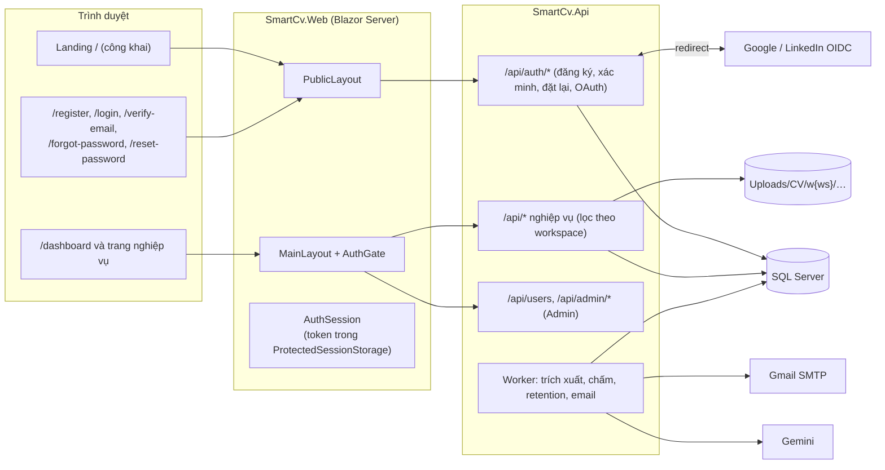
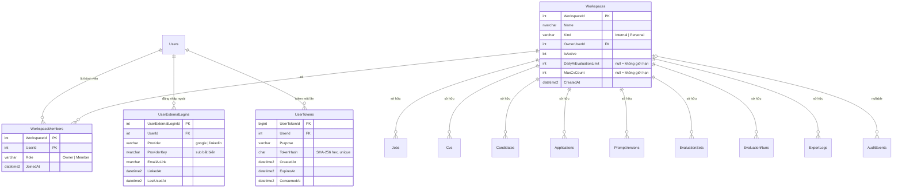
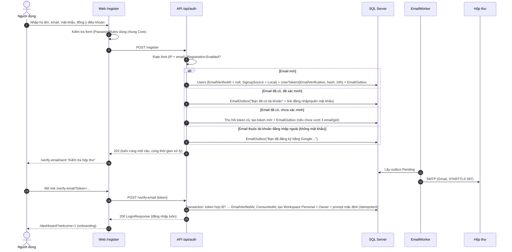
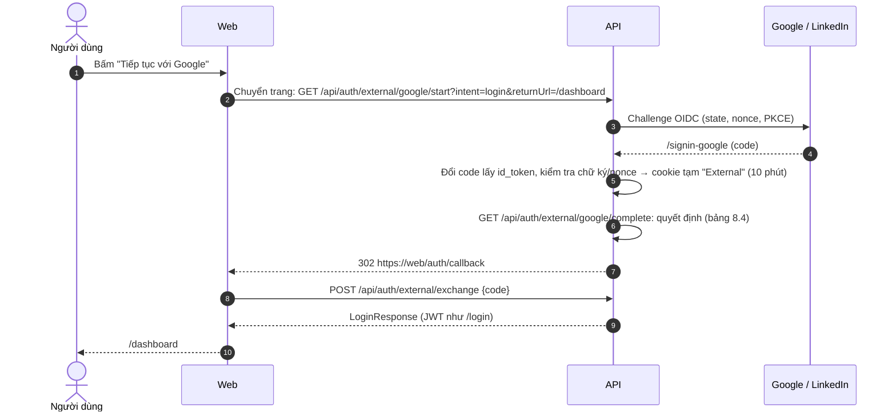
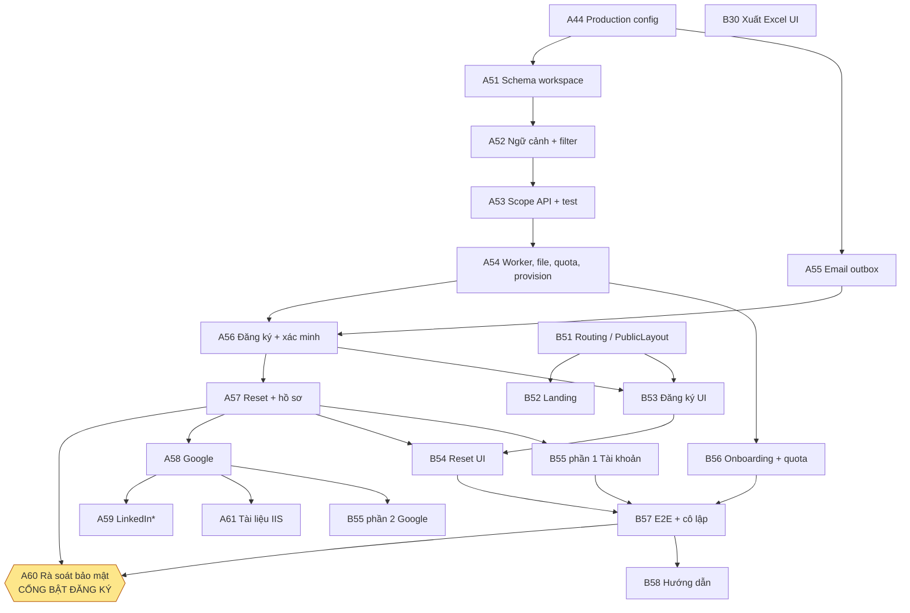

# SCApp — Hướng dẫn triển khai FINAL tuần 7–8

> **Mục đích:** biến SCApp (Screening Candidates Application) từ phần mềm tuyển dụng nội bộ thành **nền tảng sàng lọc CV bằng AI cho người dùng bên ngoài**: tự đăng ký, có không gian dữ liệu riêng (workspace), dữ liệu thật vẫn được bảo vệ.
>
> **Cách dùng tài liệu:** mỗi nhiệm vụ ở [Chương 11](#11-hướng-dẫn-thực-hiện-từng-nhiệm-vụ) là **một lần giao việc** cho Codex hoặc Claude Code. Một nhiệm vụ tương ứng một nhánh và một PR. Khi giao, dán nguyên mục của nhiệm vụ đó kèm [Chương 6](#6-phân-quyền-và-workspace-isolation) (quy tắc workspace) và [Phụ lục A](#phụ-lục-a--quy-tắc-chung-cho-mọi-nhiệm-vụ-dán-kèm-khi-giao-việc).
>
> **Ký hiệu trong tài liệu:**
> - **[XM]** — đã xác minh trực tiếp trong source.
> - **[ĐX]** — đề xuất; người thực hiện phải kiểm tra lại source trước khi làm.
> - **P0…P6** — độ ưu tiên theo định hướng đã chốt.

| Mục | Giá trị |
|---|---|
| Repository | `C:\TTCN\project\AI-CV-Screening` · origin `https://github.com/TuyetAnh0101/AI-CV-Screening` |
| Thời điểm rà soát | 20/11/2026 |
| Nhánh đang mở khi rà soát | `feature/a44-business-implementation`, HEAD `5fe517a`, trùng `origin/main` (theo ref cục bộ, **không** chạy `git fetch`) |
| Working tree khi rà soát | **Có thay đổi chưa commit của A44** (17 file sửa, 9 file/thư mục mới). Tài liệu này không đụng tới các thay đổi đó |
| Stack | .NET 10 (SDK 10.0.403) · ASP.NET Core Minimal API · Blazor Web App (Interactive Server, `prerender: false`) · EF Core 10 + SQL Server · Gemini + chấm keyword · ClosedXML · Serilog · Tesseract |
| Kiểm thử hiện có | 1 project `tests/SmartCv.Tests`, khoảng **1.731** `[Fact]/[Theory]` (đếm thô); có Playwright E2E và test SQL Server dùng database tạm `SmartCv_*_Test_<guid>`; `ApplicationDatabaseGuard` chặn mọi kết nối tới `SmartCvDb` |

---

## Mục lục

1. [Định hướng cuối cùng của SCApp](#1-định-hướng-cuối-cùng-của-scapp)
2. [Đánh giá source và tiến độ sau tuần 6](#2-đánh-giá-source-và-tiến-độ-sau-tuần-6)
3. [Các chức năng đã hoàn thiện](#3-các-chức-năng-đã-hoàn-thiện)
4. [Danh sách nhiệm vụ cũ: giữ / cải tiến / gộp / bỏ / hoãn](#4-danh-sách-nhiệm-vụ-cũ-giữ--cải-tiến--gộp--bỏ--hoãn)
5. [Kiến trúc hệ thống cho người dùng đăng ký công khai](#5-kiến-trúc-hệ-thống-cho-người-dùng-đăng-ký-công-khai)
6. [Phân quyền và workspace isolation](#6-phân-quyền-và-workspace-isolation)
7. [Landing Page và trải nghiệm người dùng](#7-landing-page-và-trải-nghiệm-người-dùng)
8. [Registration, Email Verification, Google/LinkedIn](#8-registration-email-verification-googlelinkedin)
9. [Kế hoạch chi tiết tuần 7](#9-kế-hoạch-chi-tiết-tuần-7)
10. [Kế hoạch chi tiết tuần 8](#10-kế-hoạch-chi-tiết-tuần-8)
11. [Hướng dẫn thực hiện từng nhiệm vụ](#11-hướng-dẫn-thực-hiện-từng-nhiệm-vụ)
12. [Thứ tự tạo nhánh Git, phụ thuộc và merge](#12-thứ-tự-tạo-nhánh-git-phụ-thuộc-và-merge)
13. [Ma trận kiểm thử nghiệp vụ và bảo mật](#13-ma-trận-kiểm-thử-nghiệp-vụ-và-bảo-mật)
14. [Checklist chuẩn bị IIS](#14-checklist-chuẩn-bị-iis)
15. [Tiêu chí nghiệm thu cuối cùng](#15-tiêu-chí-nghiệm-thu-cuối-cùng)
16. [Rủi ro, giới hạn và nhiệm vụ hoãn](#16-rủi-ro-giới-hạn-và-nhiệm-vụ-hoãn)
- [Phụ lục A — Quy tắc chung cho mọi nhiệm vụ](#phụ-lục-a--quy-tắc-chung-cho-mọi-nhiệm-vụ-dán-kèm-khi-giao-việc)
- [Phụ lục B — Bảng mã lỗi API mới](#phụ-lục-b--bảng-mã-lỗi-api-mới)

---

## 1. Định hướng cuối cùng của SCApp

### 1.1 Sản phẩm sau tuần 8

SCApp là ứng dụng web giúp **người làm tuyển dụng**: tạo vị trí tuyển dụng, tải CV, để AI và bộ chấm từ khóa xếp hạng ứng viên, rồi tự ra quyết định. Ai cũng có thể vào trang giới thiệu, **tự đăng ký** (email/mật khẩu, Google, hoặc LinkedIn nếu đủ điều kiện), xác minh email và nhận ngay **một workspace cá nhân trống** để dùng thử toàn bộ luồng chính.

| Nguyên tắc | Cách SCApp thực hiện |
|---|---|
| Tự đăng ký, không cần Admin | `POST /api/auth/register` + xác minh email, tự tạo workspace (A56) |
| Nhiều cách đăng nhập | Email/mật khẩu (đã có), Google (A58), LinkedIn (A59, có điều kiện) |
| Bảo vệ tài khoản | Xác minh email, giới hạn tần suất, quên/đặt lại mật khẩu, thu hồi phiên bằng `SecurityStamp` (đã có từ A30) |
| Dữ liệu riêng | Mọi dữ liệu nghiệp vụ gắn `WorkspaceId`. Đọc dữ liệu workspace khác → 404 (A51–A54) |
| Admin chỉ quản trị nền tảng | Admin quản lý tài khoản, Audit Log, retention, chẩn đoán. Admin **không** xem dữ liệu workspace người khác qua API nghiệp vụ |
| Tái sử dụng | Giữ nguyên Job, CV, Ranking, Prompt, bộ đánh giá, Dashboard, Export. Chỉ thêm phạm vi workspace |
| Không phức tạp hóa | Mỗi người **một** workspace. Chưa mời thành viên, chưa thanh toán, chưa đa tổ chức |
| Dữ liệu thật an toàn | Toàn bộ dữ liệu hiện có chuyển vào workspace **"SCApp nội bộ"**. Tài khoản công khai không bao giờ là thành viên workspace này |
| Mở đăng ký có điều kiện | Cờ `Registration:Enabled` mặc định **tắt**. Chỉ bật trên database **không chứa dữ liệu thật** sau khi A60 đạt |

### 1.2 Quyết định quan trọng nhất

**Đăng ký công khai chỉ được bật khi đủ cả ba điều kiện sau:**

1. Toàn bộ bộ test cô lập workspace (A53, A54, B57) đạt trên CI/máy dev.
2. Rà soát bảo mật A60 ký "Đạt" từng mục.
3. Môi trường bật đăng ký dùng **database riêng** (ví dụ `SmartCvDemo`) không chứa CV thật.

Database `SmartCvDb` (dữ liệu nội bộ) giữ `Registration:Enabled = false` cho tới khi nhóm và công ty duyệt riêng.

### 1.3 Ngoài phạm vi tuần 7–8

Thanh toán, gói cước, mời thành viên, đa tổ chức, chuyển workspace, đổi email đăng nhập, xác thực 2 lớp (2FA), captcha, ứng dụng di động, CV gần giống (A32) và triển khai IIS thật. Chi tiết ở [Chương 16](#16-rủi-ro-giới-hạn-và-nhiệm-vụ-hoãn).

---

## 2. Đánh giá source và tiến độ sau tuần 6

### 2.1 Trạng thái Git (đã kiểm tra)

| Nội dung | Kết quả |
|---|---|
| Commit mới nhất trên `main` cục bộ | `0199b2e` (B29). `main` cục bộ **chậm hơn** `origin/main` 3 commit |
| `origin/main` (ref cục bộ) | `5fe517a feat(A31): implement secure Excel ranking export API (#92)` |
| 3 PR mới nhất đã merge | #90 B43 (truy cập file an toàn + Audit Log), #91 sửa quyền Admin/HR, #92 A31 (xuất Excel) |
| Nhánh hiện tại | `feature/a44-business-implementation` = `origin/main` + **thay đổi chưa commit** (Production config, `/api/health`, Serilog, `LogMasking`, `ICvStorageProbe`, `ApplicationReadiness`, `WebProductionSetup`, 2 file `appsettings.Production.json`) |
| Nhánh remote khác | `feature/database`, `feature/ui-shell-refinement`, `fix/scapp-runtime-api-errors` — không thuộc kế hoạch tuần 7–8 |

> **Việc đầu tiên trước mọi nhiệm vụ mới:** người dùng tự commit/PR phần A44 đang dở (nhiệm vụ [A44](#a44--hoàn-tất-cấu-hình-production-đang-dở)), hoặc `git stash` có kiểm soát. **Không** tạo nhánh mới từ working tree bẩn.

### 2.2 Đối chiếu bảng phân công cũ

Nguồn: *Phân công các giai đoạn tiếp theo* (bản mới nhất đã gửi). Theo bảng, tuần 6 gồm A31, A44, A45, B30, B44, B45; tuần 7 gồm A34, A46, A47, A32*, B31, B32, C9; tuần 8 gồm A48, B46, C5.

| Mã | Trạng thái thật (từ Git và `docs/`) |
|---|---|
| A27–A30, B27–B29 | **Đã merge** (#83–#89). Có `docs/A27…A30-implementation-report.md`, `docs/B27…B29-implementation-report.md` |
| B43 | **Đã merge** (#90). Trong repo thật, B43 = *truy cập file an toàn + Audit Log* (`AuditEvents`, `/api/admin/audit-events`, trang `/admin/activity-logs`), **khác** nội dung B43 trong hướng dẫn tuần 5 |
| Sửa quyền HR/Admin | **Đã merge** (#91). Có `docs/hr-admin-permissions-fix-report.md`: HR làm được mọi nghiệp vụ; Admin giữ tài khoản, Audit, retention, chẩn đoán |
| A31 | **Đã merge** (#92). Có `docs/a31-export-api.md`, bảng `ExportLogs` (migration `20261120114152_AddRankingExportLogs`), các API `/api/exports/settings`, `/api/runs/{id}/ranking/export/preview`, `/api/runs/{id}/ranking/export`, `/api/exports` |
| A44 | **Đang làm, chưa commit** trên `feature/a44-business-implementation` |
| B30 (giao diện xuất) | **Chưa có.** Web chưa gọi `ranking/export`. Lưu ý: `docs/a31-export-api.md` gọi phần giao diện này là "B45" — **lệch mã** với bảng phân công (B45 = rà giao diện). Tài liệu này dùng **B30** |
| A45, B44, B45 | **Chưa có** trong repo (chỉ có hướng dẫn) |
| A26, B22, B37, B40, B42 | Không tìm thấy commit hay báo cáo nào. Bảng cũ ghi A26, B37 là tùy chọn. **Không** đưa vào kế hoạch mới |
| Tuần 7–8 cũ (A32, A34, A46, A47, A48, B31, B32, B46, C9, C5) | Chưa bắt đầu |

### 2.3 Đánh giá kiến trúc hiện tại liên quan tới định hướng mới

| Khía cạnh | Hiện trạng [XM] | Hệ quả khi mở đăng ký công khai |
|---|---|---|
| Phân tách dữ liệu | **Không có** cột chủ sở hữu/workspace trên bất kỳ bảng nghiệp vụ nào (`Jobs`, `Cvs`, `Candidates`, `Applications`, `PromptVersions`, `EvaluationRuns`, `EvaluationSets`…) | Người đăng ký mới thấy **toàn bộ** CV thật. **Chặn tuyệt đối** việc mở đăng ký trước P0 |
| Ràng buộc duy nhất toàn cục | `UQ_Jobs_Title` (Title), filtered unique `PromptVersions.IsActive = 1` (chỉ 1 prompt kích hoạt cho cả hệ thống), kiểm tra trùng CV theo `FileHash` toàn cục (`CvUploadService`), gợi ý trùng ứng viên theo email/SĐT toàn cục (`CandidateQueries`) | Lộ dữ liệu gián tiếp: thông báo "CV đã có, đã nộp vào job X", "tên job đã tồn tại", "ứng viên trùng: Nguyễn Văn A". Phải chuyển sang phạm vi workspace |
| Vai trò | `UserRoles` = `Admin`, `HR`. Chính sách nghiệp vụ (`AuthSetup`) = đã đăng nhập + Admin/HR + không `MustChangePassword`. `FallbackPolicy` fail-closed | Giữ được. Thêm điều kiện "có workspace hợp lệ" |
| Phiên | JWT + `SecurityStamp`. `UserSessionValidator` kiểm tra DB **mỗi request** (`requireFresh: true`) | Chỗ tốt nhất để kiểm tra thành viên workspace còn hiệu lực, không cần cache phức tạp |
| Tài khoản | `Users`: Email (unique toàn cục), PasswordHash, Role, IsActive, MustChangePassword, SecurityStamp. Admin tạo tài khoản qua `/api/users` (A30) | Thiếu: xác minh email, nguồn đăng ký, đăng nhập ngoài, token một lần |
| Prompt | Lượt chấm lưu snapshot `PromptVersionId`. Start run chọn prompt `IsActive` toàn cục (`RunEndpoints.cs:48`, `PromptToolSupport.cs:96`) | Prompt kích hoạt phải theo workspace. Workspace mới cần một prompt mặc định (hiện **không có** prompt mặc định trong code; prompt chỉ đến từ `seed_demo.sql`/người dùng tạo) |
| Worker | `CvExtractionWorker`, `RunScoringWorker`, `RetentionWorker` (`src/SmartCv.Api/Background`) xử lý toàn cục | Phải chạy theo phạm vi workspace của từng bản ghi |
| File | `LocalCvFileStorage`: `{root}/Uploads/CV/yyyy/MM/{GUID}{ext}`. File chỉ đọc qua API sau khi tra `Cvs` (B43) | An toàn nếu tra `Cvs` bị lọc theo workspace. Nên thêm thư mục theo workspace cho file mới |
| Audit | `AuditEvents` (B43) không có workspace | Thêm `WorkspaceId` (nullable) để lọc và điều tra |
| Web | `/` = Dashboard (`Home.razor`). Mọi trang trong `Pages/` mặc định `[Authorize]` (`Pages/_Imports.razor`). `AuthGate` chỉ vẽ khung khi dùng được app. Token lưu `ProtectedSessionStorage` (mỗi tab) | Cần Landing ở `/` với layout công khai riêng, Dashboard chuyển `/dashboard` |
| Database | EF Core Migrations ở `src/SmartCv.Infrastructure/Data/Migrations` (11 migration, mới nhất `20261120114152_AddRankingExportLogs`). Thư mục `database/` lưu script SQL xuất từ migration để áp có kiểm soát | Mọi thay đổi schema mới đi theo cùng quy trình: migration + script SQL idempotent + test trên database tạm |
| Email | **Chưa có** gói gửi mail | Thêm MailKit (A55) |
| OAuth | **Chưa có** | Thêm OpenID Connect (A58/A59) |

**Kết luận:** nền tảng nghiệp vụ và bảo mật đăng nhập đã tốt (fail-closed, kiểm tra phiên tươi, Audit Log, chống lộ dữ liệu trong log/export). Thiếu duy nhất nhưng **nghiêm trọng**: chưa có khái niệm "dữ liệu này của ai". Vì vậy tuần 7 phải dành cho P0.

---

## 3. Các chức năng đã hoàn thiện

Danh sách dưới đây là phần **tái sử dụng nguyên vẹn**. Nhiệm vụ mới chỉ thêm phạm vi workspace, không viết lại.

| Nhóm | Chức năng | Bằng chứng [XM] |
|---|---|---|
| Vị trí tuyển dụng | CRUD, kỹ năng, từ khóa/alias, headcount, hạn nộp, mở/ngừng tuyển | `JobEndpoints.cs`, `JobSkillEndpoints.cs`, `Pages/Jobs.razor`, `JobEdit.razor` |
| CV | Upload nhiều file, kiểm tra định dạng/giả mạo, chống trùng hash, OCR (PdfText/PdfOcr/ImageOcr), nguồn + đồng ý, hạn lưu, ẩn danh hóa | `CvEndpoints.cs`, `CvUploadService.cs`, `CvExtractionWorker.cs`, `RetentionWorker.cs`, `CvAnonymizer.cs` |
| Ứng viên | Hồ sơ ứng viên, gắn CV, gợi ý trùng, gộp, xuất/xóa dữ liệu theo yêu cầu (A43) | `CandidateEndpoints.cs`, `CandidateDataRightsEndpoints.cs`, `Pages/Candidates.razor`, `CandidateDetail.razor` |
| Hồ sơ ứng tuyển | Gắn CV vào job, giai đoạn (New…Rejected/OnHold) có lịch sử, lý do loại, cờ cần xem kỹ, cờ HR | `ApplicationEndpoints.cs`, `ApplicationStageEndpoints.cs`, `ManualFlagEndpoints.cs` |
| Chấm điểm | Keyword + Gemini (30/70), lượt chấm, tiến độ, thử lại, snapshot cấu hình, lịch sử lượt chấm | `RunEndpoints.cs`, `RunScoringWorker.cs`, `Pages/Runs.razor`, `RunDetail.razor` |
| Kết quả | Ranking, chi tiết đánh giá, so sánh ứng viên, ẩn danh trên giao diện | `Pages/Results.razor`, `Components/Results/*`, `EvaluationDetail.razor`, `RunCompareEndpoints.cs` |
| System Prompt | Phiên bản bất biến, kích hoạt, xem payload đã che, playground 1 CV | `PromptEndpoints.cs`, `PromptToolSupport.cs`, `AiPreviewEndpoints.cs`, `Pages/Prompts.razor` |
| Đánh giá prompt | Bộ dữ liệu đánh giá, nhãn HR, gợi ý nhãn, Prompt Test, độ chính xác, so sánh | `EvaluationSet*Endpoints.cs`, `PromptTestEndpoints.cs`, `Pages/EvaluationSets.razor` |
| Dashboard | Tổng quan, xu hướng | `DashboardEndpoints.cs` (`/api/dashboard/summary`, `/api/dashboard/trend`), `Pages/Home.razor` |
| Xuất | Excel ranking + nhật ký xuất (PDF tắt) | `ExportEndpoints.cs`, `docs/a31-export-api.md` |
| Xác thực | Đăng nhập JWT, giới hạn tần suất, khóa tài khoản, đổi mật khẩu bắt buộc, Admin tạo/sửa/khóa/reset tài khoản, thu hồi phiên | `AuthEndpoints.cs`, `AuthPasswordEndpoints.cs`, `UserEndpoints.cs`, `UserAccountService.cs`, `Pages/Login.razor`, `Users.razor`, `Account/ChangePassword.razor` |
| Audit | Nhật ký thao tác toàn hệ thống (Admin) | `Auditing/*`, `AuditEndpoints.cs`, `Pages/ActivityLogs.razor` |
| Bảo vệ dữ liệu | Che thông tin cá nhân trước khi gửi Gemini, không lưu nội dung CV trong log/audit | `Core/Privacy/*`, `Infrastructure/Privacy/*` |
| Giao diện | Deep Teal + AI Glow, menu theo vai trò, trang 403/404, xác nhận hành động | `Components/Layout/*`, `Helpers/AppNavigation.cs`, `Helpers/AccessRules.cs` |

---

## 4. Danh sách nhiệm vụ cũ: giữ / cải tiến / gộp / bỏ / hoãn

| Mã cũ | Nội dung cũ | Quyết định | Lý do / nhiệm vụ mới thay thế |
|---|---|---|---|
| A27–A30, B27–B29 | Users, JWT, phân quyền, quản lý tài khoản | **BỎ** (đã xong) | A56–A58 mở rộng trên nền này, không làm lại |
| B43 | File an toàn + Audit Log | **BỎ** (đã xong) | A53 thêm `WorkspaceId` cho Audit |
| Sửa quyền HR/Admin (#91) | Ma trận quyền mới | **BỎ** (đã xong) | Chương 6 giữ nguyên tinh thần: HR làm nghiệp vụ, Admin quản trị |
| A31 | API xuất Excel | **BỎ** (đã xong) | A53 chỉ thêm phạm vi workspace cho export |
| A44 | Cấu hình Production | **GIỮ – hoàn tất** | Đang dở trong working tree → nhiệm vụ **A44**, làm đầu tiên |
| B30 | Nút xuất Excel/PDF | **GIỮ** | API A31 đã sẵn, giao diện chưa có → **B30** (chỉ Excel; PDF đang tắt) |
| A45 | Dựng máy thử IIS | **HOÃN + GỘP** | Chưa có máy chủ/domain. Gộp vào **A61** (cập nhật tài liệu, checklist ở Chương 14) |
| A46 | Sao lưu/khôi phục | **GỘP** | Vào A61 + Chương 14 |
| B44 | Hiệu năng trên máy thử | **HOÃN** | Phụ thuộc máy thử. Đo quota AI cơ bản trong B57 |
| B45 | Rà giao diện | **GỘP** | Vào **B57** (rà cả trang mới: Landing, đăng ký, tài khoản) |
| C9 | UAT với HR, CV thật | **CẢI TIẾN** | UAT trên môi trường demo bằng CV tổng hợp (`test-files/`) với người dùng bên ngoài. UAT CV thật chỉ trong workspace nội bộ, khi công ty cho phép |
| B31 | Kiểm thử toàn luồng | **GỘP** | Vào **B57**, thêm kịch bản đăng ký + cô lập workspace |
| B32 | Ghi lỗi GitHub Issues | **GỘP** | Vào B57 (mỗi lỗi một issue, cùng mẫu) |
| A34 | Sửa lỗi theo issue | **GIỮ (đệm)** | Không là nhiệm vụ riêng. Dùng thời gian dư cuối tuần 8, nhánh `fix/<issue>-<ten>` |
| A47 | Rà soát bảo mật | **CẢI TIẾN** | Thành **A60**: trọng tâm cô lập workspace + đăng ký công khai, là cổng bắt buộc trước khi bật đăng ký |
| A32 (A33, B33) | CV gần giống, phân cụm | **HOÃN** | Không liên quan định hướng mới |
| A48 | Triển khai chính thức, v1.0.0 | **HOÃN** | Phụ thuộc máy chủ, domain, quyết định công ty |
| B46 | Hướng dẫn HR | **CẢI TIẾN** | Thành **B58**: hướng dẫn người dùng mới (đăng ký → kết quả) + phần nội bộ |
| C5 | Báo cáo, demo | **GIỮ** (cả nhóm) | Không mô tả kỹ thuật trong tài liệu này. Kịch bản demo dùng [Chương 15](#15-tiêu-chí-nghiệm-thu-cuối-cùng) |
| A26*, B37*, B22, B40, B42 | Không có dấu vết trong repo | **BỎ khỏi kế hoạch** | Không bịa nội dung. Nếu nhóm muốn làm, lập lại từ bảng gốc |

---

## 5. Kiến trúc hệ thống cho người dùng đăng ký công khai

### 5.1 Tổng quan thành phần



### 5.2 Mô hình dữ liệu mới (tóm tắt)



> `EmailOutbox` (A55) không gắn workspace, chỉ gắn `UserId`, nên không có trong sơ đồ.

### 5.3 Quyết định kiến trúc

| # | Quyết định | Phương án bị loại và lý do |
|---|---|---|
| K1 | **Một database, phân tách theo `WorkspaceId`** + EF Core global query filter + kiểm tra khi ghi | Mỗi người một database: quá nặng cho đồ án. Chỉ lọc thủ công trong từng endpoint: dễ quên, không phòng thủ nhiều lớp |
| K2 | **Workspace nội bộ** `WorkspaceId = 1`, `Kind = Internal` chứa toàn bộ dữ liệu cũ. Tài khoản hiện có (kể cả Admin ID 1) là thành viên | Reset database: vi phạm yêu cầu. Gán dữ liệu cũ cho Admin cá nhân: HR mất quyền truy cập |
| K3 | **Mỗi tài khoản đúng một workspace** trong MVP (đăng ký công khai → workspace cá nhân `Personal`, Owner) | Chuyển đổi workspace/mời thành viên: tăng gấp đôi phạm vi UI và test → hoãn. Bảng `WorkspaceMembers` vẫn tạo để mở rộng sau |
| K4 | Workspace hiện hành nằm trong **claim JWT `smartcv_ws`**, được `UserSessionValidator` xác nhận lại từ DB mỗi request | Gửi workspace qua header/query: client sửa được. Chỉ đọc DB mà không có claim: không biết workspace nào khi sau này có nhiều workspace |
| K5 | **Dữ liệu workspace khác trả 404**, giống "không tồn tại" | 403 tiết lộ ID có tồn tại (dò được) |
| K6 | **OAuth xử lý ở API**, trả về Web bằng **mã một lần** (60 giây, lưu hash, dùng một lần) trong fragment URL `#code=…`; Web đổi mã lấy JWT qua `POST /api/auth/external/exchange` | Web tự làm OAuth: phải nhân đôi logic tạo tài khoản/cấp JWT. Đưa JWT thẳng vào URL: lộ qua log, lịch sử, Referer |
| K7 | Google và LinkedIn cùng dùng **OpenID Connect handler** (`Microsoft.AspNetCore.Authentication.OpenIdConnect`) để đọc claim `email_verified` từ id_token một cách thống nhất | Google handler riêng: không map `email_verified` mặc định; LinkedIn không có handler chính thức |
| K8 | **Email gửi qua outbox + worker** (bảng `EmailOutbox`, nội dung mã hóa bằng ASP.NET Core Data Protection, xóa nội dung sau khi gửi) | Gửi đồng bộ trong request: SMTP chậm/lỗi làm hỏng đăng ký, lộ thời gian phản hồi khác nhau giữa email mới và email đã có |
| K9 | Token xác minh/đặt lại: 32 byte ngẫu nhiên, chỉ lưu **SHA-256**, một lần, có hạn | Lưu token gốc: lộ database = chiếm tài khoản. JWT làm token: không thu hồi được |
| K10 | **Không tự gộp tài khoản theo email.** Email trùng → yêu cầu đăng nhập bằng phương thức cũ rồi liên kết trong trang Tài khoản | Tự gộp: kẻ tạo tài khoản Google bằng email người khác (hoặc email chưa xác minh) chiếm được tài khoản |
| K11 | Vai trò hệ thống giữ giá trị `HR` cho mọi người dùng không phải Admin (không đổi dữ liệu). Hiển thị "Người dùng" cho tài khoản `Personal` | Đổi giá trị Role: phải sửa CHECK, token, test A29 → rủi ro không cần thiết |
| K12 | Quota AI theo workspace: đếm số đánh giá AI trong ngày (UTC+7) từ dữ liệu đã có, giới hạn lưu trên `Workspaces` | Bảng đếm riêng: thêm điểm đồng bộ. Không giới hạn: một người dùng có thể dùng hết hạn mức Gemini |
| K13 | Landing Page vẫn là trang Blazor Interactive Server (cùng `Routes`) với `PublicLayout` riêng | Static SSR cho Landing: tốt cho SEO nhưng phải sửa `App.razor` chọn render mode theo trang. Hoãn |

### 5.4 Cấu hình mới (tên khóa đề xuất [ĐX])

| Khóa | Dev (User Secrets / appsettings.Development) | Production (biến môi trường) | Bí mật? |
|---|---|---|---|
| `App:WebBaseUrl` | `https://localhost:<cổng Web>/` | `https://scapp.<domain>/` | Không |
| `App:ApiBaseUrl` (API tự biết, dùng trong redirect URI) | `https://localhost:<cổng API>/` | `https://api.scapp.<domain>/` | Không |
| `Registration:Enabled` | `true` trên DB dev tạm | `false` cho `SmartCvDb`; `true` chỉ trên DB demo sau A60 | Không |
| `Registration:RequireTermsAcceptance` | `true` | `true` | Không |
| `Email:Mode` | `File` (ghi `.eml` vào thư mục, **không gửi thật**) hoặc `Smtp` khi thử thật | `Smtp` | Không |
| `Email:Smtp:Host` / `Port` / `UseStartTls` | `smtp.gmail.com` / `587` / `true` | như dev | Không |
| `Email:Smtp:UserName` | User Secrets | `Email__Smtp__UserName` | Có (định danh) |
| `Email:Smtp:Password` | **User Secrets** (Gmail App Password) | `Email__Smtp__Password` | **Có** |
| `Email:FromAddress`, `Email:FromName` | `…@gmail.com`, `SCApp` | như dev | Không |
| `Email:PickupDirectory` | `./.mail-dev` (thêm vào `.gitignore`) | — | Không |
| `Authentication:Google:Enabled` / `ClientId` / `ClientSecret` | User Secrets | `Authentication__Google__ClientSecret` | ClientSecret **có** |
| `Authentication:LinkedIn:Enabled` / `ClientId` / `ClientSecret` | User Secrets | biến môi trường | ClientSecret **có** |
| `Workspaces:PersonalDailyAiEvaluations` | `30` | `30` (điều chỉnh theo hạn mức Gemini) | Không |
| `Workspaces:PersonalMaxCvs` | `100` | `100` | Không |
| `DataProtection:KeysPath` (API, cho outbox + cookie OAuth) | để trống (mặc định) | `C:\SmartCv\keys\api` | Thư mục cần bảo vệ |

> **Không bao giờ** ghi App Password, ClientSecret, JWT key vào `appsettings*.json`, tài liệu, PR, issue hay log. A44 đã có startup guard cho Production; A55/A58 bổ sung các khóa mới vào danh sách kiểm tra.

---

## 6. Phân quyền và workspace isolation

### 6.1 Vai trò

| Vai trò | Là gì | Làm được | Không làm được |
|---|---|---|---|
| **Guest** | Chưa đăng nhập | Landing, đăng ký, đăng nhập, xác minh email, quên/đặt lại mật khẩu, `/api/health` (đơn giản), `/api/auth/registration-settings` | Mọi API/trang nghiệp vụ (401, chuyển `/login`) |
| **Người dùng (Workspace Owner)** | `Role = HR`, Owner của workspace cá nhân | Toàn bộ nghiệp vụ tuyển dụng **trong workspace của mình**: Job, CV, Ứng viên, chấm, Kết quả, Export, Prompt, bộ đánh giá, Dashboard; hồ sơ cá nhân, phương thức đăng nhập | Dữ liệu workspace khác; trang Admin; vượt quota |
| **HR nội bộ (Workspace Member)** | `Role = HR`, thành viên workspace `Internal` | Như hiện nay (#91), trong workspace nội bộ | Như trên |
| **System Admin** | `Role = Admin` (Admin ID 1 và Admin hiện có) | Tài khoản (`/api/users`), Audit Log toàn hệ thống, retention, ẩn danh hóa, chẩn đoán; **nghiệp vụ trong workspace nội bộ** (là thành viên) | Đọc/sửa dữ liệu workspace cá nhân qua API nghiệp vụ; đăng nhập bằng Google/LinkedIn (chặn để giảm rủi ro chiếm quyền) |
| **Workspace Member (mời)** | — | **Hoãn** (chưa có tính năng mời) | — |

### 6.2 Quy tắc hai câu hỏi (áp dụng cho mọi endpoint)

```text
1. Thao tác có được phép?   → policy (SignedIn / Business / Admin) như hiện tại + yêu cầu có workspace.
2. Dữ liệu có thuộc phạm vi? → bản ghi gốc phải có WorkspaceId = workspace hiện hành (query filter + kiểm tra khi ghi).
```

| Loại endpoint | Câu 1 | Câu 2 |
|---|---|---|
| Nghiệp vụ (`/api/jobs`, `/api/cvs`, `/api/candidates`, `/api/applications`, `/api/runs`, `/api/evaluations`, `/api/prompts`, `/api/prompt-tests`, `/api/evaluation-sets`, `/api/exports/settings`, `/api/dashboard/*`, scoring/AI preview, manual flags) | Business policy + `WorkspaceMember` | Bắt buộc |
| Hệ thống (`/api/users`, `/api/admin/audit-events`, `/api/retention/*`, `/api/health/database`, `/api/health/gemini`, `/api/exports` nhật ký) | Admin | Không lọc workspace, nhưng **phải hiển thị cột workspace** và không trả nội dung CV |
| Tài khoản cá nhân (`/api/auth/me*`, `change-password`, phương thức đăng nhập) | SignedIn | Chỉ chính mình (`sub`) |
| Công khai (`/api/auth/register`, `verify-email`, `resend-verification`, `forgot-password`, `reset-password`, `external/*`, `registration-settings`, `/api/health`) | AllowAnonymous + rate limit | Không có dữ liệu workspace |

### 6.3 Các lớp bảo vệ (defense in depth)

| Lớp | Cơ chế | Nhiệm vụ |
|---|---|---|
| 1. Token | Claim `smartcv_ws` ký trong JWT | A52 |
| 2. Phiên | `UserSessionValidator` xác nhận membership + workspace `IsActive` từ DB mỗi request; sai → 401 | A52 |
| 3. Query | `HasQueryFilter` trên mọi entity gốc: `WorkspaceId == CurrentWorkspaceId`. Không có workspace → **không trả dòng nào** (fail-closed) | A52 |
| 4. Ghi | `SaveChanges`: entity mới tự nhận `WorkspaceId` hiện hành; entity có `WorkspaceId` khác → ném lỗi, rollback | A52 |
| 5. Tham chiếu chéo | Khóa ngoại composite: `Applications(WorkspaceId, JobId) → Jobs(WorkspaceId, JobId)`, `Applications(WorkspaceId, CvId) → Cvs(WorkspaceId, CvId)`, `EvaluationRuns(WorkspaceId, PromptVersionId) → PromptVersions(...)`: database từ chối gắn CV workspace A vào job workspace B | A51 |
| 6. Ràng buộc duy nhất | Theo workspace: `(WorkspaceId, Title)` cho Jobs; filtered unique `(WorkspaceId) WHERE IsActive = 1` cho PromptVersions; index `(WorkspaceId, FileHash)` cho Cvs | A51 |
| 7. Worker | Mỗi bản ghi được xử lý trong `WorkspaceScope` của chính nó | A54 |
| 8. File | Chỉ phục vụ file sau khi tra `Cvs` (đã lọc); file mới lưu `Uploads/CV/w{WorkspaceId}/yyyy/MM/` | A54 |
| 9. Bỏ qua filter | `IgnoreQueryFilters()` chỉ được dùng ở danh sách cho phép (retention, Admin audit, migration/seed, worker lấy hàng đợi) và có **test quét source** chặn chỗ dùng mới | A52, A60 |
| 10. Kiểm thử | Ma trận route: mọi route `/api` không thuộc danh sách hệ thống phải có test "người B dùng ID của A → 404/không thấy" | A53 |

### 6.4 Bảng thuộc phạm vi workspace

| Bảng | Cách gắn | Ghi chú |
|---|---|---|
| `Jobs` | Cột `WorkspaceId` | `UQ_Jobs_Title` → `UQ_Jobs_Workspace_Title`. `JobSeedData` (5 job mẫu trong migration `SeedJobs`) gán `WorkspaceId = 1` |
| `JobSkills`, `JobSkillAliases` | Qua `Job` | Filter qua navigation |
| `Cvs` | Cột `WorkspaceId` | Index `(WorkspaceId, FileHash)`; kiểm tra trùng chỉ trong workspace |
| `Candidates` | Cột `WorkspaceId` | Gợi ý trùng email/SĐT chỉ trong workspace |
| `CandidateDataRequests` | Qua `Candidate` | |
| `Applications` | Cột `WorkspaceId` (dư thừa có chủ đích) + FK composite | Ngăn ghép chéo ở mức database |
| `ApplicationEvents`, `ApplicationFlags`, `ApplicationFlagEvents`, `HrLabels`, `EvaluationSetMembers` | Qua `Application` / `EvaluationSet` | |
| `PromptVersions` | Cột `WorkspaceId` | Một prompt kích hoạt **mỗi workspace** |
| `EvaluationSets` | Cột `WorkspaceId` | |
| `EvaluationRuns` | Cột `WorkspaceId` + FK composite tới PromptVersions | |
| `Evaluations`, `EvaluationSkills` | Qua `EvaluationRun` | |
| `ExportLogs` | Cột `WorkspaceId` | |
| `AuditEvents` | Cột `WorkspaceId` **nullable** | Sự kiện hệ thống (đăng nhập, Admin) có thể null |
| `Users`, `UserTokens`, `UserExternalLogins`, `EmailOutbox` | Không | Định danh toàn cục |

### 6.5 Chuyển đổi dữ liệu hiện hữu (không reset)

1. Tạo `Workspaces`, chèn `WorkspaceId = 1`, `Name = N'SCApp nội bộ'`, `Kind = 'Internal'`, `OwnerUserId` = Admin có `UserId` nhỏ nhất đang tồn tại. **Không sửa** dòng Admin ID 1.
2. Thêm `WorkspaceId` **nullable** vào các bảng ở 6.4 → `UPDATE … SET WorkspaceId = 1` → `ALTER … NOT NULL` → tạo FK, index, unique mới → xóa unique cũ.
3. Chèn `WorkspaceMembers` cho **mọi** `Users` hiện có vào workspace 1 (Admin có ID nhỏ nhất = Owner, còn lại = Member).
4. `Users.EmailVerifiedAt = CreatedAt` cho mọi tài khoản cũ (do Admin tạo, coi như đã xác minh). `SignupSource = 'Admin'`.
5. Toàn bộ trong **một migration EF** + script SQL xuất bằng `--idempotent`, chạy thử trên database tạm `SmartCv_A51_Test_<guid>` có dữ liệu mẫu (`seed_demo.sql`). Áp lên `SmartCvDb` **chỉ do người dùng làm**, sau backup `COPY_ONLY, CHECKSUM` và `RESTORE VERIFYONLY`, đúng quy trình trong `database/README.md`.

---

## 7. Landing Page và trải nghiệm người dùng

### 7.1 Bản đồ route mới

| Route | Trang | Layout | Quyền | Nhiệm vụ |
|---|---|---|---|---|
| `/` | Landing Page | `PublicLayout` (mới) | Anonymous; đã đăng nhập thấy nút "Vào bảng điều khiển" | B51, B52 |
| `/login` | Đăng nhập (có sẵn) | `AuthLayout` | Anonymous | B53, B55 thêm liên kết/nút |
| `/register` | Đăng ký | `AuthLayout` | Anonymous; ẩn form nếu đăng ký tắt | B53 |
| `/verify-email` | Kết quả xác minh (`?token=`) | `AuthLayout` | Anonymous | B53 |
| `/verify-email/sent` | "Kiểm tra hộp thư" + gửi lại | `AuthLayout` | Anonymous | B53 |
| `/forgot-password` | Quên mật khẩu | `AuthLayout` | Anonymous | B54 |
| `/reset-password` | Đặt lại (`?token=`) | `AuthLayout` | Anonymous | B54 |
| `/auth/callback` | Nhận `#code=` từ OAuth, đổi lấy JWT | `AuthLayout` | Anonymous | B55 |
| `/dashboard` | Dashboard (chuyển từ `/`) | `MainLayout` | Business | B51 |
| `/account` | Hồ sơ, mật khẩu, phương thức đăng nhập, workspace | `MainLayout` | SignedIn | B55 |
| `/change-password` | Có sẵn (A30/B29) | — | SignedIn | Giữ |
| Các trang nghiệp vụ hiện có | Giữ nguyên route | `MainLayout` | Business | — |
| `/terms`, `/privacy` | Điều khoản, chính sách dữ liệu (văn bản ngắn) | `PublicLayout` | Anonymous | B52 |

**Tương thích link cũ:** `/` trước đây là Dashboard và nhận query của `DashboardFilter` (`DashboardFilter.Url => "/" + Query` [XM]). Sau B51:
- Người đã đăng nhập mở `/` **có** query Dashboard → tự chuyển `/dashboard?<cùng query>`.
- Mở `/` không có query → thấy Landing với nút "Vào bảng điều khiển".
- `AuthText.SafeReturnUrl` mặc định trả `/` [XM] → đổi thành `/dashboard`, để đăng nhập xong vào thẳng Dashboard.

### 7.2 Cấu trúc Landing Page

| Khu vực | Nội dung | Ghi chú thiết kế |
|---|---|---|
| Header (dính đầu trang) | Logo SCApp · Tính năng · Cách hoạt động · Câu hỏi · **Đăng nhập** · **Bắt đầu miễn phí** (nút chính) | Mobile: menu gọn trong nút "Menu" có `aria-expanded`. Đã đăng nhập: thay hai nút bằng "Vào bảng điều khiển" |
| Hero | Tiêu đề ≤ 2 dòng (32–40 px desktop, 26–28 px mobile), câu phụ 1–2 dòng, nút "Trải nghiệm ngay" + "Xem cách hoạt động" | Hình minh họa: ảnh chụp **giao diện SCApp thật**, dữ liệu tổng hợp, đã ẩn danh. Không dùng số liệu quảng cáo |
| Tính năng nổi bật (5 thẻ) | Quản lý vị trí · Phân tích CV bằng AI + từ khóa · Xếp hạng có giải thích · System Prompt có phiên bản · Dashboard tuyển dụng | Mỗi thẻ: biểu tượng, tiêu đề, 1–2 câu. Không hứa độ chính xác |
| Cách hoạt động (5 bước) | Đăng ký → Tạo vị trí → Tải CV → AI phân tích → Xem kết quả và quyết định | Dạng bước ngang (desktop), dọc (mobile) |
| Lợi ích | Giảm thời gian đọc CV lặp lại · Tiêu chí nhất quán · Giữ quyền quyết định ở người tuyển dụng ("AI chỉ hỗ trợ, HR quyết định") | |
| Bảo vệ dữ liệu | Dữ liệu tách theo không gian riêng · Thông tin liên hệ được che trước khi gửi AI · Bạn xóa được dữ liệu ứng viên · Không bán dữ liệu | Chỉ ghi điều **đã có trong code** (A37, A43, A53). Liên kết `/privacy` |
| FAQ (6–8 câu, `<details>`) | Có mất phí không (hiện miễn phí dùng thử, có giới hạn lượt AI/ngày) · Dữ liệu ở đâu · AI có tự loại ứng viên không · Định dạng CV hỗ trợ · Giới hạn dùng thử · Xóa tài khoản thế nào (liên hệ Admin — hoãn tự xóa) | |
| CTA cuối trang | "Bắt đầu với một vị trí tuyển dụng" + nút | |
| Footer | © SCApp · Điều khoản · Chính sách dữ liệu · Liên hệ (email dự án) | |

**Quy tắc CTA:** gọi `GET /api/auth/registration-settings`.
- `registrationEnabled = true` → "Bắt đầu miễn phí" dẫn `/register`.
- `false`, API chưa có endpoint (404) hoặc API lỗi → nút thành "Đăng nhập" kèm dòng nhỏ "Đăng ký công khai sẽ mở sớm". **Không bao giờ** dẫn tới trang lỗi.

### 7.3 Ngôn ngữ thiết kế (dùng chung các trang công khai)

| Mục | Quy định |
|---|---|
| Màu | Dùng biến có sẵn của SCApp (Deep Teal `--sc-brand-*`, nền `--sc-surface-*`, chữ `--sc-ink-*`). "AI Glow" chỉ dùng cho **một** điểm nhấn (viền/nền nhẹ của hero hoặc thẻ AI), không phủ toàn trang |
| Chữ | Thân 15–16 px, line-height 1.6. H1 32–40 px, H2 24–28 px, H3 18 px. Không quá 3 cỡ tiêu đề trên một trang |
| Lưới | Nội dung tối đa 1120 px, lề 24 px (desktop) / 16 px (mobile). Khoảng cách section 72–96 px desktop, 48–56 px mobile |
| Breakpoint | ≥ 1200 · 768–1199 · < 768. Kiểm tra 1366×768, 1024×768, 390×844 |
| Trạng thái | Mọi nút gọi API có loading (chữ "Đang …" + disabled). Lỗi dạng `role="alert"`, thành công `role="status"`. Danh sách trống có hướng dẫn bước tiếp theo |
| Truy cập | `lang="vi"`, thứ tự Tab hợp lý, `:focus-visible` rõ, label cho mọi input, tương phản ≥ 4,5:1, không dùng màu là tín hiệu duy nhất |
| Chuyển động | Chỉ transition ≤ 200 ms cho hover/focus. Tôn trọng `prefers-reduced-motion`. Không parallax, không carousel tự chạy |

---

## 8. Registration, Email Verification, Google/LinkedIn

### 8.1 Đăng ký bằng email



### 8.2 Bảng ngoại lệ đăng ký và đăng nhập

| Tình huống | API | Web hiển thị |
|---|---|---|
| Email sai định dạng / mật khẩu yếu / thiếu đồng ý | 400 `validation_failed` + lỗi từng trường | Lỗi dưới từng ô |
| Đăng ký tắt | 404 `registration_disabled` (endpoint vẫn map để Web nhận diện) | Ẩn form, nút "Đăng nhập" |
| Email trùng (mọi kiểu) | 202 cùng câu (không tiết lộ) + email tương ứng | "Nếu email hợp lệ, SCApp đã gửi hướng dẫn tới hộp thư của bạn" |
| Gửi quá nhiều | 429 `too_many_requests` + `Retry-After` | "Bạn đã yêu cầu quá nhiều lần, thử lại sau N phút" |
| SMTP lỗi | Không ảnh hưởng request. Outbox thử lại 3 lần (1, 5, 15 phút) rồi `Failed` | Người dùng bấm "Gửi lại email" |
| Link hết hạn | 400 `token_expired` | "Liên kết đã hết hạn" + ô email "Gửi lại" |
| Link sai / đã dùng | 400 `token_invalid` | "Liên kết không hợp lệ hoặc đã được dùng" + nút Đăng nhập |
| Đã xác minh rồi bấm lại link | 400 `token_invalid` (token đã consumed) | Như trên, có nút Đăng nhập |
| Đăng nhập khi chưa xác minh (mật khẩu đúng) | 403 `email_not_verified` | "Email chưa xác minh" + nút gửi lại |
| Đăng nhập, mật khẩu sai | 401 như hiện tại (không tiết lộ trạng thái xác minh) | Như hiện tại |
| Tài khoản bị khóa (mật khẩu đúng) | 403 `account_locked` (có sẵn [XM]) | Như hiện tại |
| Workspace chưa tạo được khi xác minh | Rollback cả transaction → 503 `workspace_unavailable`, token **chưa** consumed | "Chưa hoàn tất kích hoạt, thử lại" (bấm lại link được) |
| Đăng nhập tài khoản đã xác minh nhưng thiếu workspace (dữ liệu lỗi) | Đăng nhập tự gọi provisioning idempotent. Vẫn lỗi → 503 `workspace_unavailable` | Thông báo, không vào app |
| Hai request đăng ký cùng email cùng lúc | Unique `UQ_Users_Email` [XM] chặn dòng thứ hai → bắt `DbUpdateException` → trả 202 như email trùng | Như email trùng |
| Bấm link xác minh hai lần cùng lúc | `UPDATE UserTokens SET ConsumedAt = … WHERE … AND ConsumedAt IS NULL` (kiểm tra số dòng = 1); unique `(Kind, OwnerUserId) WHERE Kind = 'Personal'` chặn workspace thứ hai | Một tab thành công, tab kia "đã dùng" |

### 8.3 Google / LinkedIn



### 8.4 Quyết định khi quay về từ nhà cung cấp

Định danh = `(Provider, ProviderKey = claim sub)`. **Không** dùng email làm định danh.

| # | Điều kiện | Kết quả |
|---|---|---|
| 1 | Đã có `UserExternalLogins(provider, sub)` → user `IsActive`, không phải Admin | Đăng nhập (mã một lần) |
| 2 | Như 1 nhưng user bị khóa | `/login?external_error=account_locked` |
| 3 | Như 1 nhưng user là Admin | `/login?external_error=admin_not_allowed` (Admin chỉ đăng nhập bằng mật khẩu) |
| 4 | Chưa có liên kết; `email_verified = true`; **không** có `Users` nào trùng email; `Registration:Enabled = true` | Tạo user (`EmailVerifiedAt = now`, `PasswordHash` trống, `SignupSource = google`), liên kết, workspace → đăng nhập |
| 5 | Như 4 nhưng `Registration:Enabled = false` | `external_error=registration_disabled` |
| 6 | Chưa có liên kết; email **trùng** user đã có | **Không gộp.** `external_error=link_required`: "Email này đã có tài khoản SCApp. Đăng nhập bằng mật khẩu rồi liên kết Google trong trang Tài khoản" |
| 7 | Nhà cung cấp không trả email, hoặc `email_verified` false/thiếu | `external_error=email_unverified`. Chỉ cho **liên kết** vào tài khoản đang đăng nhập (intent=link), không tạo tài khoản mới |
| 8 | Người dùng hủy ở trang nhà cung cấp / lỗi callback / state sai | `external_error=cancelled` hoặc `provider_error`. Log cảnh báo, không lộ chi tiết |
| 9 | `intent=link` (đã đăng nhập, có link ticket hợp lệ) và `sub` chưa thuộc ai | Tạo liên kết cho chính user đó → `/account?linked=google` |
| 10 | `intent=link` nhưng `sub` đã liên kết user khác | `/account?external_error=already_linked` |
| 11 | Hủy liên kết khi đó là phương thức đăng nhập **duy nhất** (không mật khẩu, không liên kết khác) | 409 `last_login_method`: "Hãy đặt mật khẩu trước khi hủy liên kết" |

### 8.5 LinkedIn — điều kiện thực tế (đã kiểm tra tài liệu nhà cung cấp)

- Ứng dụng LinkedIn phải thêm sản phẩm **"Sign In with LinkedIn using OpenID Connect"** ở tab Products của Developer Portal. Sản phẩm này cấp scope `openid`, `profile`, `email`; không có thì scope không tồn tại.
- Tạo ứng dụng LinkedIn cần gắn với một **LinkedIn Page** (trang công ty).
- `email` và `email_verified` là trường **tùy chọn** trong phản hồi. Áp dụng quy tắc 8.4 #7: thiếu thì không tạo tài khoản.
- LinkedIn ghi rõ OIDC của họ **không xác minh danh tính** người dùng và không được quảng bá như vậy. SCApp chỉ dùng LinkedIn để đăng nhập.
- Định danh `sub` là pairwise (theo từng ứng dụng). Đổi ứng dụng LinkedIn = mất liên kết cũ.

⇒ **A59 chỉ bắt đầu khi đã có ứng dụng LinkedIn được duyệt sản phẩm OIDC**, nếu không thì hoãn. Google không có ràng buộc tương tự. Ứng dụng Google ở trạng thái "Testing" chỉ cho tối đa 100 test user; mở công khai cần publish OAuth consent screen (scope cơ bản `openid email profile` thường không cần thẩm định).

### 8.6 Gmail SMTP

| Mục | Giá trị |
|---|---|
| Máy chủ | `smtp.gmail.com`, cổng **587 STARTTLS** (hoặc 465 SSL) |
| Xác thực | Địa chỉ Gmail + **App Password** (cần bật xác minh 2 bước). App Password bị thu hồi tự động khi đổi mật khẩu Google → phải cập nhật secret |
| Giới hạn | Tài khoản Gmail miễn phí khoảng **500 người nhận / 24 giờ**. Đủ cho đồ án/demo, **không** đủ cho vận hành thật; khi triển khai thật cân nhắc Google Workspace hoặc dịch vụ email giao dịch |
| Thư viện | **MailKit** (`MailKit` NuGet). `System.Net.Mail.SmtpClient` không được khuyến nghị cho code mới |
| Chống spam | Gửi từ đúng địa chỉ Gmail đã xác thực (From = UserName). Nội dung có bản text thuần, không ảnh theo dõi, không rút gọn link |

---

## 9. Kế hoạch chi tiết tuần 7

**Mục tiêu tuần 7 (P0 + chuẩn bị giao diện):** mọi dữ liệu có chủ, API và worker không thể đọc chéo, test cô lập chạy xanh. Frontend chuẩn bị điều hướng, Landing và xuất Excel. **Chưa** mở đăng ký.

> Ngày theo bảng cũ: tuần 7 = 28/12/2026–1/1/2027, tuần 8 = 4–8/1/2027. Repo đang **nhanh hơn** kế hoạch (tuần 6 đã xong phần lớn ngày 20/11), nên bảng dưới dùng "Ngày 1…5" thay vì ngày cụ thể.

| Ngày | Backend A | Frontend B |
|---|---|---|
| 1 | **A44** hoàn tất + PR (0,5) → **A51** bắt đầu | **B30** giao diện xuất Excel (0,5) → **B51** bắt đầu |
| 2 | **A51** schema workspace + migration + script + test DB tạm | **B51** tách `/` và `/dashboard`, `PublicLayout` |
| 3 | **A52** ngữ cảnh workspace, claim, query filter, kiểm tra ghi | **B52** Landing Page |
| 4 | **A53** giới hạn API theo workspace + ma trận test | **B52** Landing (tiếp) + `/terms`, `/privacy` |
| 5 | **A53** (tiếp) → **A54** bắt đầu | **B57-a**: viết kịch bản E2E + rà giao diện các trang **đã có** (1366×768, bàn phím), ghi issue |

**Cuối tuần 7 phải có:** A44, A51, A52, A53 đã merge (A54 có thể sang ngày 1 tuần 8); B30, B51, B52 đã merge; `dotnet test` toàn bộ xanh; danh sách issue giao diện.

**Điểm dừng:** nếu A53 chưa xanh cuối ngày 5 thì **không** bắt đầu A55/A56. Kéo dài A53 và cắt A58/A59 (xem [Chương 16](#16-rủi-ro-giới-hạn-và-nhiệm-vụ-hoãn)).

## 10. Kế hoạch chi tiết tuần 8

**Mục tiêu tuần 8 (P1 → P5):** tự đăng ký có xác minh email, đặt lại mật khẩu, hồ sơ cá nhân, onboarding workspace mới, Google Login (nếu kịp), rà soát bảo mật và E2E. Bật đăng ký **chỉ trên database demo** khi A60 đạt.

| Ngày | Backend A | Frontend B |
|---|---|---|
| 1 | **A54** prompt/worker/file/quota (hoàn tất) → **A55** email | **B56** onboarding + hiển thị workspace/quota (cần A53, A54) |
| 2 | **A56** đăng ký + xác minh + tạo workspace | **B56** (tiếp) → **B53** khung trang đăng ký/xác minh (merge sau A56) |
| 3 | **A56** (tiếp) → **A57** quên/đặt lại mật khẩu + hồ sơ | **B53** tích hợp thật → **B54** quên/đặt lại |
| 4 | **A60** rà soát bảo mật + cổng bật đăng ký → **A58** Google | **B55** trang Tài khoản (hồ sơ, mật khẩu) |
| 5 | **A58** (tiếp) · **A59** nếu đủ điều kiện · **A61** tài liệu IIS | **B55** nút Google + `/auth/callback` (sau A58) · **B57-b** E2E + regression · **B58** nếu còn thời gian |

**Đường cắt MVP (theo thứ tự cắt):**
1. B58 (hướng dẫn) → làm trong tuần báo cáo C5.
2. A59 LinkedIn → hoãn.
3. A61 → checklist Chương 14 là đủ.
4. A58 + phần Google của B55 → hoãn. Đăng ký email vẫn đủ cho MVP.

**Không bao giờ cắt:** A51–A54, A56, A60, B57 (phần cô lập dữ liệu).

---

## 11. Hướng dẫn thực hiện từng nhiệm vụ

**Tổng: 21 nhiệm vụ** — Backend A: 12 (A44, A51–A61), Frontend B: 9 (B30, B51–B58).

| Mã | Tên | Ai | Ưu tiên | Ước lượng | Phụ thuộc |
|---|---|---|---|---|---|
| [A44](#a44--hoàn-tất-cấu-hình-production-đang-dở) | Hoàn tất cấu hình Production | A | P6 (làm trước để dọn working tree) | 0,5 ngày | — |
| [A51](#a51--workspace-bảng-quan-hệ-migration-chuyển-đổi-dữ-liệu) | Workspace: bảng, quan hệ, migration chuyển đổi | A | P0 | 1 | A44 |
| [A52](#a52--ngữ-cảnh-workspace-claim-kiểm-tra-phiên-query-filter-kiểm-tra-ghi) | Ngữ cảnh workspace, query filter, kiểm tra ghi | A | P0 | 1 | A51 |
| [A53](#a53--giới-hạn-mọi-api-nghiệp-vụ-theo-workspace--ma-trận-test-cô-lập) | Giới hạn mọi API theo workspace + ma trận test | A | P0 | 2 | A52 |
| [A54](#a54--prompt-worker-file-quota-ai-và-khởi-tạo-workspace) | Prompt, worker, file, quota AI, khởi tạo workspace | A | P0/P5 | 1 | A53 |
| [A55](#a55--hạ-tầng-email-mailkit-gmail-smtp-outbox) | Hạ tầng email (MailKit, Gmail SMTP, outbox) | A | P1 | 0,5 | A44 |
| [A56](#a56--đăng-ký-công-khai-xác-minh-email-khởi-tạo-workspace) | Đăng ký công khai, xác minh email, khởi tạo workspace | A | P1 | 1,5 | A54, A55 |
| [A57](#a57--quên--đặt-lại-mật-khẩu-và-api-hồ-sơ-cá-nhân) | Quên/đặt lại mật khẩu, API hồ sơ | A | P1/P2 | 0,5 | A56 |
| [A58](#a58--đăng-nhập-google-liên-kết--hủy-liên-kết) | Google Login, liên kết/hủy liên kết | A | P2 | 1,5 | A57 |
| [A59](#a59--đăng-nhập-linkedin-có-điều-kiện) | LinkedIn Login (có điều kiện) | A | P4 | 0,5 | A58 + ứng dụng LinkedIn được duyệt |
| [A60](#a60--rà-soát-bảo-mật-và-cổng-bật-đăng-ký-thay-a47) | Rà soát bảo mật, cổng bật đăng ký | A | P5 | 1 | A57 |
| [A61](#a61--tài-liệu-và-cấu-hình-sẵn-sàng-iis-gộp-a45-a46) | Tài liệu sẵn sàng IIS | A | P6 | 0,5 | A58 (hoặc A57) |
| [B30](#b30--giao-diện-xuất-excel-bảng-xếp-hạng) | Giao diện xuất Excel ranking | B | P3 | 0,5 | A31 (đã có) |
| [B51](#b51--tách-landing-và-dashboard-publiclayout-điều-hướng) | Tách Landing/Dashboard, `PublicLayout` | B | P3 | 1 | — |
| [B52](#b52--landing-page) | Landing Page + Điều khoản/Chính sách | B | P3 | 2 | B51 |
| [B53](#b53--trang-đăng-ký-và-xác-minh-email) | Trang đăng ký, xác minh email | B | P1 | 1 | B51, A56 |
| [B54](#b54--trang-quên-và-đặt-lại-mật-khẩu) | Quên/đặt lại mật khẩu | B | P1 | 0,5 | B53, A57 |
| [B55](#b55--trang-tài-khoản-và-đăng-nhập-googlelinkedin) | Trang Tài khoản, nút Google/LinkedIn, callback | B | P2 | 1,5 | A57 (phần 1), A58 (phần 2) |
| [B56](#b56--onboarding-workspace-mới-workspacequota-trên-giao-diện-cập-nhật-trang-tài-khoản-của-admin) | Onboarding, workspace/quota trên UI, trang Users của Admin | B | P3/P5 | 1 | A54 (+ A56 cho cột trang Users) |
| [B57](#b57--kiểm-thử-e2e-cô-lập-dữ-liệu-và-rà-giao-diện-gộp-b31-b32-b45) | E2E, cô lập dữ liệu, rà giao diện (gộp B31, B32, B45) | B | P5 | 1,5 | B53–B56 |
| [B58](#b58--hướng-dẫn-sử-dụng-thay-b46) | Hướng dẫn sử dụng (thay B46) | B | P5 | 0,5 | B57 |

> **Quy ước file:** đường dẫn có **[XM]** đã thấy trong source ngày 20/11/2026. Đường dẫn **[ĐX]** là file mới đề xuất, hoặc file mà người thực hiện phải xác nhận tên/vị trí trước khi sửa.

---

### A44 — Hoàn tất cấu hình Production (đang dở)

**1. Thông tin**

| Mục | Giá trị |
|---|---|
| Nhóm | Backend A |
| Ưu tiên | P6, nhưng làm **đầu tiên** để working tree sạch |
| Nhánh | `feature/a44-business-implementation` (đã tồn tại, đang checkout) |
| Phụ thuộc | Không |
| Ước lượng | 0,5 ngày |
| Điều kiện bắt đầu | Người dùng đồng ý tiếp tục trên các thay đổi chưa commit hiện có |

**2. Mục tiêu nghiệp vụ.** Đưa phần cấu hình Production đang dở (health thật, Serilog có che dữ liệu, kiểm tra bí mật khi khởi động, `appsettings.Production.json` không bí mật) vào `main`. Mọi nhánh tuần 7–8 sau đó sẽ dựa trên nền này (A55, A58 thêm bí mật mới vào danh sách kiểm tra).

**3. Luồng xử lý.** Chạy API/Web với `ASPNETCORE_ENVIRONMENT=Production`. Thiếu bí mật → API dừng, liệt kê **tên** biến thiếu. Đủ → `/api/health` báo database/storage/OCR.

**4. Backend.** Không thêm API mới ngoài phần đã có trong working tree. Rà lại:
- `SmartCvApi.cs` vẫn map đủ nhóm như `origin/main`.
- `JobEndpoints.cs`: endpoint health cũ đã chuyển sang `Ops/HealthEndpoints.cs` mà không mất `/api/health/database`, `/api/health/gemini` của `HealthController`.
- `.gitignore` không bỏ sót `logs/`.

**5. Frontend.** `src/SmartCv.Web/Program.cs` + `Services/WebProductionSetup.cs` (đã có trong working tree).

**6. File** (tất cả **[XM]** qua `git status`):

| Loại | File |
|---|---|
| Sửa | `.gitignore`, `src/SmartCv.Api/{Program.cs, SmartCvApi.cs, SmartCv.Api.csproj, Endpoints/JobEndpoints.cs}`, `src/SmartCv.Core/Options/CvUploadOptions.cs`, `src/SmartCv.Infrastructure/{DependencyInjection.cs, Data/DatabaseSchemaDiagnostics.cs, Storage/LocalCvFileStorage.cs}`, `src/SmartCv.Web/Program.cs`, 7 file test |
| Mới | `src/SmartCv.Api/Ops/*`, `src/SmartCv.Api/appsettings.Production.json`, `src/SmartCv.Core/Ops/*`, `src/SmartCv.Core/Privacy/LogMasking.cs`, `src/SmartCv.Core/Storage/ICvStorageProbe.cs`, `src/SmartCv.Infrastructure/Ops/*`, `src/SmartCv.Web/Services/WebProductionSetup.cs`, `src/SmartCv.Web/appsettings.Production.json`, `tests/SmartCv.Tests/Ops/*` |

**7. Các bước**
1. `git status` và `git diff --stat`: xác nhận đúng danh sách trên, không có file lạ.
2. `git diff -- src/SmartCv.Api/SmartCvApi.cs`: không mất dòng `Map…Endpoints` nào.
3. Tìm bí mật (lệnh ở mục 8): không có kết quả.
4. `dotnet build SmartCv.slnx` → 0 lỗi.
5. `dotnet test SmartCv.slnx` → xanh.
6. Chạy thử Production trên máy dev (biến môi trường tạm, database dev): API dừng khi thiếu bí mật; chạy khi đủ.
7. Viết `docs/A44-implementation-report.md` theo mẫu các báo cáo A27–A43.
8. **Người dùng** commit, push, mở PR, merge. Codex **không** tự commit.

**8. Kiểm thử bắt buộc**
- `dotnet build SmartCv.slnx`; `dotnet test SmartCv.slnx`.
- Tìm bí mật: `git diff HEAD | Select-String -Pattern 'ApiKey"\s*:\s*"[^"]+|Password=|AppPassword'` → không có.
- `/api/health` anonymous: chỉ trạng thái chung. `/api/health/database` anonymous: 401.
- Regression: đăng nhập, tải CV, chấm (UseFake) chạy như trước.

**9. Definition of Done**
- PR merge vào `main`; `main` build/test xanh.
- `appsettings.Production.json` của API và Web không chứa khóa nào trong nhóm bí mật ([5.4](#54-cấu-hình-mới-tên-khóa-đề-xuất-đx)).
- Báo cáo A44 có ảnh/đoạn log đã che.

**10. Không làm:** thêm cấu hình email/OAuth (để A55/A58); triển khai IIS; đổi JWT/User Secrets.

---

### A51 — Workspace: bảng, quan hệ, migration chuyển đổi dữ liệu

**1. Thông tin**

| Mục | Giá trị |
|---|---|
| Nhóm | Backend A |
| Ưu tiên | **P0** |
| Nhánh | `feature/a51-workspace-schema` |
| Phụ thuộc | A44 đã merge |
| Ước lượng | 1 ngày |
| Điều kiện bắt đầu | `main` sạch; có SQL Server LocalDB/`localhost\BB` để tạo database tạm |

**2. Mục tiêu nghiệp vụ.** Mỗi dữ liệu tuyển dụng thuộc đúng một workspace. Dữ liệu hiện có (CV thật) nằm trong workspace "SCApp nội bộ", không ai bên ngoài là thành viên. Đây là nền móng để A52–A54 lọc dữ liệu và A56 tạo workspace cá nhân.

**3. Luồng xử lý.** Không có luồng người dùng. Luồng dữ liệu là migration theo [6.5](#65-chuyển-đổi-dữ-liệu-hiện-hữu-không-reset):
- Database có dữ liệu → sau migration mọi dòng có `WorkspaceId = 1`, mọi user là thành viên workspace 1.
- Database trống (dev mới) → migration `SeedJobs` tạo 5 job vào workspace 1. Workspace 1 được tạo trong cùng migration, trước khi gán.

**4. Backend**

*Entity mới* (`src/SmartCv.Core/Entities/` **[ĐX]**):

```csharp
public class Workspace
{
    public int WorkspaceId { get; set; }
    public string Name { get; set; } = "";          // ≤ 100
    public string Kind { get; set; } = WorkspaceKinds.Personal;   // Internal | Personal
    public int? OwnerUserId { get; set; }
    public bool IsActive { get; set; } = true;
    public int? DailyAiEvaluationLimit { get; set; } // null = không giới hạn (Internal)
    public int? MaxCvCount { get; set; }
    public DateTime CreatedAt { get; set; }          // UTC
    public User? Owner { get; set; }
    public ICollection<WorkspaceMember> Members { get; set; } = [];
}
public class WorkspaceMember
{
    public int WorkspaceId { get; set; }
    public int UserId { get; set; }
    public string Role { get; set; } = WorkspaceRoles.Owner;   // Owner | Member
    public DateTime JoinedAt { get; set; }
}
public interface IWorkspaceOwned { int WorkspaceId { get; set; } }   // Core/Workspaces [ĐX]
```

*Hằng số* `src/SmartCv.Core/Workspaces/WorkspaceKinds.cs`, `WorkspaceRoles.cs` **[ĐX]**: `InternalWorkspaceId = 1`.

*Thêm `int WorkspaceId` + `IWorkspaceOwned`* vào `Job`, `Cv`, `Candidate`, `Application`, `PromptVersion`, `EvaluationSet`, `EvaluationRun`, `ExportLog` **[XM file entity]**. `AuditEvent`: `int? WorkspaceId` (không implement `IWorkspaceOwned`).

*User* (`Core/Entities/User.cs` **[XM]**):
- Thêm `DateTime? EmailVerifiedAt`, `string SignupSource` (`Admin | Local | google | linkedin`, mặc định `Admin`), `DateTime? TermsAcceptedAt`.
- `PasswordHash` cho phép **rỗng** (tài khoản chỉ đăng nhập ngoài). **Không** đổi sang null: giữ code login A28 an toàn. Thêm thuộc tính tính toán `HasPassword => PasswordHash.Length > 0`; login từ chối hash rỗng bằng đường dummy-hash hiện có (`LoginDummyHash` [XM]).

*Bảng `UserTokens` và `UserExternalLogins`* tạo luôn trong migration này (một migration cho cả tuần), entity dùng ở A56/A58:

```csharp
public class UserToken { public long UserTokenId; public int UserId; public string Purpose; /* EmailVerification | PasswordReset | ExternalLoginCode | ExternalLinkTicket */
    public string TokenHash; /* 64 hex */ public DateTime CreatedAt, ExpiresAt; public DateTime? ConsumedAt; public string? Payload; /* chỉ cho ExternalLoginCode: returnUrl đã kiểm tra */ }
public class UserExternalLogin { public int UserExternalLoginId; public int UserId; public string Provider; public string ProviderKey; public string? EmailAtLink; public DateTime LinkedAt; public DateTime? LastUsedAt; }
```

*Cấu hình EF* (`src/SmartCv.Infrastructure/Data/Configurations/` **[XM thư mục]**):

| Bảng | Ràng buộc |
|---|---|
| `Workspaces` | `CK_Workspaces_Kind IN ('Internal','Personal')`; filtered unique `UX_Workspaces_PersonalOwner (OwnerUserId) WHERE Kind = 'Personal'` |
| `WorkspaceMembers` | PK `(WorkspaceId, UserId)`; `CK Role IN ('Owner','Member')`; FK Users `NoAction`; index `UserId` |
| `Jobs` | Bỏ `UQ_Jobs_Title` [XM] → `UQ_Jobs_Workspace_Title (WorkspaceId, Title)`; alternate key `AK_Jobs_Workspace_Job (WorkspaceId, JobId)` |
| `Cvs` | Alternate key `(WorkspaceId, CvId)`; index `IX_Cvs_Workspace_FileHash (WorkspaceId, FileHash)` |
| `Applications` | FK composite `(WorkspaceId, JobId) → Jobs`, `(WorkspaceId, CvId) → Cvs` (thay FK đơn hiện tại, giữ hành vi xóa như cũ) |
| `PromptVersions` | Đổi filtered unique `IsActive` [XM `PromptVersionConfiguration.cs:25`] → `(WorkspaceId) WHERE IsActive = 1`; alternate key `(WorkspaceId, PromptVersionId)` |
| `EvaluationRuns` | FK composite `(WorkspaceId, PromptVersionId) → PromptVersions` |
| `Candidates`, `EvaluationSets`, `ExportLogs` | Index `WorkspaceId`; FK Workspaces `NoAction` |
| `AuditEvents` | Index `(WorkspaceId, OccurredAtUtc DESC)` |
| `Users` | `CK SignupSource`; giữ `UQ_Users_Email` [XM] |
| `UserTokens` | Unique `TokenHash`; index `(UserId, Purpose, CreatedAt)`; FK Users `Cascade` |
| `UserExternalLogins` | Unique `(Provider, ProviderKey)`; unique `(UserId, Provider)`; FK Users `Cascade` |

*Seed:* `JobSeedData.cs` [XM] gán `WorkspaceId = 1`. Migration phải **chèn workspace 1 trước** khi `ALTER … NOT NULL` (dùng `migrationBuilder.Sql`). EF `HasData` cho `Workspace` id 1 cũng được, nhưng `OwnerUserId` phải null trong HasData; migration SQL cập nhật owner sau.

*Migration* `AddWorkspaces` (một migration). Thứ tự trong `Up()`:
1. Tạo `Workspaces`, `WorkspaceMembers`, `UserTokens`, `UserExternalLogins`.
2. `INSERT Workspaces (WorkspaceId = 1, …)` với `SET IDENTITY_INSERT`.
3. Thêm cột `Users`: `EmailVerifiedAt`, `SignupSource` default `'Admin'`, `TermsAcceptedAt` → `UPDATE Users SET EmailVerifiedAt = CreatedAt`.
4. Với từng bảng: thêm `WorkspaceId int NULL` → `UPDATE … SET WorkspaceId = 1` → `ALTER COLUMN … NOT NULL`.
5. Drop index/FK cũ → tạo alternate key, FK composite, unique mới.
6. `INSERT WorkspaceMembers SELECT 1, UserId, CASE WHEN UserId = (SELECT MIN(UserId) FROM Users WHERE Role = 'Admin') THEN 'Owner' ELSE 'Member' END, SYSUTCDATETIME() FROM Users`.
7. `UPDATE Workspaces SET OwnerUserId = (SELECT MIN(UserId) FROM Users WHERE Role = 'Admin') WHERE WorkspaceId = 1`.

`Down()` đảo ngược có thể chạy được trên database test. Ghi rõ trong báo cáo: không dùng `Down()` trên dữ liệu thật mà khôi phục backup.

*Trigger/CHECK hiện có:* A35 có trigger trên lịch sử giai đoạn (theo `database/README.md`) — phải kiểm tra migration không phá trigger, và `check_runtime_schema.sql` vẫn chạy được.

*Script:* `database/a51_add_workspaces.sql` sinh bằng `dotnet ef migrations script <migration trước> AddWorkspaces --idempotent` (UTF-8 BOM, như A35). Thêm `database/check_a51_workspaces.sql` (chỉ SELECT):
- mọi bảng có `WorkspaceId` không null;
- số dòng mỗi bảng theo workspace;
- mọi user có đúng 1 membership;
- không còn `UQ_Jobs_Title`.

Cập nhật `database/README.md`.

*Validation/Authorization/Audit:* không có endpoint mới trong A51.

**5. Frontend.** Không.

**6. File**

| Loại | File |
|---|---|
| Sửa [XM] | `src/SmartCv.Core/Entities/{Job,Cv,Candidate,Application,PromptVersion,EvaluationSet,EvaluationRun,ExportLog,AuditEvent,User}.cs`; `src/SmartCv.Infrastructure/Data/SmartCvDbContext.cs`; `Data/Configurations/{Job,Cv,Candidate,Application,PromptVersion,EvaluationSet,EvaluationRun,ExportLog,AuditEvent,User}Configuration.cs`; `Data/Seed/JobSeedData.cs`; `Data/Migrations/SmartCvDbContextModelSnapshot.cs`; `Data/DatabaseSchemaDiagnostics.cs` (thêm migration mới vào danh sách kiểm tra); `database/README.md` |
| Mới [ĐX] | `Core/Entities/{Workspace,WorkspaceMember,UserToken,UserExternalLogin}.cs`; `Core/Workspaces/{IWorkspaceOwned,WorkspaceKinds,WorkspaceRoles}.cs`; `Infrastructure/Data/Configurations/{Workspace,WorkspaceMember,UserToken,UserExternalLogin}Configuration.cs`; `Data/Migrations/<ts>_AddWorkspaces.cs`; `database/a51_add_workspaces.sql`; `database/check_a51_workspaces.sql`; `tests/SmartCv.Tests/Workspaces/A51SchemaTests.cs`, `A51MigrationSqlTests.cs`; `docs/A51-implementation-report.md` |

**7. Các bước**
1. Đọc `DatabaseSchemaDiagnostics.cs`, `DatabaseStartupCheck.cs` [XM] để biết cách API phát hiện thiếu migration. Thêm `AddWorkspaces` vào đó, nếu thiếu thì API báo rõ (giống A35/B43).
2. Tạo entity, hằng số → build Core.
3. Cấu hình EF → `dotnet ef migrations add AddWorkspaces --project src/SmartCv.Infrastructure --startup-project src/SmartCv.Api`. Kiểm tra file sinh ra, viết tay phần `Sql(...)` backfill theo thứ tự ở mục 4.
4. Sửa mọi chỗ code tạo entity gốc để build lại: tạm gán `WorkspaceId = WorkspaceKinds.InternalWorkspaceId` **chỉ** trong test helper. Code sản phẩm sẽ do A52 đóng dấu tự động. Ghi chú TODO A52 trong PR, không để rải rác trong code.
5. Test SQL trên database tạm (mẫu `A11SqlServerTests.cs` [XM]: tên `SmartCv_A51_Test_<guid>`):
   - (a) migrate tới migration ngay trước A51;
   - (b) nạp dữ liệu tổng hợp (job, CV, candidate, application, prompt active, run, export, audit, 2 user);
   - (c) migrate lên A51;
   - (d) kiểm tra toàn bộ dòng `WorkspaceId = 1` và membership;
   - (e) kiểm tra FK composite từ chối ghép chéo;
   - (f) 2 workspace được trùng tiêu đề job; cùng workspace thì không;
   - (g) mỗi workspace có tối đa 1 prompt active.
6. Xuất script idempotent, chạy 2 lần trên database tạm thứ hai → lần 2 không lỗi, không đổi gì.
7. `dotnet build`, `dotnet test`.
8. Báo cáo `docs/A51-implementation-report.md` (bảng thay đổi schema, lệnh backup/áp dụng cho người dùng, kết quả test).

**8. Kiểm thử bắt buộc**

| Nhóm | Test case |
|---|---|
| Thành công | Database có dữ liệu → migrate → đếm dòng mỗi bảng không đổi, `WorkspaceId = 1` hết |
| Ràng buộc | Chèn `Application` có Job ws 1 + CV ws 2 → lỗi FK. Hai job cùng tên ở 2 workspace → được. Cùng workspace → `UQ_Jobs_Workspace_Title` |
| Prompt | 2 prompt active ở 2 workspace → được; 2 prompt active cùng workspace → lỗi unique |
| Workspace cá nhân | 2 workspace `Personal` cùng `OwnerUserId` → lỗi unique |
| Idempotent | Chạy script A51 lần 2 → không lỗi |
| Regression | Toàn bộ `dotnet test`; `check_runtime_schema.sql` trên database tạm sau A51 vẫn đạt |
| An toàn | Test chạy với `ApplicationDatabaseGuard` [XM]: không có kết nối nào tới `SmartCvDb` |

Lệnh: `dotnet build SmartCv.slnx` · `dotnet test SmartCv.slnx` · lọc nhanh `dotnet test --filter "FullyQualifiedName~A51"`.

**9. Definition of Done**
- Migration + script idempotent + script kiểm tra có trong PR.
- Test SQL (a)–(g) xanh trên database tạm.
- Mô hình EF không còn `UQ_Jobs_Title`, không còn unique `IsActive` toàn cục.
- Mọi test cũ xanh.
- Báo cáo có quy trình áp dụng cho `SmartCvDb` (backup `COPY_ONLY, CHECKSUM` → `RESTORE VERIFYONLY` → chạy script → `check_a51_workspaces.sql`). **Người dùng tự chạy.**

**10. Không làm:** lọc dữ liệu trong API (A52/A53); endpoint đăng ký; chạy migration lên `SmartCvDb`; sửa/xóa Admin ID 1; đổi giá trị `Role`.

---

### A52 — Ngữ cảnh workspace: claim, kiểm tra phiên, query filter, kiểm tra ghi

**1. Thông tin**

| Mục | Giá trị |
|---|---|
| Nhóm | Backend A |
| Ưu tiên | **P0** |
| Nhánh | `feature/a52-workspace-context` |
| Phụ thuộc | A51 merge |
| Ước lượng | 1 ngày |
| Điều kiện bắt đầu | A51 đã áp trên database dev (bản sao, không phải `SmartCvDb` thật nếu chưa được duyệt) |

**2. Mục tiêu nghiệp vụ.** Mỗi request biết "đang làm việc trong workspace nào", lấy từ token đã ký và được xác nhận lại với database. Mọi truy vấn EF tự lọc theo workspace đó, kể cả khi lập trình viên quên `Where`. Ghi dữ liệu sai workspace bị chặn.

**3. Luồng xử lý**
1. `POST /api/auth/login` [XM] tìm membership của user. MVP: đúng 1, ưu tiên Internal nếu có nhiều.
2. JWT thêm claim `smartcv_ws = <id>`.
3. Mỗi request: `UserSessionValidator.ValidateAsync` [XM] đọc user + membership trong **cùng một truy vấn**:
   - không còn membership, hoặc workspace `IsActive = false` → `context.Fail` → 401 (giống thu hồi phiên A30);
   - hợp lệ → `IWorkspaceContext` (scoped) nhận `WorkspaceId`, `WorkspaceRole`, `WorkspaceKind`.
4. `SmartCvDbContext` lọc mọi entity `IWorkspaceOwned` theo `IWorkspaceContext.WorkspaceId`; không có workspace → không trả dòng nào.
5. `SaveChanges`:
   - entity `Added` có `WorkspaceId = 0` → gán workspace hiện hành;
   - entity có `WorkspaceId ≠` workspace hiện hành → `WorkspaceViolationException` → rollback, log `Error`, trả 500 chung (không lộ chi tiết).
6. Token cũ không có `smartcv_ws` (cấp trước A52) → 401, client đăng nhập lại (đã có cơ chế `?expired=1` [XM]).

**4. Backend**
- `src/SmartCv.Core/Workspaces/IWorkspaceContext.cs` **[ĐX]**:
  ```csharp
  public interface IWorkspaceContext
  {
      int? WorkspaceId { get; }
      string? Role { get; }
      string? Kind { get; }
      bool IsSystemScope { get; }   // chỉ worker/hệ thống, có lý do
  }
  ```
- `src/SmartCv.Infrastructure/Workspaces/WorkspaceScope.cs` **[ĐX]**: implementation `AsyncLocal`, có `IDisposable Begin(int workspaceId)` và `IDisposable BeginSystem(string reason)` (reason ghi log Debug). Request dùng `HttpWorkspaceContext` (đọc `HttpContext.Items` do validator gán), nằm ở `src/SmartCv.Api/Auth/` **[ĐX]**. Đăng ký `IWorkspaceContext` scoped, ưu tiên scope `AsyncLocal` nếu đang mở.
- `SmartCvDbContext` [XM]:
  - constructor nhận `IWorkspaceContext` (tùy chọn, mặc định `NullWorkspaceContext` cho design-time/test cũ);
  - trong `OnModelCreating`, mỗi entity gốc: `HasQueryFilter(e => _bypass || e.WorkspaceId == _currentWs)` với `_currentWs`/`_bypass` là thuộc tính instance (EF tham số hóa theo instance);
  - entity con lọc qua navigation (`JobSkill → Job`, `Evaluation → EvaluationRun`, `ApplicationEvent → Application`…);
  - override `SaveChanges`/`SaveChangesAsync` hiện có (dòng 34–43 [XM]) thêm bước đóng dấu/kiểm tra trước `base`.
- `JwtTokenService` [XM]: thêm claim. `SmartCvClaims` [XM]: `public const string Workspace = "smartcv_ws";`.
- `UserSessionValidator`, `ISessionStateStore`/`DbSessionStateStore` [XM tên trong `AuthSetup.cs`]: mở rộng trạng thái phiên với membership. `SessionRules` [XM `Core/Auth/SessionRules.cs`] thêm lý do `workspace_revoked`.
- Policy (`AuthSetup.cs` [XM]): `business` thêm `RequireClaim(SmartCvClaims.Workspace)`. `Admin` kế thừa `business` như hiện tại, vì Admin có workspace nội bộ. `SignedIn` **không** đòi workspace: trang đổi mật khẩu/tài khoản vẫn dùng được.
- `GET /api/auth/me` [XM]: `MeDto` [XM `Core/Contracts/AuthContracts.cs`] thêm `Workspace { Id, Name, Kind, Role }` (null nếu chưa có).
- **Danh sách cho phép `IgnoreQueryFilters()`**: đặt hằng số + test quét source `tests/SmartCv.Tests/Workspaces/A52IgnoreFiltersGuardTests.cs` **[ĐX]**. Test đọc mọi file `.cs` trong `src/`, liệt kê chỗ gọi `IgnoreQueryFilters`, so với allowlist (đường dẫn file + lý do). Chỗ mới → test đỏ.
- Audit: `AuditTrail.Create` [XM] gán `WorkspaceId` từ `IWorkspaceContext` khi có.

**5. Frontend.**
- `Services/AuthApiClient.cs` [XM]: đọc trường `workspace` mới của `/me` (không đổi giao diện).
- Token cũ bị 401 → luồng `expired` hiện có xử lý, không cần sửa.

**6. File**

| Loại | File |
|---|---|
| Sửa [XM] | `src/SmartCv.Api/Auth/{AuthSetup,JwtTokenService,UserSessionValidator,AuthMapping}.cs`, `Endpoints/AuthEndpoints.cs`, `Auditing/AuditTrail.cs`; `src/SmartCv.Core/Auth/{SmartCvClaims,SessionRules}.cs`, `Contracts/AuthContracts.cs`; `src/SmartCv.Infrastructure/Data/SmartCvDbContext.cs`, `DependencyInjection.cs`; `tests/SmartCv.Tests/TestSupport.cs` (helper đăng nhập trả token có workspace) |
| Mới [ĐX] | `Core/Workspaces/IWorkspaceContext.cs`; `Infrastructure/Workspaces/{WorkspaceScope,NullWorkspaceContext,WorkspaceViolationException}.cs`; `Api/Auth/HttpWorkspaceContext.cs`; `tests/SmartCv.Tests/Workspaces/{A52QueryFilterTests,A52SaveGuardTests,A52SessionTests,A52IgnoreFiltersGuardTests}.cs`; `docs/A52-implementation-report.md` |

**7. Các bước**
1. Đọc `DbSessionStateStore` + `UserSessionValidator` để mở rộng **một** truy vấn (không thêm round-trip).
2. Viết `IWorkspaceContext` + scope + đăng ký DI.
3. Query filter + SaveChanges guard → test InMemory với 2 workspace.
4. Claim + login + `/me` → test A28/A29 hiện có, sửa helper `TestSupport` để cấp token có workspace.
5. Policy business đòi claim → chạy ma trận A29 (`A29AuthorizationTests.cs` [XM]): route nghiệp vụ với token thiếu claim → 401/403.
6. Allowlist `IgnoreQueryFilters` + guard test.
7. `dotnet build`, `dotnet test` toàn bộ. Test cũ dựa vào dữ liệu không có workspace sửa bằng helper, **không** tắt filter.
8. Báo cáo.

**8. Kiểm thử bắt buộc**

| Nhóm | Test |
|---|---|
| Thành công | Token ws 1 → `db.Jobs` chỉ trả job ws 1; tạo job → `WorkspaceId = 1` |
| Fail-closed | Không có workspace (DbContext mới, không scope) → `Jobs.CountAsync() = 0`; ghi → exception |
| Ghi sai | Sửa `WorkspaceId` của job sang 2 rồi `SaveChanges` → exception, không ghi |
| Phiên | Xóa membership trong DB → request tiếp theo 401. Workspace `IsActive = false` → 401 |
| Token cũ | JWT không có `smartcv_ws` → 401 ở route nghiệp vụ; `/api/auth/me` vẫn 200 (SignedIn) và `workspace = null` |
| Concurrent | 2 request song song của 2 user khác workspace (Task.WhenAll trên WebApplicationFactory) → mỗi bên chỉ thấy dữ liệu mình (kiểm tra AsyncLocal không rò) |
| Database lỗi | Validator gặp lỗi DB → 503 như hiện tại (`AuthProblems.IsDatabaseFailure` [XM]) |
| Regression | Toàn bộ test A28/A29/A30/B27/B28 xanh |

**9. Definition of Done**
- Mọi entity ở bảng [6.4](#64-bảng-thuộc-phạm-vi-workspace) có query filter, kiểm chứng bằng test liệt kê `Model.GetEntityTypes()` có `GetQueryFilter() != null`.
- Guard test `IgnoreQueryFilters` có trong CI.
- `/me` trả workspace.
- Mọi test xanh.

**10. Không làm:** sửa từng endpoint (A53); UI chọn workspace; mời thành viên; quota.

---

### A53 — Giới hạn mọi API nghiệp vụ theo workspace + ma trận test cô lập

**1. Thông tin**

| Mục | Giá trị |
|---|---|
| Nhóm | Backend A |
| Ưu tiên | **P0** |
| Nhánh | `feature/a53-workspace-api-scope` |
| Phụ thuộc | A52 merge |
| Ước lượng | 2 ngày |
| Điều kiện bắt đầu | Query filter đã chạy; danh sách 67 route `Map*` [XM, đếm bằng grep] |

**2. Mục tiêu nghiệp vụ.** Người A không đọc/sửa được bất kỳ dữ liệu nào của B, kể cả khi đổi ID trên URL, gửi ID trong body, dùng thao tác hàng loạt, xem trùng lặp, xuất file hay xem thống kê. Query filter (A52) đã chặn phần lớn. A53 rà **từng** endpoint để sửa chỗ đi vòng (raw SQL, `FindAsync` với key, dictionary toàn cục, cache) và viết test chứng minh.

**3. Luồng xử lý (ví dụ đại diện)**

| Thao tác | Bình thường | Ngoại lệ |
|---|---|---|
| `GET /api/jobs/{id}` | Job của ws hiện hành → 200 | Job ws khác → **404** (không phải 403) |
| `POST /api/applications` (`jobId`, `cvIds`) | Cả job và CV thuộc ws → tạo | Một ID ngoài ws → coi như không tồn tại: giữ hợp đồng hiện có (`CvNotFound` theo từng CV [XM `ApplicationItemStatuses`]); job ngoài ws → 404 |
| `POST /api/runs` (`applicationIds`) | Thuộc ws → tạo lượt với prompt active **của ws** | ID ngoài ws → 400/404 như ID không tồn tại; không tạo lượt một phần |
| `POST /api/cvs/upload` trùng file | Trùng hash **trong ws** → `Duplicate` + thông tin CV cũ (A42) | Trùng hash ws khác → **không** báo trùng (lưu bình thường), không tiết lộ |
| Gợi ý trùng ứng viên | Chỉ trong ws | — |
| `GET /api/dashboard/summary` | Số liệu ws | — |
| Export | Chỉ lượt chấm của ws | Lượt ws khác → 404 |
| `/api/exports` (Admin) | Mọi workspace, thêm cột `workspaceId`, `workspaceName` | HR → 403 như hiện tại |
| `/api/admin/audit-events` (Admin) | Thêm lọc `workspaceId`, cột workspace | — |

**4. Backend — rà theo nhóm route** (tên file [XM]):

| File endpoint | Việc cần làm |
|---|---|
| `JobEndpoints.cs`, `JobSkillEndpoints.cs` | Kiểm tra trùng tên theo ws (unique mới). Thông báo trùng chỉ nói "đã có vị trí cùng tên trong không gian của bạn" |
| `CvEndpoints.cs`, `CvCandidateEndpoints.cs`, `CvUploadRateLimiting.cs` | `Infrastructure/Uploads/CvUploadService.cs` `LoadExistingAsync(hashes)` [XM] lọc ws (filter tự lo, kiểm tra không dùng raw SQL). `/file`, `/text`: tra `Cvs` qua filter. Rate limit upload giữ theo user |
| `CandidateEndpoints.cs`, `CandidateDataRightsEndpoints.cs`, `CandidateApiFilter.cs`, `CandidateRightsAccessFilter.cs`, `Infrastructure/Candidates/*` | Gợi ý/gộp chỉ trong ws. Gộp 2 ứng viên khác ws → 404. Xuất/xóa dữ liệu ứng viên chỉ ws |
| `ApplicationEndpoints.cs`, `ApplicationStageEndpoints.cs`, `ManualFlagEndpoints.cs` | Bulk stage: ID ngoài ws trả `NotFound` theo từng mục (giữ hợp đồng) |
| `RunEndpoints.cs`, `RunCompareEndpoints.cs`, `EvaluationEndpoints.cs`, `EvaluationReviewReader.cs` | Start run lấy prompt active trong ws (`RunEndpoints.cs:48` [XM]). Không có prompt active → 409 `no_active_prompt` có hướng dẫn |
| `PromptEndpoints.cs`, `PromptToolSupport.cs`, `PromptTestEndpoints.cs`, `AiPreviewEndpoints.cs`, `ScoringPreviewEndpoints.cs` | Kích hoạt chỉ bỏ active **trong ws** (`PromptEndpoints.cs:204` [XM]). Prompt Test kiểm tra `evaluationSetId` + `promptVersionId` cùng ws |
| `EvaluationSetEndpoints.cs`, `EvaluationSetMemberEndpoints.cs`, `EvaluationSetSuggestionsEndpoints.cs`, `Infrastructure/Prompts/*` | Thêm thành viên chỉ application cùng ws |
| `DashboardEndpoints.cs`, `Core/Dashboard/*` | Kiểm tra mọi aggregate đi qua `DbSet` có filter (không dùng `FromSql`) |
| `ExportEndpoints.cs`, `Infrastructure/Export/*` | `ExportLog.WorkspaceId` tự đóng dấu; danh sách Admin dùng `IgnoreQueryFilters` (allowlist) + cột workspace |
| `AuditEndpoints.cs`, `Core/Contracts/AuditContracts.cs` | Admin: thêm lọc/cột workspace; allowlist |
| `RetentionEndpoints.cs` | Admin, system scope, allowlist |
| `UserEndpoints.cs`, `UserAccountService.cs` | Admin tạo tài khoản → **thêm membership workspace nội bộ** (Member), như hành vi hiện tại (HR nội bộ). `UserDto` thêm `workspaceName`, `emailVerified`, `signupSource` (B56 hiển thị) |
| `Controllers/HealthController.cs` | Admin, không đổi |

*Mẫu lỗi:* dùng `AuthProblems.Problem` / `TypedResults.Problem` có sẵn. 404 cho ws khác dùng **đúng** câu và `title` của "không tìm thấy" hiện tại.

*Raw SQL:* tìm `FromSql`, `ExecuteSql`, `SqlQuery`, `ExecuteUpdate`, `ExecuteDelete` trong `src/` (`ExecuteUpdateAsync` có trong login [XM]). `ExecuteUpdate`/`ExecuteDelete` **có áp** query filter. `FromSql*` có áp filter khi composable. Ghi lại từng chỗ trong báo cáo.

*Cache:* tìm `IMemoryCache` (có trong `UserEndpoints` [XM]). Khóa cache nào chứa dữ liệu nghiệp vụ phải thêm `ws:{id}`.

*Ma trận test tự động* (trọng tâm của A53):
- `tests/SmartCv.Tests/Workspaces/WorkspaceIsolationFixture.cs` **[ĐX]**: database InMemory (và 1 biến thể SQL Server tạm cho các truy vấn phức tạp). Seed **ws A** và **ws B**, mỗi bên: 1 job + skill, 2 CV (1 trùng hash giữa hai bên), 1 candidate (trùng email giữa hai bên), 2 application, 1 prompt active, 1 run Completed có evaluation, 1 evaluation set + nhãn, 1 export log, 1 cờ HR. User `ownerA`, `ownerB` (HR), `admin` (thuộc ws A = nội bộ).
- `WorkspaceIsolationRouteTests.cs` **[ĐX]**: bảng `[Theory]` liệt kê mọi route nghiệp vụ với ID của A, gọi bằng token B → 404, hoặc không thấy trong danh sách, hoặc `NotFound` theo mục.
- **Test bao phủ route**: lấy danh sách endpoint từ `EndpointDataSource` (như ma trận A29 [XM `A29AuthorizationTests.cs`]); mọi route `/api` không thuộc allowlist hệ thống/công khai phải có trong bảng `[Theory]`. Route mới thiếu test → đỏ.

**5. Frontend.** Không có màn hình mới. Thông báo 404 hiện có đã đủ. B56 hiển thị cột mới ở trang Users.

**6. File:** các file endpoint ở bảng trên **[XM]**; `src/SmartCv.Core/Contracts/{UserContracts?,AuditContracts,ExportContracts}.cs` (kiểm tra tên `UserDto` nằm ở file nào trước khi sửa **[ĐX]**); test mới **[ĐX]** `tests/SmartCv.Tests/Workspaces/{WorkspaceIsolationFixture,WorkspaceIsolationRouteTests,WorkspaceRouteCoverageTests,WorkspaceDuplicateLeakTests}.cs`; `docs/A53-implementation-report.md`.

**7. Các bước**
1. Liệt kê toàn bộ route (dùng test A29 hiện có in ra) → bảng trong báo cáo: route, loại (nghiệp vụ/hệ thống/công khai), cách đảm bảo phạm vi.
2. Viết fixture 2 workspace.
3. Viết test bao phủ route **trước** (đỏ) → viết test từng route (nhiều cái xanh nhờ A52) → sửa chỗ đỏ.
4. Rà raw SQL, cache, `FindAsync`, dictionary/static.
5. Sửa thông báo trùng lặp (job, CV, ứng viên) để không lộ dữ liệu ngoài ws.
6. Admin endpoints: allowlist + cột workspace.
7. `dotnet build`, `dotnet test`.
8. Báo cáo: bảng route đầy đủ, danh sách allowlist, kết quả test.

**8. Kiểm thử bắt buộc**

| Nhóm | Test |
|---|---|
| ID trên URL | Mọi `GET/PUT/PATCH/DELETE …/{id}` với ID của A bằng token B → 404, body giống "không tồn tại" |
| ID trong body | `POST /api/applications` (jobId A), `POST /api/runs` (applicationIds A), thêm thành viên bộ đánh giá (applicationId A), Prompt Test (setId A), gộp ứng viên (id A) → không tạo gì |
| Danh sách | `GET /api/jobs`, `/api/cvs`, `/api/candidates`, `/api/runs`, `/api/prompts`, `/api/evaluation-sets` bằng token B → chỉ dữ liệu B |
| Trùng lặp | B upload file trùng hash với CV của A → **không** báo `Duplicate`. B tạo job trùng tên job A → được. Gợi ý ứng viên của B không chứa ứng viên A |
| Thống kê | Dashboard B không tính dữ liệu A |
| File | `GET /api/cvs/{idA}/file` bằng B → 404; export run A bằng B → 404 |
| Bulk | Đổi giai đoạn hàng loạt trộn ID A và B → chỉ B đổi, ID A trả `NotFound` |
| Admin | Admin xem `/api/exports`, audit: thấy cột workspace; Admin `GET /api/jobs/{idB}` → 404 (Admin không đọc ws cá nhân qua API nghiệp vụ) |
| Concurrent | A và B cùng tạo job cùng tên cùng lúc → cả hai thành công |
| Database lỗi | Giữ hành vi 503 hiện có |
| Regression | Toàn bộ test cũ (ws nội bộ) xanh |

**9. Definition of Done**
- Test bao phủ route xanh: **0 route nghiệp vụ** thiếu test cô lập.
- Không còn thông báo nào lộ dữ liệu ngoài ws (có test `WorkspaceDuplicateLeakTests`).
- Báo cáo có bảng mọi route.
- Toàn bộ test xanh.

**10. Không làm:** đổi hợp đồng API cho client (ngoài trường mới); quota; worker; UI.

---

### A54 — Prompt, worker, file, quota AI và khởi tạo workspace

**1. Thông tin**

| Mục | Giá trị |
|---|---|
| Nhóm | Backend A |
| Ưu tiên | **P0** (worker, file) / P5 (quota) |
| Nhánh | `feature/a54-workspace-workers-quota` |
| Phụ thuộc | A53 merge |
| Ước lượng | 1 ngày |
| Điều kiện bắt đầu | Fixture 2 workspace của A53 có sẵn |

**2. Mục tiêu nghiệp vụ**
- Worker nền (trích xuất, chấm AI, retention) luôn làm việc trong đúng workspace của bản ghi, dùng đúng prompt của lượt chấm đó.
- File CV mới lưu theo thư mục workspace.
- Mỗi workspace cá nhân có **giới hạn lượt AI/ngày và số CV** để một người không dùng hết hạn mức Gemini chung.
- Có dịch vụ **khởi tạo workspace cá nhân** (prompt mặc định) dùng cho A56/A58 và API mẫu cho onboarding.

**3. Luồng xử lý**
- `RunScoringWorker` [XM] lấy evaluation Pending → mở `WorkspaceScope.Begin(run.WorkspaceId)` → nạp prompt bằng `run.PromptVersionId` (snapshot có sẵn) → kiểm tra `prompt.WorkspaceId == run.WorkspaceId` (sai → đánh dấu Failed `workspace_mismatch`, log Error) → gọi Gemini → lưu.
- Bước lấy hàng đợi chạy trong `BeginSystem("queue")` vì đọc nhiều workspace (allowlist).
- `CvExtractionWorker` [XM]: tương tự theo `cv.WorkspaceId`.
- `RetentionWorker` [XM]: system scope; cập nhật theo từng CV trong scope của CV đó.
- Quota khi `POST /api/runs`, `POST /api/prompt-tests`, AI preview/playground:
  - `đã dùng hôm nay + số hồ sơ yêu cầu > DailyAiEvaluationLimit` → **429** `ai_quota_exceeded`, body có `limit`, `used`, `resetsAt` (0:00 giờ Việt Nam);
  - Internal (`null`) không giới hạn.
- Upload: `số CV hiện có + số file > MaxCvCount` → 409 `cv_quota_exceeded`.
- Khởi tạo: `WorkspaceProvisioner.EnsurePersonalAsync(user)`. Idempotent:
  - có workspace Personal của user → trả lại;
  - chưa có → tạo `Workspace` (Name = "Không gian của {FullName}", giới hạn từ `Workspaces:*`) + `WorkspaceMember` Owner + `PromptVersion` "Mặc định v1" active, nội dung từ `DefaultPromptTemplate`;
  - tất cả trong transaction của người gọi.
- Mẫu cho onboarding: `POST /api/workspace/sample-job` tạo 1 vị trí mẫu (lấy định nghĩa từ `JobSeedData` [XM], ví dụ "Backend Developer (.NET)" kèm kỹ năng/alias). Đã có job cùng tên → 409.

**4. Backend**

| API | Method/route | Request | Response | Quyền |
|---|---|---|---|---|
| Thông tin workspace | `GET /api/workspace` | — | `WorkspaceDto { id, name, kind, role, dailyAiLimit, aiUsedToday, aiResetsAt, maxCvCount, cvCount, hasActivePrompt, jobCount }` | Business |
| Vị trí mẫu | `POST /api/workspace/sample-job` | — | 201 `JobDto` (dùng DTO có sẵn [XM `JobDto.cs`]) | Business, chỉ `Kind = Personal` (Internal → 403 `not_personal_workspace`) |

- `src/SmartCv.Core/Workspaces/DefaultPromptTemplate.cs` **[ĐX]**: prompt tiếng Việt chung (vai trò: trợ lý sàng lọc CV; chỉ đánh giá theo yêu cầu vị trí; trả JSON đúng schema hiện có). **Phải** giữ đúng định dạng đầu ra mà `Infrastructure/Gemini`, `Infrastructure/Ai` [XM thư mục] đang parse — đọc parser trước khi viết. **Không** sao chép prompt nội bộ đang dùng.
- `src/SmartCv.Infrastructure/Workspaces/{WorkspaceProvisioner,AiQuotaService}.cs` **[ĐX]**. Quota đếm từ `Evaluations` của các run trong ws, tạo trong ngày (giờ VN), có dùng AI (dựa trên trường nguồn điểm hiện có, kiểm tra tên trường trong `Evaluation.cs` [XM file]); cộng số lần AI preview/playground — nếu các lần này không lưu thì đếm trong `AuditEvents` theo action code của AI preview (kiểm tra `AuditCatalog.cs` [XM]).
- `LocalCvFileStorage.cs` [XM dòng 54]: `storedPath = $"{_storageRoot}/w{workspaceId}/{yyyy}/{MM}/{cvId}{ext}"` cho file **mới**. File cũ giữ đường dẫn cũ (đã lưu tương đối trong DB). Interface `ICvFileStorage` thêm tham số `workspaceId`.
- Options: `src/SmartCv.Core/Options/WorkspaceOptions.cs` **[ĐX]** (`PersonalDailyAiEvaluations = 30`, `PersonalMaxCvs = 100`).
- Audit: `workspace.provisioned`, `workspace.sample_job`, `ai.quota_exceeded` (SafeSummary không chứa tên người).

**5. Frontend.** Không ở nhiệm vụ này. B56 dùng `GET /api/workspace`, `POST /api/workspace/sample-job`, xử lý 429/409.

**6. File**

| Loại | File |
|---|---|
| Sửa [XM] | `src/SmartCv.Api/Background/{RunScoringWorker,CvExtractionWorker,RetentionWorker}.cs`; `src/SmartCv.Infrastructure/Storage/LocalCvFileStorage.cs`; `src/SmartCv.Core/Storage/*` (interface lưu file); `Infrastructure/Uploads/CvUploadService.cs`; `Api/Endpoints/{RunEndpoints,PromptTestEndpoints,AiPreviewEndpoints,CvEndpoints}.cs`; `Api/SmartCvApi.cs` (map nhóm `/api/workspace`); `Api/Program.cs` (options) |
| Mới [ĐX] | `Core/Workspaces/{DefaultPromptTemplate,WorkspaceDto}.cs`; `Core/Options/WorkspaceOptions.cs`; `Infrastructure/Workspaces/{WorkspaceProvisioner,AiQuotaService}.cs`; `Api/Endpoints/WorkspaceEndpoints.cs`; `tests/SmartCv.Tests/Workspaces/{A54WorkerScopeTests,A54QuotaTests,A54ProvisionerTests,A54StorageTests}.cs`; `docs/A54-implementation-report.md` |

**7. Các bước**
1. Đọc 3 worker, xác định chỗ lấy hàng đợi và chỗ xử lý từng bản ghi.
2. Thêm scope → test: 2 run của 2 ws xử lý xen kẽ, mỗi evaluation chỉ dùng prompt/CV của ws mình (AI giả ghi lại prompt nhận được).
3. Storage path + test file mới nằm trong `w{id}`; file cũ đọc được.
4. Quota service + chặn ở 3 endpoint + test giới hạn biên (đúng bằng giới hạn được; vượt 1 → 429).
5. Provisioner + endpoint workspace + sample job.
6. Đọc parser kết quả Gemini → viết `DefaultPromptTemplate` → test parse bằng AI giả trả JSON mẫu.
7. `dotnet build`, `dotnet test`. Báo cáo.

**8. Kiểm thử bắt buộc**

| Nhóm | Test |
|---|---|
| Worker | Run ws A và ws B cùng hàng đợi → không evaluation nào nhận prompt/CV của ws kia; giả lập run có prompt khác ws → Failed `workspace_mismatch` |
| Quota | Personal giới hạn 3, chạy run 3 hồ sơ → được; thêm 1 → 429 `ai_quota_exceeded` có `resetsAt`; Internal 100 hồ sơ → không chặn |
| Quota đồng thời | 2 request start run song song cùng ws, tổng vượt giới hạn → tối đa một request được nhận (kiểm tra trong transaction serializable hoặc `UPDLOCK` trên dòng `Workspaces`; test SQL Server) |
| CV quota | `MaxCvCount = 2`, upload 3 file → 409, không lưu file nào |
| Provision | Gọi 2 lần → 1 workspace, 1 prompt active; lỗi giữa chừng (giả lập) → rollback hết |
| Sample job | Personal → 201; gọi lại → 409; Internal → 403 |
| File | CV ws A đường dẫn chứa `w{A}`; B tải file A → 404 (đã có ở A53, chạy lại) |
| Regression | Chấm lượt cũ (ws nội bộ, file đường dẫn cũ) chạy bình thường |

**9. Definition of Done**
- 3 worker chạy theo scope, có test.
- Quota trả 429 đúng định dạng.
- `GET /api/workspace` có số liệu thật.
- Workspace mới chạy được lượt chấm đầu tiên với prompt mặc định (test end-to-end bằng AI giả).
- Toàn bộ test xanh.

**10. Không làm:** UI; đăng ký; tính phí; thay đổi trọng số chấm; di chuyển file cũ sang thư mục mới.

---

### A55 — Hạ tầng email (MailKit, Gmail SMTP, outbox)

**1. Thông tin**

| Mục | Giá trị |
|---|---|
| Nhóm | Backend A |
| Ưu tiên | P1 |
| Nhánh | `feature/a55-email-outbox` |
| Phụ thuộc | A44 merge (có thể làm song song A51–A54 nếu A rảnh; không đụng file chung ngoài `Program.cs`) |
| Ước lượng | 0,5 ngày |
| Điều kiện bắt đầu | Có Gmail dùng riêng cho dự án + App Password lưu **chỉ** trong User Secrets |

**2. Mục tiêu nghiệp vụ.** SCApp gửi được email giao dịch (xác minh, đặt lại mật khẩu, thông báo bảo mật) một cách tin cậy: không làm chậm/hỏng request, tự thử lại khi SMTP lỗi, không lưu token đọc được trong database, máy dev không gửi email thật trừ khi chủ động bật.

**3. Luồng xử lý**
1. Code nghiệp vụ gọi `IEmailQueue.EnqueueAsync(userId, template, model)` **trong cùng transaction** của nghiệp vụ (đăng ký tạo user + outbox cùng lúc).
2. Nội dung (subject, HTML, text) được render từ template rồi **mã hóa** bằng `IDataProtector` (purpose `SmartCv.EmailOutbox.v1`) → lưu `EmailOutbox.ProtectedPayload`.
3. `EmailWorker` (BackgroundService) mỗi 10 giây lấy tối đa 20 dòng `Pending` có `NextAttemptAt <= now` (khóa dòng bằng `UPDATE … OUTPUT` hoặc `READPAST`), giải mã, gửi qua `IEmailSender`:
   - thành công → `Sent`, `SentAt`, **xóa `ProtectedPayload`**;
   - lỗi → `Attempts + 1`, `NextAttemptAt` = +1 / +5 / +15 phút; sau 3 lần → `Failed`, xóa payload, log Warning (chỉ mã lỗi, không có địa chỉ email đầy đủ).
4. `Email:Mode`:
   - `Smtp` → MailKit kết nối `smtp.gmail.com:587` STARTTLS;
   - `File` → ghi `.eml` vào `Email:PickupDirectory` (dev/test, B57 đọc file này để lấy link);
   - `Disabled` → ghi log "email bị tắt", đánh dấu `Sent` (chỉ dùng cho test).

**4. Backend**
- Gói: `dotnet add src/SmartCv.Infrastructure package MailKit`.
- Bảng `EmailOutbox` (migration riêng `AddEmailOutbox`, nhỏ): `EmailOutboxId bigint`, `UserId int? FK`, `ToAddress nvarchar(320)`, `Template varchar(50)`, `ProtectedPayload nvarchar(max) NULL`, `Status varchar(10) CHECK (Pending|Sent|Failed)`, `Attempts tinyint`, `NextAttemptAt`, `CreatedAt`, `SentAt`, `LastError varchar(100)` (mã lỗi, không message). Index `(Status, NextAttemptAt)`.
- Template (`src/SmartCv.Infrastructure/Email/Templates/` **[ĐX]**, chuỗi C# hoặc file nhúng):
  - `VerifyEmail` (link 24 giờ);
  - `AccountAlreadyExists`;
  - `RegisteredWithProvider`;
  - `ResetPassword` (link 30 phút);
  - `PasswordChanged`;
  - `ExternalLoginLinked`.
  Tiếng Việt, có bản text. Link tạo từ `App:WebBaseUrl`. Mã hóa HTML mọi giá trị chèn vào (họ tên).
- Options `EmailOptions` (`Core/Options/EmailOptions.cs` **[ĐX]**). Startup guard (A44 `StartupGuards`/`ProductionSetup` — xác minh tên file trong A44): Production + `Mode = Smtp` → bắt buộc `Email:Smtp:UserName`, `Email:Smtp:Password`, `Email:FromAddress`, `App:WebBaseUrl`.
- Data Protection cho API: `AddDataProtection().SetApplicationName("SmartCv.Api")`, `PersistKeysToFileSystem(DataProtection:KeysPath)` khi có cấu hình (giống `WebProductionSetup` của A44).
- Health: thêm mục `email` vào `/api/health` chi tiết (Admin): số Pending/Failed 24 giờ, **không** thử kết nối SMTP mỗi lần gọi.
- Admin chẩn đoán: `POST /api/admin/email/test` (Admin) gửi email thử tới **chính địa chỉ của Admin đang đăng nhập** (không nhận địa chỉ tùy ý), rate limit 3 lần/giờ.

**5. Frontend.** Không (nút thử email trong UI Admin hoãn; dùng API qua công cụ).

**6. File**

| Loại | File |
|---|---|
| Sửa [XM] | `src/SmartCv.Infrastructure/{DependencyInjection.cs, SmartCv.Infrastructure.csproj, Data/SmartCvDbContext.cs}`; `src/SmartCv.Api/{Program.cs, SmartCvApi.cs}`; A44 startup guard; `Ops/HealthEndpoints.cs` (A44); `.gitignore` (`.mail-dev/`) |
| Mới [ĐX] | `Core/Email/{IEmailQueue,IEmailSender,EmailTemplate,EmailMessage}.cs`; `Core/Options/EmailOptions.cs`; `Core/Entities/EmailOutboxItem.cs`; `Infrastructure/Email/{EmailQueue,SmtpEmailSender,FileEmailSender,EmailTemplates}.cs`; `Infrastructure/Data/Configurations/EmailOutboxConfiguration.cs`; migration `AddEmailOutbox` + `database/a55_add_email_outbox.sql`; `Api/Background/EmailWorker.cs`; `Api/Endpoints/AdminEmailEndpoints.cs`; `tests/SmartCv.Tests/Email/{A55QueueTests,A55WorkerTests,A55TemplateTests}.cs`; `docs/A55-implementation-report.md` |

**7. Các bước**
1. Thêm gói, options, entity, migration.
2. Queue + Data Protection + test: payload trong DB không chứa chuỗi link.
3. Sender File + Smtp. Smtp test bằng **SMTP giả cục bộ** (ví dụ `smtp4dev`, Papercut) trên máy dev; **không** test tự động với Gmail.
4. Worker + test thử lại/backoff bằng `TimeProvider` giả (dự án đã dùng `TimeProvider` [XM `AuditTrail`]).
5. Template + test escape HTML.
6. Guard Production + health + endpoint test email.
7. Gửi thử **một** email thật qua Gmail bằng User Secrets (thủ công, ghi kết quả vào báo cáo, không ghi địa chỉ/mật khẩu).

**8. Kiểm thử bắt buộc**

| Nhóm | Test |
|---|---|
| Thành công | Enqueue → worker → `Sent`, payload null; Mode File tạo `.eml` có link đúng `App:WebBaseUrl` |
| Lỗi provider | Sender ném lỗi → thử lại 3 lần đúng lịch → `Failed`, payload null |
| Bảo mật | DB không chứa token/link dạng rõ; log không chứa địa chỉ email đầy đủ (dùng `LogMasking` A44) |
| Concurrent | 2 worker instance cùng lúc → không gửi trùng một dòng |
| Template | Họ tên `<script>` được escape |
| Cấu hình | Production thiếu `Email:Smtp:Password` → API không khởi động, báo tên biến |
| Regression | `dotnet test` toàn bộ |

**9. Definition of Done**
- Outbox + worker + 3 chế độ gửi hoạt động.
- Một email thật gửi thành công qua Gmail (ghi trong báo cáo).
- Không có secret trong repo (`git grep -i "app password\|smtp:password"` chỉ ra tài liệu/tên khóa).
- Test xanh.

**10. Không làm:** đăng ký/xác minh (A56); giao diện quản lý email; email marketing; gửi email cho ứng viên.

---

### A56 — Đăng ký công khai, xác minh email, khởi tạo workspace

**1. Thông tin**

| Mục | Giá trị |
|---|---|
| Nhóm | Backend A |
| Ưu tiên | **P1** |
| Nhánh | `feature/a56-public-registration` |
| Phụ thuộc | A54 (provisioner), A55 (email) merge |
| Ước lượng | 1,5 ngày |
| Điều kiện bắt đầu | Test cô lập A53/A54 xanh trên `main` |

**2. Mục tiêu nghiệp vụ.** Người ngoài tự tạo tài khoản bằng email/mật khẩu, chứng minh sở hữu email, và nhận workspace cá nhân để dùng ngay. Admin không phải can thiệp. Liên kết: dùng lại `PasswordRules`, `PasswordHasher<User>`, `JwtTokenService`, `LoginResponse`, rate limit, audit đã có.

**3. Luồng xử lý:** theo [8.1](#81-đăng-ký-bằng-email) và bảng ngoại lệ [8.2](#82-bảng-ngoại-lệ-đăng-ký-và-đăng-nhập).

**4. Backend**

| API | Method / route | Request | Response | Ghi chú |
|---|---|---|---|---|
| Cấu hình công khai | `GET /api/auth/registration-settings` | — | `{ registrationEnabled, emailPasswordEnabled, providers: [{ name, enabled }], passwordRules: { minLength, … }, termsVersion }` | Anonymous, cache 60 s. Dùng `PasswordRules` [XM] để mô tả |
| Đăng ký | `POST /api/auth/register` | `RegisterRequest { fullName (2–100), email (≤ 254), password, acceptTerms: true }` | **202** `{ message }` | Anonymous; rate limit mới `public-auth` |
| Xác minh | `POST /api/auth/verify-email` | `{ token }` | 200 `LoginResponse` [XM] + `isNewWorkspace` | Anonymous; rate limit |
| Gửi lại | `POST /api/auth/resend-verification` | `{ email }` | **202** chung | ≤ 3 email/giờ/địa chỉ, ≤ 10/giờ/IP |

- **Login** (`AuthEndpoints.LoginAsync` [XM]): sau khi mật khẩu đúng và trước kiểm tra khóa:
  - `EmailVerifiedAt == null` → 403 `email_not_verified`;
  - user không có membership → gọi `WorkspaceProvisioner.EnsurePersonalAsync` (chỉ user `SignupSource != Admin`); lỗi → 503 `workspace_unavailable`.
- **Token** (`Infrastructure/Auth/UserTokenService.cs` **[ĐX]**):
  - `Create(userId, purpose, lifetime)` → trả token gốc (base64url 32 byte), lưu SHA-256; thu hồi token cùng purpose chưa dùng.
  - `Consume(token, purpose)` → `UPDATE … SET ConsumedAt = now WHERE TokenHash = @h AND Purpose = @p AND ConsumedAt IS NULL AND ExpiresAt > now` (số dòng = 1); hết hạn → phân biệt `token_expired`.
  - So sánh hash bằng truy vấn index, **không** vòng lặp.
- **Thời gian phản hồi đều:** nhánh email đã có vẫn băm mật khẩu một lần (dùng `LoginDummyHash` [XM]) và enqueue một email → thời gian xấp xỉ nhánh tạo mới.
- **Feature flag:** `Registration:Enabled = false` → `register`, `resend` trả 404 `registration_disabled`. `verify-email` **vẫn chạy** để link đã gửi trước đó hoàn tất được.
- **Điều khoản:** `TermsAcceptedAt = now`; `termsVersion` cấu hình `Registration:TermsVersion`.
- **Vai trò:** user mới `Role = HR` [XM `UserRoles.Hr`], `SignupSource = Local`. **Không bao giờ** tạo Admin.
- **Validation:** email chuẩn hóa như `User.Email` setter [XM] (trim, lower); chặn email có ký tự điều khiển; họ tên trim, không rỗng; mật khẩu theo `PasswordRules` (không trùng email — rule hiện có).
- **Rate limit:** `Api/Auth/PublicAuthRateLimitPolicy.cs` **[ĐX]** theo mẫu `LoginRateLimitPolicy` [XM]: 5 đăng ký/10 phút/IP; 10 xác minh/10 phút/IP.
- **Audit** (`AuditCatalog` [XM]): `auth.register` (Outcome: `created` | `existing` | `rate_limited`, không ghi email), `auth.verify_email`, `auth.resend_verification`, `workspace.provisioned`. `ActorUserId` là user mới khi có.
- **Users (Admin):** `UserDto` thêm `emailVerified`, `signupSource`, `workspaceName` (nếu A53 chưa thêm). Admin **khóa** được tài khoản tự đăng ký như hiện tại.
- **Startup guard:** `Registration:Enabled = true` trong Production mà thiếu `Email:*` hoặc `App:WebBaseUrl` → không khởi động.

**5. Frontend.** B53 dùng toàn bộ API này. Không có UI trong A56.

**6. File**

| Loại | File |
|---|---|
| Sửa [XM] | `src/SmartCv.Api/Endpoints/AuthEndpoints.cs`; `Auth/{AuthSetup,AuthProblems,AuthMapping,UserAccountService}.cs`; `Auditing/AuditCatalog.cs`; `src/SmartCv.Core/Contracts/AuthContracts.cs`; `Core/Auth/{PasswordRules,UserRules}.cs` (chỉ thêm, không đổi rule cũ); `Core/Options/AuthOptions.cs` hoặc options mới |
| Mới [ĐX] | `Api/Endpoints/RegistrationEndpoints.cs`; `Api/Auth/PublicAuthRateLimitPolicy.cs`; `Infrastructure/Auth/UserTokenService.cs`; `Core/Options/RegistrationOptions.cs`; `Core/Auth/TokenPurposes.cs`; `tests/SmartCv.Tests/Registration/{A56RegisterTests,A56VerifyTests,A56LoginRulesTests,A56ConcurrencyTests}.cs`; `docs/A56-implementation-report.md` |

**7. Các bước**
1. Options + flag + `registration-settings`.
2. Token service + test (hash, hết hạn, dùng một lần, đồng thời).
3. `register` 4 nhánh + email (Mode File trong test) + thời gian đều.
4. `verify-email` + transaction provisioning + đăng nhập luôn.
5. `resend` + giới hạn.
6. Sửa login (unverified, thiếu workspace).
7. Rate limit + audit + guard.
8. Test end-to-end bằng `WebApplicationFactory` (mẫu `B27EndToEndTests` [XM]): đăng ký → đọc `.eml` → lấy token → verify → gọi `/api/workspace` → tạo job → chỉ thấy job của mình.
9. `dotnet build`, `dotnet test`. Báo cáo.

**8. Kiểm thử bắt buộc**

| Nhóm | Test |
|---|---|
| Thành công | Đăng ký → 202 → email có link → verify → 200 JWT có `smartcv_ws` → workspace Personal + prompt active |
| Validation | Email sai, mật khẩu yếu, thiếu `acceptTerms`, họ tên rỗng → 400 từng trường |
| Trùng | Email đã xác minh → 202, email "đã có tài khoản", **không** tạo user, không đổi mật khẩu cũ; email chưa xác minh → token mới, token cũ vô hiệu |
| Token | Hết hạn → `token_expired`; dùng lại → `token_invalid`; token của purpose khác → `token_invalid` |
| Login | Chưa xác minh + mật khẩu đúng → 403 `email_not_verified`; mật khẩu sai → 401 (không tiết lộ) |
| Flag | Tắt → 404 `registration_disabled`; verify link cũ vẫn chạy |
| Rate limit | Đăng ký lần 6 trong 10 phút cùng IP → 429; resend lần 4/giờ → 202 nhưng không enqueue |
| Concurrent | 2 đăng ký cùng email song song → 1 user; 2 verify cùng token song song → 1 thành công, 1 `token_invalid`, đúng 1 workspace |
| Lỗi DB/provider | Provisioning ném lỗi → rollback, token chưa consumed, 503; SMTP lỗi không ảnh hưởng 202 |
| Bảo mật | Không tạo được Admin qua body (`role` bị bỏ qua); audit/log không có email đầy đủ, không có token |
| Cô lập | User mới không thấy job/CV của ws nội bộ (gọi lại bộ A53 với user mới) |
| Regression | Login Admin/HR cũ (đã backfill `EmailVerifiedAt`) bình thường |

**9. Definition of Done**
- 4 endpoint + sửa login có test.
- Luồng end-to-end đăng ký → dashboard API chạy bằng email chế độ File.
- Flag mặc định `false` trong `appsettings.json`.
- Báo cáo có bảng ngoại lệ thực tế đã kiểm.

**10. Không làm:** UI (B53); Google (A58); captcha; xóa tài khoản tự phục vụ; đổi email.

---

### A57 — Quên / đặt lại mật khẩu và API hồ sơ cá nhân

**1. Thông tin**

| Mục | Giá trị |
|---|---|
| Nhóm | Backend A |
| Ưu tiên | P1/P2 |
| Nhánh | `feature/a57-password-reset-profile` |
| Phụ thuộc | A56 merge |
| Ước lượng | 0,5 ngày |
| Điều kiện bắt đầu | `UserTokenService` đã có |

**2. Mục tiêu nghiệp vụ.** Người dùng tự lấy lại quyền truy cập và tự cập nhật thông tin, không cần Admin. Admin vẫn giữ nút reset mật khẩu của A30 cho tài khoản nội bộ.

**3. Luồng xử lý**
- **Quên:** nhập email → 202 chung → nếu user active có email đó: token `PasswordReset` 30 phút + email.
  - Tài khoản chỉ có Google: email ghi "bạn có thể đặt mật khẩu bằng link này".
  - Tài khoản khóa: **không** gửi.
- **Đặt lại:** mở link → nhập mật khẩu mới → `POST reset-password`:
  - đổi hash;
  - **đổi `SecurityStamp`** (thu hồi mọi phiên, cơ chế A30 [XM]);
  - `MustChangePassword = false`;
  - `EmailVerifiedAt ??= now` (token chứng minh sở hữu email);
  - email `PasswordChanged`.
  → 200. Web chuyển `/login?reset=1`.
- **Hồ sơ:** xem, sửa họ tên. Đổi mật khẩu dùng `POST /api/auth/change-password` có sẵn [XM]. Tài khoản chưa có mật khẩu → hướng dẫn dùng "Đặt mật khẩu qua email" (gọi forgot cho chính mình).

**4. Backend**

| API | Method / route | Request | Response | Quyền |
|---|---|---|---|---|
| Quên mật khẩu | `POST /api/auth/forgot-password` | `{ email }` | 202 | Anonymous, rate limit `public-auth` (3/giờ/email, 10/giờ/IP) |
| Đặt lại | `POST /api/auth/reset-password` | `{ token, newPassword }` | 200 `{ message }` | Anonymous, rate limit |
| Hồ sơ | `GET /api/auth/me/profile` | — | `ProfileDto { userId, fullName, email, emailVerified, hasPassword, role, signupSource, createdAt, lastLoginAt, workspace, logins: [{ provider, emailAtLink, linkedAt, lastUsedAt }] }` | SignedIn |
| Sửa hồ sơ | `PUT /api/auth/me/profile` | `{ fullName }` | 200 `ProfileDto` | SignedIn; dùng cơ chế ghi tuần tự `AccountWriteCoordinator` [XM] như A30 |
| Đặt mật khẩu qua email (đã đăng nhập) | `POST /api/auth/me/password-setup-email` | — | 202 | SignedIn, chỉ khi `hasPassword = false` |

- `change-password` [XM `AuthPasswordEndpoints.cs`]: tài khoản `hasPassword = false` → 409 `no_password_set` (thay vì so mật khẩu rỗng).
- Audit: `auth.forgot_password`, `auth.reset_password`, `account.profile_updated`. Không ghi họ tên mới vào `SafeSummary`.
- Admin reset (A30) giữ nguyên.

**5. Frontend.** B54 (quên/đặt lại), B55 (hồ sơ).

**6. File**

| Loại | File |
|---|---|
| Sửa [XM] | `Api/Endpoints/{AuthEndpoints,AuthPasswordEndpoints}.cs`; `Api/Auth/{UserAccountService,AccountWriteCoordinator}.cs`; `Core/Contracts/AuthContracts.cs`; `Auditing/AuditCatalog.cs`; `Infrastructure/Email/EmailTemplates.cs` (A55) |
| Mới [ĐX] | `Api/Endpoints/AccountSelfServiceEndpoints.cs`; `tests/SmartCv.Tests/Registration/{A57ResetTests,A57ProfileTests}.cs`; `docs/A57-implementation-report.md` |

**7. Các bước:** endpoint forgot/reset → test thu hồi phiên (token JWT cũ bị 401 sau reset) → profile GET/PUT → sửa change-password → audit → test → báo cáo.

**8. Kiểm thử bắt buộc**

| Nhóm | Test |
|---|---|
| Thành công | Forgot → email → reset → login mật khẩu mới được, mật khẩu cũ 401 |
| Phiên | JWT cấp trước reset → 401 ở request kế tiếp |
| Không tiết lộ | Email không tồn tại / khóa / tồn tại → cùng 202, cùng câu |
| Token | Hết 30 phút → `token_expired`; dùng 2 lần → `token_invalid`; token xác minh dùng cho reset → `token_invalid` |
| Validation | Mật khẩu yếu → 400; trùng email → 400 |
| Profile | Sửa họ tên → `/me` trả tên mới; họ tên rỗng/quá dài → 400; user A không sửa được user B (không có route theo ID) |
| Concurrent | Hai reset song song cùng token → 1 thành công |
| Regression | Admin reset A30, đổi mật khẩu bắt buộc B29 vẫn đúng |

**9. Definition of Done:** 5 endpoint có test; reset thu hồi phiên có test; báo cáo.

**10. Không làm:** đổi email; xóa tài khoản; 2FA; UI.

---

### A58 — Đăng nhập Google, liên kết / hủy liên kết

**1. Thông tin**

| Mục | Giá trị |
|---|---|
| Nhóm | Backend A |
| Ưu tiên | P2 |
| Nhánh | `feature/a58-google-login` |
| Phụ thuộc | A57 merge |
| Ước lượng | 1,5 ngày |
| Điều kiện bắt đầu | Có OAuth Client (Web application) trong Google Cloud Console, redirect URI `https://localhost:<cổng API>/signin-google`. ClientId/Secret trong User Secrets. **Phụ thuộc bên ngoài** |

**2. Mục tiêu nghiệp vụ.** Người dùng đăng ký/đăng nhập bằng Google không cần mật khẩu. Người đã có tài khoản email liên kết thêm Google. An toàn trước tấn công gộp tài khoản theo email.

**3. Luồng xử lý:** theo [8.3](#83-google--linkedin) và bảng quyết định [8.4](#84-quyết-định-khi-quay-về-từ-nhà-cung-cấp).

**4. Backend**
- Gói: `dotnet add src/SmartCv.Api package Microsoft.AspNetCore.Authentication.OpenIdConnect` (đúng bản 10.x như các gói ASP.NET Core hiện có [XM 10.0.14]).
- Scheme:
  - cookie `"External"`: `HttpOnly`, `Secure`, `SameSite=Lax`, 10 phút, chỉ dùng để mang principal ngoài giữa callback và `complete`;
  - OIDC `"google"`: Authority `https://accounts.google.com`, `ResponseType = code`, `UsePkce = true`, scope `openid email profile`, `CallbackPath = /signin-google`, `SignInScheme = External`, `MapInboundClaims = false`, `SaveTokens = false`.
  - **Không** đổi default scheme JWT hiện có.
- Endpoint (`Api/Endpoints/ExternalAuthEndpoints.cs` **[ĐX]**):

| Method / route | Quyền | Việc |
|---|---|---|
| `GET /api/auth/external/{provider}/start?intent=login\|link&returnUrl=&ticket=` | Anonymous | Provider phải enabled. `returnUrl` qua kiểm tra giống `AuthText.SafeReturnUrl` (chỉ đường dẫn tương đối). `intent=link` bắt buộc `ticket` hợp lệ. Challenge; lưu intent/ticket/returnUrl trong `AuthenticationProperties` |
| `GET /api/auth/external/{provider}/complete` | Cookie External | Áp bảng 8.4 → tạo `UserToken(ExternalLoginCode, 60 s, Payload = returnUrl)` → `SignOut(External)` → 302 `App:WebBaseUrl/auth/callback#code=…` hoặc `/login?external_error=…` |
| `POST /api/auth/external/exchange` | Anonymous, rate limit | `{ code }` → consume → cập nhật `LastLoginAt`, `LastUsedAt` → `LoginResponse` + `returnUrl` |
| `POST /api/auth/external/link-ticket` | SignedIn | `{ provider }` → token `ExternalLinkTicket` 2 phút gắn user → `{ startUrl }` |
| `GET /api/auth/me/logins` | SignedIn | Danh sách liên kết (có trong ProfileDto; route riêng để B55 làm mới) |
| `DELETE /api/auth/me/logins/{provider}` | SignedIn | Hủy liên kết; 409 `last_login_method` nếu không còn phương thức khác; **không** đổi `SecurityStamp` (không cần đăng xuất); audit + email thông báo "đã hủy liên kết" |

- Quy tắc bắt buộc:
  - đọc `sub` từ id_token làm `ProviderKey`;
  - `email_verified` phải đúng `true` (chuỗi `"true"` hoặc bool);
  - Admin không đăng nhập/liên kết ngoài;
  - tài khoản tạo mới `SignupSource = google`, `Role = HR`, `PasswordHash = ""`, `EmailVerifiedAt = now`, workspace qua provisioner trong cùng transaction;
  - `Registration:Enabled = false` → không tạo mới nhưng **vẫn cho đăng nhập** người đã liên kết.
- Chống CSRF đăng nhập: `state`/nonce/correlation cookie do handler lo. `ticket` chặn liên kết nhầm tài khoản. Mã một lần đặt trong **fragment** (không vào log IIS).
- Startup guard: `Authentication:Google:Enabled = true` → bắt buộc ClientId/Secret.
- `registration-settings` trả `providers` theo cấu hình.
- Audit: `auth.external_login`, `auth.external_register`, `auth.external_link`, `auth.external_unlink`, `auth.external_rejected` (FailureCode = mã ở 8.4).

**5. Frontend.** B55 (nút, callback, trang Tài khoản).

**6. File**

| Loại | File |
|---|---|
| Sửa [XM] | `src/SmartCv.Api/{SmartCv.Api.csproj, Program.cs}`; `Auth/AuthSetup.cs`; `Auditing/AuditCatalog.cs`; A44 startup guard; `Endpoints/RegistrationEndpoints.cs` (A56) |
| Mới [ĐX] | `Api/Auth/ExternalAuthSetup.cs`; `Api/Auth/ExternalLoginService.cs` (bảng quyết định, test được không cần HTTP); `Api/Endpoints/ExternalAuthEndpoints.cs`; `Core/Auth/ExternalProviders.cs`; `tests/SmartCv.Tests/ExternalAuth/{A58DecisionTests,A58ExchangeTests,A58LinkTests,A58EndpointTests}.cs`; `docs/A58-implementation-report.md` (kèm hướng dẫn tạo OAuth Client, không chứa secret) |

**7. Các bước**
1. Tạo OAuth Client (người dùng làm, Codex hướng dẫn).
2. `ExternalLoginService.DecideAsync(provider, principal, intent, ticketUserId)` + test đủ 11 dòng bảng 8.4 (principal giả).
3. Cấu hình scheme + endpoint start/complete.
4. Exchange + link-ticket + unlink.
5. Test HTTP:
   - giả lập cookie External bằng test auth handler (không gọi Google thật);
   - kiểm tra redirect có fragment, không có query `code`.
6. Thử thật trên máy dev với tài khoản Google thử (ghi kết quả, không ghi email).
7. Guard, audit, báo cáo.

**8. Kiểm thử bắt buộc**

| Nhóm | Test |
|---|---|
| Thành công | Lần đầu (email mới) → tài khoản + workspace; lần sau → cùng user |
| Liên kết | Đăng nhập mật khẩu → link-ticket → link → đăng nhập Google vào cùng user |
| Trùng email | Google email trùng user có sẵn → `link_required`, **không** tạo liên kết/user |
| Email chưa xác minh / thiếu | → `email_unverified`, không tạo user |
| Khóa / Admin | → `account_locked` / `admin_not_allowed` |
| Hủy | Unlink khi còn mật khẩu → 204; khi duy nhất → 409 `last_login_method` |
| Mã một lần | Dùng 2 lần → `token_invalid`; quá 60 s → `token_expired`; brute-force bị rate limit |
| Ticket | Ticket hết hạn / của user khác → từ chối |
| `returnUrl` | `https://evil.com`, `//evil.com`, `/\evil` → bị thay bằng `/dashboard` |
| Provider lỗi | Callback lỗi / user hủy → `/login?external_error=cancelled\|provider_error`, không 500 |
| Concurrent | 2 complete cùng `sub` mới song song → 1 user (unique `(Provider, ProviderKey)`) |
| Regression | Login mật khẩu, JWT, ma trận A29, cô lập A53 |

**9. Definition of Done**
- Bảng 8.4 có test cho mọi dòng.
- Đăng nhập Google thật thành công trên máy dev.
- Secret chỉ trong User Secrets.
- Báo cáo có hướng dẫn cấu hình redirect URI cho dev và Production.

**10. Không làm:** LinkedIn (A59); UI; lưu access token Google; đọc dữ liệu Google ngoài `openid email profile`.

---

### A59 — Đăng nhập LinkedIn (có điều kiện)

**1. Thông tin**

| Mục | Giá trị |
|---|---|
| Nhóm | Backend A |
| Ưu tiên | P4 |
| Nhánh | `feature/a59-linkedin-login` |
| Phụ thuộc | A58 merge |
| Ước lượng | 0,5 ngày |
| Điều kiện bắt đầu | **Đã có** ứng dụng LinkedIn gắn LinkedIn Page và **được cấp** sản phẩm "Sign In with LinkedIn using OpenID Connect" (scope `openid profile email` hiện trong tab Auth). Không có → **hoãn**, ghi lý do vào báo cáo tuần |

**2. Mục tiêu nghiệp vụ.** Thêm lựa chọn LinkedIn cho người làm tuyển dụng, dùng lại toàn bộ hạ tầng A58.

**3. Luồng xử lý.** Như Google. Khác biệt: LinkedIn có thể **không trả** `email`/`email_verified`. Khi đó:
- không tạo tài khoản mới (`email_unverified`);
- chỉ cho `intent=link` từ tài khoản đang đăng nhập.

**4. Backend**
- Scheme OIDC `"linkedin"`: Authority `https://www.linkedin.com/oauth` (metadata `/.well-known/openid-configuration`), scope `openid profile email`, `CallbackPath = /signin-linkedin`.
- Kiểm tra thực tế khi làm:
  - id_token có `email_verified` hay phải gọi userinfo `https://api.linkedin.com/v2/userinfo`;
  - LinkedIn có hỗ trợ PKCE cho ứng dụng web hay không.
  Ghi kết quả vào báo cáo, **không giả định** giống Google.
- `ExternalProviders.LinkedIn`; bật bằng `Authentication:LinkedIn:Enabled`.

**5. Frontend.** B55 hiện nút khi `providers` có `linkedin` enabled.

**6. File:** `Api/Auth/ExternalAuthSetup.cs`, `Core/Auth/ExternalProviders.cs` (sửa, từ A58); `tests/SmartCv.Tests/ExternalAuth/A59LinkedInDecisionTests.cs` **[ĐX]**; `docs/A59-implementation-report.md`.

**7. Các bước:** xác minh điều kiện → cấu hình scheme → test quyết định với principal thiếu email → thử thật → báo cáo.

**8. Kiểm thử:**
- LinkedIn có email verified → tạo/đăng nhập;
- thiếu email → `email_unverified`; link từ tài khoản đăng nhập → được;
- tắt flag → nút ẩn, `start` trả 404;
- regression Google.

**9. Definition of Done:** đăng nhập LinkedIn thật thành công **hoặc** báo cáo hoãn có bằng chứng (ảnh tab Products chưa được cấp).

**10. Không làm:** đọc hồ sơ LinkedIn ngoài OIDC, đăng bài, import CV từ LinkedIn.

---

### A60 — Rà soát bảo mật và cổng bật đăng ký (thay A47)

**1. Thông tin**

| Mục | Giá trị |
|---|---|
| Nhóm | Backend A (B tham gia kiểm tra chéo phần UI) |
| Ưu tiên | **P5 — cổng bắt buộc** |
| Nhánh | `docs/a60-security-review` |
| Phụ thuộc | A57 merge (A58 nếu đã xong) |
| Ước lượng | 1 ngày |
| Điều kiện bắt đầu | A51–A57 trên `main` |

**2. Mục tiêu nghiệp vụ.** Có bằng chứng bằng văn bản rằng mở đăng ký công khai không làm lộ dữ liệu. Đây là điều kiện để bật `Registration:Enabled = true` trên môi trường demo.

**3. Luồng.** Chạy checklist → ghi Đạt/Không đạt + bằng chứng → mục Không đạt thành issue `security` → sửa trong nhánh `fix/<issue>` → chạy lại → ký.

**4. Nội dung `docs/bao-mat.md`** (cập nhật/khởi tạo, đúng đường dẫn A47 cũ):

| # | Hạng mục (OWASP Top 10 2021) | Kiểm tra | Bằng chứng |
|---|---|---|---|
| 1 | A01 Broken Access Control | Ma trận A29 + bao phủ route A53 xanh; thử tay đổi ID trên 10 URL bằng 2 tài khoản thật trên DB demo | Kết quả test + bảng URL |
| 2 | A01 | `IgnoreQueryFilters` chỉ trong allowlist (guard test) | Test |
| 3 | A02 Cryptographic Failures | Token chỉ lưu hash; outbox mã hóa; HTTPS/HSTS bật ngoài Development; cookie External `Secure` | Truy vấn DB mẫu, header |
| 4 | A03 Injection | Không có `FromSqlRaw` nối chuỗi; email template escape | grep + test |
| 5 | A04 Insecure Design | Không tự gộp tài khoản theo email; Admin không đăng nhập ngoài; không tạo Admin qua đăng ký | Test A56/A58 |
| 6 | A05 Misconfiguration | OpenAPI tắt Production; lỗi không lộ stack; `appsettings*.json` không secret | Smoke test |
| 7 | A07 Identification & Auth | Rate limit login/register/forgot/exchange; không phân biệt email tồn tại; reset thu hồi phiên | Test |
| 8 | A08 Integrity | Không có endpoint nhận URL tùy ý để gửi email; `returnUrl` chỉ tương đối | Test |
| 9 | A09 Logging | Log/audit không có email đầy đủ, token, nội dung CV (đọc mẫu 1 file log sau E2E) | Trích đoạn đã che |
| 10 | A10 SSRF | Không có tính năng fetch URL người dùng nhập | Rà endpoint |
| 11 | Secrets trong Git | `git log -p --all` tìm chuỗi App Password/Gemini key/JWT key; lộ → thay khóa | Lệnh + kết quả |
| 12 | Gemini chỉ nhận dữ liệu đã che (A37) | Test hiện có + kiểm tra prompt mặc định workspace mới | Test |
| 13 | Quota | Vượt quota → 429; không vượt bằng request song song | Test A54 |
| 14 | File upload | Kiểm tra giả mạo định dạng (A5/A42) vẫn chạy với workspace mới | Test |
| 15 | Môi trường | DB demo ≠ `SmartCvDb`; danh sách tài khoản thử; Admin demo khác Admin thật | Ảnh cấu hình (che bí mật) |

**Cổng bật đăng ký** (cuối tài liệu): bảng ký tên/ngày (A, B), điều kiện [1.2](#12-quyết-định-quan-trọng-nhất), lệnh đặt biến `Registration__Enabled=true` **chỉ** cho môi trường demo.

**5. Frontend.** B kiểm tra chéo các mục 6, 7, 9 trên UI (thông báo lỗi không lộ chi tiết, không hiển thị token).

**6. File:** `docs/bao-mat.md` **[ĐX]** (mới hoặc cập nhật); có thể thêm test nhỏ cho chỗ còn thiếu (ví dụ `tests/SmartCv.Tests/Security/A60*Tests.cs`).

**7. Các bước:** rà từng dòng → chạy toàn bộ test → thử tay → ghi bằng chứng → issue → sửa → chạy lại → ký.

**8. Kiểm thử:** toàn bộ `dotnet test SmartCv.slnx`; thử tay 2 tài khoản trên DB demo; quét Git.

**9. Definition of Done:** 15/15 mục Đạt (hoặc Không áp dụng có lý do); 0 issue `security` mức cao đang mở; bảng ký có hai người.

**10. Không làm:** pentest công cụ tự động trên máy chủ thật; sửa lớn kiến trúc (ghi issue cho sau).

---

### A61 — Tài liệu và cấu hình sẵn sàng IIS (gộp A45, A46)

**1. Thông tin**

| Mục | Giá trị |
|---|---|
| Nhóm | Backend A |
| Ưu tiên | P6 |
| Nhánh | `docs/a61-iis-readiness` |
| Phụ thuộc | A58 (hoặc A57 nếu Google hoãn) |
| Ước lượng | 0,5 ngày |
| Điều kiện bắt đầu | Không cần máy chủ. **Domain, máy chủ, chứng chỉ = phụ thuộc bên ngoài** |

**2. Mục tiêu nghiệp vụ.** Khi công ty có máy chủ, nhóm (hoặc người vận hành) triển khai được mà không phải hỏi lại: biết đủ biến môi trường, redirect URI, thư mục, quyền, backup.

**3. Luồng.** Chuyển [Chương 14](#14-checklist-chuẩn-bị-iis) thành `docs/trien-khai.md` theo đúng repo (tên biến, tên migration, thư mục thật). Thêm `docs/van-hanh.md`: backup/khôi phục, xem log, thay App Password, thay ClientSecret, xử lý hết quota Gemini/Gmail.

**4. Backend.** Chỉ thêm mẫu `appsettings.Production.json` cho khóa mới (không secret) nếu A44 chưa có; không đổi code.

**5. Frontend.** Không.

**6. File:** `docs/trien-khai.md`, `docs/van-hanh.md` **[ĐX]**; `scripts/` (chỉ thêm script đọc/kiểm tra, ví dụ `scripts/kiem-tra-cau-hinh.ps1` in tên biến thiếu, **không** in giá trị).

**7. Các bước:** đối chiếu khóa cấu hình thật trong code (`grep "Configuration\[\|GetSection("`) → viết tài liệu → người khác đọc thử, ghi câu hỏi → sửa.

**8. Kiểm thử:** chạy `scripts/kiem-tra-cau-hinh.ps1` trên máy dev với `ASPNETCORE_ENVIRONMENT=Production` → liệt kê đúng biến thiếu.

**9. Definition of Done:** mọi khóa ở [5.4](#54-cấu-hình-mới-tên-khóa-đề-xuất-đx) có trong tài liệu với nơi đặt; redirect URI Google/LinkedIn cho Production ghi rõ; quy trình backup/rollback có lệnh cụ thể.

**10. Không làm:** cài IIS; mua domain; deploy.

---

### B30 — Giao diện xuất Excel bảng xếp hạng

**1. Thông tin**

| Mục | Giá trị |
|---|---|
| Nhóm | Frontend B |
| Ưu tiên | P3 (API sẵn, giá trị ngay cho người dùng) |
| Nhánh | `feature/b30-export-ui` |
| Phụ thuộc | A31 (**đã merge** #92) |
| Ước lượng | 0,5 ngày |
| Điều kiện bắt đầu | Đọc `docs/a31-export-api.md` [XM]. Tài liệu này gọi phần UI là "B45"; dùng mã B30 và ghi chú lệch mã trong PR |

**2. Mục tiêu nghiệp vụ.** Trên trang Kết quả, người dùng tải file Excel bảng xếp hạng đúng lượt chấm, đúng vị trí, đúng phạm vi đang xem, để gửi nội bộ hoặc lưu hồ sơ. Kế thừa chế độ ẩn danh hiện có.

**3. Luồng xử lý**
1. Trang Kết quả có lượt chấm + vị trí (`RunJobFilter` [XM]) → nút **"Xuất Excel"** trên thanh công cụ của `RankingTable`.
2. Bấm → hộp thoại (dùng `ConfirmDialog`/mẫu `StageDialog` [XM]):
   - phạm vi: **Qua vòng CV** (mặc định) · **Tất cả** · **Theo bộ lọc đang xem**;
   - ô "Ẩn danh ứng viên" mặc định theo `AnonymityState` [XM];
   - dòng chú thích "File sắp theo điểm cuối giảm dần".
3. Mở hộp thoại → `GET /api/runs/{id}/ranking/export/preview?…` → hiện "Sẽ xuất N hồ sơ".
   - `canExport = false` → hiện `blockReason`, khóa nút (ví dụ lượt chưa `Completed`);
   - N = 0 → "Không có hồ sơ nào trong phạm vi này".
4. Bấm "Tải file" → `GET /api/runs/{id}/ranking/export?…` qua `ApiClientBase.GetFileAsync` [XM] → `FileDownloadService.OpenAsync(file, preferPreview: false)` [XM].
5. Thành công → thông báo `role="status"` "Đã tải {tên file}". Lỗi:
   - 401 → luồng hết phiên hiện có;
   - 403 → "Bạn không có quyền xuất bảng xếp hạng";
   - 404 → "Lượt chấm không còn tồn tại";
   - 400 `export_pdf_disabled` không xảy ra (chỉ gửi `xlsx`);
   - 400 khác → hiện `detail`.

**4. Backend.** Không sửa. Dùng đúng tham số của A31: `jobId`, `format=xlsx`, `stage`, `fit`, `needsReview`, `manualFlags`, `search`, `anonymous`.

**5. Frontend**
- `Services/RunApiClient.cs` [XM]: thêm `GetExportSettingsAsync()`, `PreviewExportAsync(runId, ExportQuery)`, `ExportAsync(runId, ExportQuery)`.
- `Helpers/ExportQueryBuilder.cs` **[ĐX]**: chuyển trạng thái lọc của `RankingTable` (`RankingTable.razor.cs`, `RankingTable.Flags.cs` [XM]) thành query A31 (bảng ánh xạ trong `docs/a31-export-api.md`).
- `Components/Results/ExportDialog.razor` + `.razor.css` **[ĐX]**.
- Ẩn nút khi `/api/exports/settings` trả `canExport = false`.
- Bàn phím: hộp thoại có focus trap như `ConfirmDialog` [XM], Esc đóng, focus quay về nút.
- Mobile < 768 px: hộp thoại toàn màn hình, nút cuối hộp thoại.

**6. File**

| Loại | File |
|---|---|
| Sửa [XM] | `src/SmartCv.Web/Services/RunApiClient.cs`; `Components/Results/RankingTable.razor` (+ `.razor.cs`); `Components/Pages/Results.razor` (truyền run/job nếu cần) |
| Mới [ĐX] | `Components/Results/ExportDialog.razor`, `.razor.css`; `Helpers/ExportQueryBuilder.cs`; `tests/SmartCv.Tests/Web/B30ExportQueryTests.cs` (vị trí theo quy ước test Web hiện có, ví dụ `B23CvLibraryTests.cs` [XM]); `docs/B30-implementation-report.md` |

**7. Các bước:**
1. Đọc hợp đồng A31 và `RankingTable` (bộ lọc, tìm kiếm, ẩn danh).
2. Viết `ExportQueryBuilder` + test.
3. Thêm API client.
4. Làm dialog với các trạng thái loading/empty/blocked/error/success.
5. Tích hợp `FileDownloadService`.
6. Thử trên lượt `Completed` và lượt `Running`.
7. Chạy `dotnet test`. Viết báo cáo kèm ảnh **đã bật ẩn danh**.

**8. Kiểm thử bắt buộc**

| Nhóm | Test |
|---|---|
| Thành công | Ba phạm vi đều tải file mở được bằng Excel; số dòng = N của preview |
| Lọc | Đang lọc "Tiềm năng" + tìm "java" → query có `fit=potential&search=java` (unit test builder) |
| Ẩn danh | Bật → `anonymous=true`; file không có tên thật |
| Chặn | Lượt `Running` → nút khóa, hiện lý do |
| Lỗi | API trả 403/404/500 (giả lập bằng handler test) → thông báo đúng, không treo loading |
| Cô lập (sau A53) | Người B mở `/results?runId=<run của A>` → không có dữ liệu, không xuất được |
| Regression | Đổi giai đoạn, mở hồ sơ trên `RankingTable` vẫn bình thường |

**9. Definition of Done:**
- File tải về đúng tên theo `Content-Disposition` và mở được.
- Có test builder.
- Báo cáo có ảnh 1366×768 và 390×844.

**10. Không làm:** PDF; nhật ký xuất cho Admin (trang riêng, hoãn); sửa API A31.

---

### B51 — Tách Landing và Dashboard, PublicLayout, điều hướng

**1. Thông tin**

| Mục | Giá trị |
|---|---|
| Nhóm | Frontend B |
| Ưu tiên | P3 |
| Nhánh | `feature/b51-public-routing` |
| Phụ thuộc | Không (không cần API mới) |
| Ước lượng | 1 ngày |
| Điều kiện bắt đầu | `main` có A44 (để tránh conflict `Web/Program.cs`) |

**2. Mục tiêu nghiệp vụ.** Trang đầu tiên khi vào SCApp là trang giới thiệu, không phải Dashboard hay đăng nhập. Dashboard chuyển sang `/dashboard` mà mọi link nội bộ, menu, `returnUrl` cũ vẫn đúng.

**3. Luồng xử lý**

| Người dùng | Mở `/` | Mở `/dashboard` |
|---|---|---|
| Chưa đăng nhập | Landing (khung tạm có header/footer, nội dung đầy đủ ở B52) | `/login?returnUrl=%2Fdashboard` (cơ chế `RedirectToLogin` [XM]) |
| Đã đăng nhập | Landing với nút "Vào bảng điều khiển". Nếu URL có query Dashboard (`jobId`, `period`… theo `DashboardFilter` [XM]) → chuyển `/dashboard?<query>` | Dashboard |
| Phải đổi mật khẩu | Landing | `/change-password?returnUrl=…` (giữ hành vi B29) |

Đăng nhập thành công không có `returnUrl` → `/dashboard`.

**4. Backend.** Không.

**5. Frontend**
- `Components/Pages/Home.razor` [XM]: `@page "/"` → `@page "/dashboard"`. Giữ nguyên toàn bộ logic.
- `Components/Pages/Landing.razor` **[ĐX]**: `@page "/"`, `@attribute [AllowAnonymous]`, `@layout PublicLayout`. B51 chỉ dựng khung + xử lý chuyển hướng query cũ.
- `Components/Layout/PublicLayout.razor` + `.razor.css` **[ĐX]**: header (logo → `/`, liên kết neo, Đăng nhập / Bắt đầu miễn phí hoặc Vào bảng điều khiển), `<main id="main-content">`, footer. **Không** dùng `AuthGate`/`MainLayout`. Đọc trạng thái đăng nhập qua `AuthenticationStateProvider` có sẵn (`ApiAuthenticationStateProvider` [XM]).
- `Helpers/AppNavigation.cs` [XM]: mục "Bảng điều khiển" `Href ""` → `"dashboard"`, giữ `NavLinkMatch.All`.
- `Helpers/AuthText.cs` [XM]: giá trị mặc định/fallback `"/"` → `"/dashboard"` ở `SafeReturnUrl`, `LoginUrl`, `ChangePasswordUrl`, `AfterPasswordChange` (dòng 17, 23, 26, 35, 49, 57). `/login` và `/` (Landing) đều không được làm returnUrl → `/dashboard`.
- `Helpers/DashboardFilter.cs` [XM dòng 25]: `"/" + Query` → `"/dashboard" + Query`.
- Tìm toàn bộ `NavigateTo("/")`, `NavigateTo("")`, `href="/"`, `href=""`, `Href = ""` trong `Components/`, `Helpers/`, `Services/` và sửa nơi có nghĩa "Dashboard". Logo trong `MainLayout` → `/dashboard`.
- `NotFound.razor`, `ForbiddenPage.razor`, `AccessDenied.razor` [XM]: nút "Về trang chủ" → `/dashboard` khi đã đăng nhập, `/` khi chưa.
- `AuthGate`/`Routes.razor`: kiểm tra trang `[AllowAnonymous]` dùng layout riêng không bị `AuthGate` che (Login dùng `AuthLayout` [XM] là mẫu).

**6. File**

| Loại | File |
|---|---|
| Sửa [XM] | `src/SmartCv.Web/Components/Pages/{Home,NotFound,ForbiddenPage}.razor`; `Components/Shared/AccessDenied.razor`; `Components/Layout/{MainLayout,NavMenu}.razor`; `Helpers/{AppNavigation,AuthText,DashboardFilter}.cs`; test hiện có liên quan: `tests/SmartCv.Tests/B28AccessRulesTests.cs`, `B19DashboardTests.cs`, `B27LoginUiTests.cs`… (sửa kỳ vọng `/` → `/dashboard`) |
| Mới [ĐX] | `Components/Pages/Landing.razor`; `Components/Layout/PublicLayout.razor`, `.razor.css`; `tests/SmartCv.Tests/B51RoutingTests.cs`; `docs/B51-implementation-report.md` |

**7. Các bước:**
1. Liệt kê mọi chỗ trỏ về `/` (lệnh tìm ở trên), ghi vào báo cáo.
2. Chuyển Home → `/dashboard`.
3. Sửa helper + test unit (`AuthText` có test hiện tại).
4. `PublicLayout` + `Landing` khung.
5. Chuyển hướng query cũ.
6. Sửa test E2E/UI hiện có.
7. Thử tay: menu, logo, đăng nhập, đăng xuất, hết phiên, 403, 404.

**8. Kiểm thử bắt buộc**

| Nhóm | Test |
|---|---|
| Route | Anonymous `/` → Landing 200, không gọi API nghiệp vụ; anonymous `/dashboard` → `/login?returnUrl=%2Fdashboard` |
| Đăng nhập | Login không returnUrl → `/dashboard`; returnUrl `/jobs` → `/jobs`; returnUrl `/` hoặc `https://evil` → `/dashboard` |
| Link cũ | `/?jobId=3` khi đã đăng nhập → `/dashboard?jobId=3` |
| Menu | Mục Bảng điều khiển sáng ở `/dashboard`, không sáng ở `/jobs` |
| Hết phiên | 401 giữa chừng → `/login?expired=1&returnUrl=…` như cũ |
| Regression | Toàn bộ test B19, B27, B28, B29 (sửa kỳ vọng route) xanh |

**9. Definition of Done:**
- Không còn chỗ nào trỏ Dashboard bằng `/`.
- Test routing xanh.
- Landing khung hiển thị khi chưa đăng nhập và không có menu nội bộ.

**10. Không làm:** nội dung Landing (B52); trang đăng ký (B53); đổi giao diện Dashboard.

---

### B52 — Landing Page

**1. Thông tin**

| Mục | Giá trị |
|---|---|
| Nhóm | Frontend B |
| Ưu tiên | P3 |
| Nhánh | `feature/b52-landing-page` |
| Phụ thuộc | B51 merge |
| Ước lượng | 2 ngày |
| Điều kiện bắt đầu | Có ảnh chụp giao diện SCApp bằng **dữ liệu tổng hợp** (`test-files/` [XM], README ghi là CV mẫu) và bật ẩn danh |

**2. Mục tiêu nghiệp vụ.** Người lần đầu nghe về SCApp hiểu trong 30 giây: SCApp làm gì, cho ai, dữ liệu được bảo vệ ra sao, và bắt đầu thế nào. Không quảng cáo quá sự thật.

**3. Luồng xử lý**
1. Vào `/` → Landing.
2. Trang gọi `GET /api/auth/registration-settings` (chưa có trước A56 → 404 → coi như tắt).
3. Nút chính theo quy tắc [7.2](#72-cấu-trúc-landing-page).
4. Liên kết neo cuộn mượt (tôn trọng reduced motion) tới các section.
5. FAQ mở/đóng bằng `<details>`/`<summary>` (không cần JS).

**4. Backend.** Không. Chỉ đọc `registration-settings` khi có.

**5. Frontend**
- Cấu trúc thành phần `Components/Public/` **[ĐX]**:
  - `LandingHero.razor`;
  - `FeatureGrid.razor` (5 thẻ);
  - `HowItWorks.razor` (5 bước);
  - `BenefitList.razor`;
  - `DataProtectionSection.razor`;
  - `FaqSection.razor`;
  - `CtaBand.razor`;
  - `PublicFooter.razor`;
  - mỗi file có `.razor.css`.
- `Services/PublicSettingsClient.cs` **[ĐX]**: gọi `registration-settings`, **không** gắn token; cache trong circuit; lỗi → `RegistrationEnabled = false`.
- Nội dung chữ: theo bảng 7.2. Câu bảo vệ dữ liệu phải khớp tính năng có thật:
  - che thông tin liên hệ trước khi gửi AI (A37);
  - xóa/xuất dữ liệu ứng viên (A43);
  - dữ liệu theo không gian riêng (A53);
  - giới hạn lượt AI/ngày (A54).
- `/terms`, `/privacy` (`Components/Pages/Terms.razor`, `Privacy.razor` **[ĐX]**, `PublicLayout`): văn bản ngắn, rõ, có ngày cập nhật. Nêu: dịch vụ thử nghiệm của đồ án; dữ liệu CV người dùng tải lên thuộc trách nhiệm người dùng (phải có sự đồng ý của ứng viên — khớp A38); AI chỉ gợi ý; liên hệ xóa tài khoản. **Nhóm/công ty duyệt nội dung**, không tự bịa cam kết pháp lý.
- Ảnh: `wwwroot/img/landing/*.webp` (≤ 200 KB mỗi ảnh, có `width`/`height`, `alt` mô tả, `loading="lazy"` trừ ảnh hero).
- SEO cơ bản: `<PageTitle>` "SCApp — Sàng lọc CV bằng AI cho người tuyển dụng", `<HeadContent>` meta description. Ghi chú: `prerender: false` [XM] nên công cụ tìm kiếm thấy ít nội dung (giới hạn chấp nhận, Chương 16).

**6. File**

| Loại | File |
|---|---|
| Sửa | `Components/Pages/Landing.razor`, `Components/Layout/PublicLayout.razor` (B51) |
| Mới [ĐX] | `Components/Public/*.razor(.css)`; `Components/Pages/{Terms,Privacy}.razor`; `Services/PublicSettingsClient.cs`; `wwwroot/img/landing/*`; `tests/SmartCv.Tests/B52LandingTests.cs` (CTA theo settings); `docs/B52-implementation-report.md` |

**7. Các bước:**
1. Phác bố cục 3 breakpoint (Figma hoặc giấy, đính kèm báo cáo).
2. Dựng từng section với dữ liệu tĩnh.
3. Gắn `PublicSettingsClient` + logic CTA.
4. Ảnh chụp giao diện (ẩn danh).
5. Kiểm tra a11y (Lighthouse Accessibility ≥ 90, bàn phím, tương phản).
6. Kiểm tra 1366×768, 1024×768, 390×844.
7. Báo cáo kèm ảnh.

**8. Kiểm thử bắt buộc**

| Nhóm | Test |
|---|---|
| CTA | settings 404 → nút "Đăng nhập" + dòng "sắp mở"; `enabled=true` → `/register`; đã đăng nhập → "Vào bảng điều khiển" |
| Responsive | Không cuộn ngang ở 3 kích thước; menu mobile mở/đóng bằng bàn phím, `aria-expanded` đúng |
| A11y | Tab đi qua header → hero → … → footer theo thứ tự; mọi ảnh có `alt`; Lighthouse ≥ 90 |
| Nội dung | Không có số liệu/độ chính xác/giá; mọi câu bảo vệ dữ liệu đối chiếu được với tính năng |
| Hiệu năng | Ảnh tổng ≤ 800 KB; lần tải đầu không gọi API nghiệp vụ |
| Regression | Đăng nhập từ header → `/login` → `/dashboard` |

**9. Definition of Done:**
- Đủ 9 khu vực 7.2.
- Đạt 3 kích thước, Lighthouse Accessibility ≥ 90.
- Nội dung đã được nhóm duyệt (ghi trong PR).
- CTA không dẫn tới trang chưa có.

**10. Không làm:** bảng giá; form liên hệ gửi email; blog; animation trang trí; theo dõi người dùng (analytics).

---

### B53 — Trang đăng ký và xác minh email

**1. Thông tin**

| Mục | Giá trị |
|---|---|
| Nhóm | Frontend B |
| Ưu tiên | P1 |
| Nhánh | `feature/b53-register-verify-ui` |
| Phụ thuộc | B51; **A56 merge trước khi merge B53** (có thể dựng UI trước trên nhánh, nhưng chỉ tích hợp với API thật) |
| Ước lượng | 1 ngày |
| Điều kiện bắt đầu | Hợp đồng A56 (mục A56.4) đã chốt |

**2. Mục tiêu nghiệp vụ.** Người dùng tự tạo tài khoản trong vài bước, biết chính xác cần làm gì tiếp (mở hộp thư), xử lý được link hết hạn mà không cần hỗ trợ.

**3. Luồng xử lý**
1. **`/register`** (AuthLayout, cùng phong cách `Login.razor` [XM]): Họ tên · Email · Mật khẩu (dùng `PasswordInput` [XM] + gợi ý quy tắc từ `registration-settings.passwordRules`) · Nhập lại mật khẩu · ô "Tôi đồng ý Điều khoản và Chính sách dữ liệu" (liên kết mở `/terms`, `/privacy` tab mới) · nút **Tạo tài khoản** · "Đã có tài khoản? Đăng nhập" · (B55 thêm nút Google).
   - Đăng ký tắt → không hiện form; hiện "Đăng ký công khai chưa mở" + nút Đăng nhập.
2. Gửi → loading → 202 → `/verify-email/sent?email=<đã che: a***@gmail.com>` (chỉ để hiển thị; không truyền email đầy đủ trên URL; giữ email đầy đủ trong state circuit để gửi lại).
3. **`/verify-email/sent`**: "Kiểm tra hộp thư {email đã che}. Liên kết có hiệu lực 24 giờ." · nút **Gửi lại email** (khóa 60 giây sau mỗi lần, đếm ngược) · "Sai email? Đăng ký lại" · gợi ý kiểm tra thư rác.
4. **`/verify-email?token=…`**: tự gọi `POST /api/auth/verify-email` khi trang interactive.
   - 200 → lưu token vào `AuthSession` (như login [XM]) → `/dashboard?welcome=1`;
   - `token_expired` → ô email + "Gửi lại";
   - `token_invalid` → thông báo + "Đăng nhập";
   - 503 → "Chưa hoàn tất kích hoạt, thử lại" + nút thử lại.
   - Xóa `token` khỏi thanh địa chỉ ngay khi đọc (`NavigateTo(..., replace: true)`).
5. **Login** (`Login.razor` [XM]): xử lý 403 `email_not_verified` → thông báo + nút "Gửi lại email xác minh". Thêm liên kết "Tạo tài khoản" (khi bật) và "Quên mật khẩu?" (B54).

**4. Backend.** Không (dùng A56).

**5. Frontend**
- `Services/AuthApiClient.cs` [XM]: `GetRegistrationSettingsAsync`, `RegisterAsync`, `VerifyEmailAsync`, `ResendVerificationAsync`.
- `Helpers/RegisterForm.cs` **[ĐX]** (theo mẫu `LoginForm.cs`, `ChangePasswordForm.cs` [XM]): validation phía client dùng `SmartCv.Core.Auth.PasswordRules` [XM] để thông báo trùng với server.
- Trang **[ĐX]**: `Components/Pages/Register.razor`, `VerifyEmail.razor`, `VerifyEmailSent.razor` (+ `.razor.css`), `@layout AuthLayout`, `[AllowAnonymous]`.
- Lỗi server theo trường (`errors.email`, …) gắn vào đúng ô (`aria-describedby`, `aria-invalid`).
- Nút submit khóa khi đang gửi; Enter gửi form; không xóa mật khẩu khi lỗi email.

**6. File**

| Loại | File |
|---|---|
| Sửa [XM] | `src/SmartCv.Web/Services/AuthApiClient.cs`; `Components/Pages/Login.razor` (+ `.css`); `Helpers/AuthText.cs` (thông báo) |
| Mới [ĐX] | `Components/Pages/{Register,VerifyEmail,VerifyEmailSent}.razor(.css)`; `Helpers/RegisterForm.cs`; `tests/SmartCv.Tests/B53RegisterUiTests.cs`; `docs/B53-implementation-report.md` |

**7. Các bước:**
1. API client + test.
2. Form helper + test validation.
3. Ba trang.
4. Sửa Login.
5. E2E tay với API dev (`Email:Mode=File`, mở `.eml` lấy link).
6. Đủ các trạng thái lỗi.
7. Báo cáo.

**8. Kiểm thử bắt buộc**

| Nhóm | Test |
|---|---|
| Thành công | Đăng ký → trang "đã gửi" → link → `/dashboard?welcome=1` |
| Validation | Email sai, mật khẩu không khớp, thiếu đồng ý → lỗi tại ô, không gọi API |
| Server | 400 theo trường → hiện đúng ô; 429 → "thử lại sau N phút"; 404 `registration_disabled` → ẩn form |
| Link | Hết hạn → gửi lại được; đã dùng → nút Đăng nhập; token biến mất khỏi URL |
| Login | Chưa xác minh → nút gửi lại hoạt động |
| A11y | Chỉ bàn phím hoàn thành đăng ký; thông báo lỗi được đọc (`role="alert"`) |
| Responsive | 390×844 không tràn |
| Regression | Đăng nhập thường, đổi mật khẩu bắt buộc vẫn đúng |

**9. Definition of Done:** luồng đăng ký → dashboard chạy với API thật (email File); mọi mã lỗi A56 có hiển thị tương ứng; test xanh; ảnh báo cáo.

**10. Không làm:** Google (B55); onboarding (B56); captcha.

---

### B54 — Trang quên và đặt lại mật khẩu

**1. Thông tin**

| Mục | Giá trị |
|---|---|
| Nhóm | Frontend B |
| Ưu tiên | P1 |
| Nhánh | `feature/b54-password-reset-ui` |
| Phụ thuộc | B53 merge (dùng chung khung), A57 merge |
| Ước lượng | 0,5 ngày |

**2. Mục tiêu nghiệp vụ.** Quên mật khẩu không phải nhờ Admin.

**3. Luồng**
- `/forgot-password`: ô email → **Gửi hướng dẫn** → luôn hiện "Nếu email có tài khoản, SCApp đã gửi hướng dẫn" (không tiết lộ). Khóa nút 60 giây.
- `/reset-password?token=`: đọc token rồi xóa khỏi URL → Mật khẩu mới + Nhập lại (`PasswordInput`) → **Đặt mật khẩu** → 200 → `/login?reset=1` (Login hiện "Đã đặt mật khẩu mới, hãy đăng nhập").
  - `token_expired`/`token_invalid` → thông báo + liên kết `/forgot-password`.
- Login: liên kết "Quên mật khẩu?".

**4. Backend.** Không (A57).

**5. Frontend:**
- `AuthApiClient` thêm `ForgotPasswordAsync`, `ResetPasswordAsync`.
- Trang `ForgotPassword.razor`, `ResetPassword.razor` **[ĐX]** (AuthLayout).
- Dùng lại `ChangePasswordForm` [XM] cho kiểm tra mật khẩu mới nếu phù hợp.

**6. File:** sửa `Services/AuthApiClient.cs`, `Components/Pages/Login.razor` [XM]; mới `Components/Pages/{ForgotPassword,ResetPassword}.razor(.css)`, `tests/SmartCv.Tests/B54PasswordResetUiTests.cs`, `docs/B54-implementation-report.md` **[ĐX]**.

**7. Các bước:** client → 2 trang → sửa Login → thử với email File → báo cáo.

**8. Kiểm thử:**
- Thành công (đăng nhập bằng mật khẩu mới);
- token hết hạn/đã dùng;
- mật khẩu yếu (lỗi tại ô);
- 429;
- bàn phím;
- sau reset, tab cũ đang đăng nhập bị đưa về `/login?expired=1` khi gọi API (thu hồi phiên).

**9. Definition of Done:** luồng chạy với API thật; không trang nào tiết lộ email có tồn tại; test xanh.

**10. Không làm:** trang Tài khoản (B55).

---

### B55 — Trang Tài khoản và đăng nhập Google/LinkedIn

**1. Thông tin**

| Mục | Giá trị |
|---|---|
| Nhóm | Frontend B |
| Ưu tiên | P2 |
| Nhánh | `feature/b55-account-and-external-login` |
| Phụ thuộc | **Phần 1** (hồ sơ, mật khẩu): A57. **Phần 2** (Google/LinkedIn): A58 (A59). Có thể tách 2 PR: `…-part1`, `…-part2` |
| Ước lượng | 1,5 ngày |

**2. Mục tiêu nghiệp vụ.** Người dùng tự quản lý thông tin, mật khẩu và cách đăng nhập. Đăng nhập nhanh bằng Google.

**3. Luồng**
- **`/account`** (`MainLayout`, policy SignedIn), 3 thẻ:
  1. **Thông tin cá nhân**: họ tên (sửa, lưu → `PUT /api/auth/me/profile`), email (chỉ đọc, nhãn "Đã xác minh"), vai trò hiển thị ("Người dùng" / "HR nội bộ" / "Quản trị viên"), ngày tạo, lần đăng nhập gần nhất.
  2. **Bảo mật**:
     - có mật khẩu → nút "Đổi mật khẩu" → `/change-password?returnUrl=/account` (B29 [XM]);
     - chưa có → "Đặt mật khẩu qua email" → `POST me/password-setup-email`.
  3. **Phương thức đăng nhập**: danh sách Email/mật khẩu, Google, LinkedIn (chỉ provider enabled), trạng thái "Đã liên kết {email lúc liên kết}, lần dùng gần nhất …".
     - **Liên kết**: `POST external/link-ticket` → chuyển trang (`forceLoad: true`) tới `startUrl`;
     - **Hủy liên kết**: xác nhận (`ConfirmDialog`) → `DELETE` → 409 `last_login_method` hiện hướng dẫn đặt mật khẩu.
  4. **Không gian làm việc** (đọc từ `/api/workspace`, A54): tên, loại, lượt AI hôm nay / giới hạn, số CV / giới hạn.
- **Nút ngoài** trên `/login`, `/register`: "Tiếp tục với Google" (và LinkedIn) khi `registration-settings.providers` enabled → `NavigateTo(api/auth/external/google/start?intent=login&returnUrl=…, forceLoad: true)`. Nút theo hướng dẫn thương hiệu của Google (nền trắng, logo chính thức).
- **`/auth/callback`**:
  - đọc `#code` (fragment) qua JS nhỏ (fragment không gửi lên server);
  - `POST external/exchange` → lưu session → `returnUrl` an toàn (`AuthText.SafeReturnUrl`);
  - lỗi → `/login?external_error=…`.
- **`/login?external_error=`**: ánh xạ mã → câu tiếng Việt (bảng 8.4).
  - Riêng `link_required`: "Email này đã có tài khoản. Đăng nhập bằng mật khẩu, sau đó vào Tài khoản → Liên kết Google".
- **`/account?linked=google`** → thông báo thành công. **`/account?external_error=already_linked`** → thông báo.
- `UserMenu.razor` [XM]: thêm mục "Tài khoản" → `/account`.

**4. Backend.** Không (A57, A58, A54).

**5. Frontend**
- Client:
  - `AuthApiClient` + `GetProfileAsync`, `UpdateProfileAsync`, `RequestPasswordSetupEmailAsync`, `GetLoginsAsync`, `CreateLinkTicketAsync`, `UnlinkAsync`, `ExchangeExternalCodeAsync`;
  - `WorkspaceApiClient.cs` **[ĐX]** (dùng chung B56).
- JS: `wwwroot/js/auth-callback.js` **[ĐX]** (`export function readAndClearFragment()` → trả fragment rồi `history.replaceState` xóa).
- Trang **[ĐX]**: `Components/Account/AccountPage.razor` (`@page "/account"`), `Components/Account/{ProfileCard,SecurityCard,LoginMethodsCard,WorkspaceCard}.razor`, `Components/Pages/ExternalCallback.razor`.
- `Components/Shared/ExternalLoginButtons.razor` **[ĐX]** dùng ở Login và Register.

**6. File**

| Loại | File |
|---|---|
| Sửa [XM] | `Services/AuthApiClient.cs`; `Components/Pages/Login.razor`; `Components/Layout/UserMenu.razor`; `Helpers/AuthText.cs` (thông báo lỗi ngoài) |
| Mới [ĐX] | Như mục 5; `tests/SmartCv.Tests/B55AccountUiTests.cs`, `B55ExternalCallbackTests.cs`; `docs/B55-implementation-report.md` |

**7. Các bước:**
1. Phần 1: client hồ sơ → `/account` 3 thẻ (chưa có thẻ liên kết) → test → PR part1.
2. Phần 2 (sau A58): nút ngoài → callback + JS → thẻ liên kết/hủy → bảng thông báo lỗi → thử Google thật trên dev → PR part2.

**8. Kiểm thử bắt buộc**

| Nhóm | Test |
|---|---|
| Hồ sơ | Sửa họ tên → UserMenu đổi tên ngay; rỗng → lỗi tại ô; API lỗi → giữ giá trị đã nhập |
| Mật khẩu | Có mật khẩu → nút đổi; không có → nút đặt qua email |
| Google | Đăng nhập lần đầu → dashboard (workspace mới); lần 2 → cùng tài khoản |
| Liên kết | Liên kết rồi hủy; hủy phương thức cuối → thông báo 409 |
| Lỗi ngoài | Mỗi `external_error` → đúng câu; hủy ở Google → về Login không lỗi đỏ khó hiểu |
| Callback | `#code` biến khỏi URL; tải lại `/auth/callback` sau khi dùng → thông báo hết hạn, không vòng lặp |
| Provider tắt | `enabled=false` → không có nút |
| A11y/Responsive | Bàn phím; 390×844 |
| Regression | Đổi mật khẩu B29, đăng xuất |

**9. Definition of Done:**
- Phần 1 merge cùng tuần với A57.
- Phần 2 merge sau A58, hoặc ghi "hoãn" nếu A58 hoãn.
- Mọi mã lỗi có câu hiển thị.

**10. Không làm:** đổi email; xóa tài khoản; ảnh đại diện; quản lý thành viên workspace.

---

### B56 — Onboarding workspace mới, workspace/quota trên giao diện, cập nhật trang tài khoản của Admin

**1. Thông tin**

| Mục | Giá trị |
|---|---|
| Nhóm | Frontend B |
| Ưu tiên | P3/P5 |
| Nhánh | `feature/b56-onboarding-quota` |
| Phụ thuộc | A54 merge (API workspace); phần trang Users cần trường mới từ A53/A56 |
| Ước lượng | 1 ngày |

**2. Mục tiêu nghiệp vụ.** Người dùng mới vào workspace trống không bị "bỏ rơi": biết 3 bước để có kết quả đầu tiên, có vị trí mẫu và CV mẫu để thử ngay, hiểu giới hạn dùng thử. Admin phân biệt được tài khoản nội bộ và tài khoản tự đăng ký.

**3. Luồng**
- **Dashboard** (`/dashboard`) khi `GET /api/workspace` cho thấy `kind = Personal` và (`jobCount = 0` hoặc có `?welcome=1`): thẻ **"Bắt đầu với SCApp"** ở đầu trang, 3 bước có trạng thái:
  1. **Tạo vị trí tuyển dụng** → nút "Tạo vị trí" (`/jobs/new`) hoặc "Dùng vị trí mẫu" (`POST /api/workspace/sample-job`; 409 → "Đã có vị trí mẫu").
  2. **Tải CV lên** → `/upload`; liên kết "Tải bộ CV mẫu" (file zip tĩnh `wwwroot/samples/cv-mau.zip` tạo từ `test-files/` **đã xác nhận là CV tổng hợp**).
  3. **Phân tích hồ sơ** → hướng dẫn chọn vị trí → "Phân tích hồ sơ" trên `/upload`.
  - Bước đánh dấu xong theo dữ liệu thật (`jobCount > 0`, `cvCount > 0`, có run).
  - Nút "Ẩn hướng dẫn" (nhớ trong `localStorage`, bọc try/catch).
- **Quota**:
  - thanh nhỏ trong `UserMenu` hoặc thẻ Dashboard: "Lượt AI hôm nay: 12/30 · đặt lại lúc 00:00";
  - khi API trả 429 `ai_quota_exceeded` ở Upload/Run/Playground/Prompt Test → thông báo thống nhất "Đã hết lượt phân tích AI hôm nay (30/30). Thử lại sau 00:00." (component chung);
  - 409 `cv_quota_exceeded` ở Upload → "Không gian dùng thử giới hạn 100 CV. Xóa bớt CV cũ để tải thêm."
- **Không có prompt active** (409 `no_active_prompt`) → thông báo + nút "Mở System Prompt".
- **Trang Users (Admin)** (`Pages/Users.razor` [XM]):
  - thêm cột **Nguồn** (Admin tạo / Tự đăng ký / Google / LinkedIn), **Email** (đã/chưa xác minh), **Không gian**;
  - bộ lọc nguồn;
  - Admin vẫn khóa/mở được mọi tài khoản;
  - nút "Đặt lại mật khẩu" (A30) chỉ hiện cho tài khoản nguồn Admin (người tự đăng ký dùng quên mật khẩu).

**4. Backend.** Không (A53, A54, A56).

**5. Frontend:**
- `Services/WorkspaceApiClient.cs` **[ĐX]** (nếu B55 chưa tạo).
- `Components/Dashboard/OnboardingChecklist.razor` **[ĐX]**.
- `Components/Shared/QuotaNotice.razor`, `QuotaMeter.razor` **[ĐX]**.
- Sửa `Pages/Home.razor`, `Pages/Upload.razor`, `Components/Upload/*`, `Components/Prompts/*` (chỗ gọi start run/playground) [XM thư mục], `Pages/Users.razor`, `Components/Users/*`, `Helpers/UserText.cs` [XM].

**6. File:** như mục 5; test `tests/SmartCv.Tests/B56OnboardingTests.cs`, `B56QuotaMessageTests.cs`; `docs/B56-implementation-report.md` **[ĐX]**.

**7. Các bước:**
1. Client workspace.
2. Checklist + sample job.
3. Component quota + thay thông báo lỗi ở 4 nơi.
4. Trang Users.
5. Tạo `cv-mau.zip` (xác nhận nguồn).
6. Thử với tài khoản mới (A56) và tài khoản nội bộ (không hiện onboarding).

**8. Kiểm thử bắt buộc**

| Nhóm | Test |
|---|---|
| Onboarding | Tài khoản mới → checklist; tạo vị trí mẫu → bước 1 xong; tài khoản nội bộ → không hiện |
| Quota | Giả lập 429 → thông báo đúng số liệu; 409 CV → thông báo đúng |
| Admin | Cột nguồn/xác minh/không gian đúng; HR không vào được `/users` (403 như cũ) |
| Lỗi | `/api/workspace` lỗi → Dashboard vẫn hiển thị phần còn lại, thẻ onboarding báo "không tải được" |
| Responsive/A11y | Checklist dùng được bằng bàn phím; 390×844 |
| Regression | Dashboard nội bộ, Upload, Run như cũ |

**9. Definition of Done:**
- Người dùng mới đi từ checklist tới kết quả đầu tiên không cần hướng dẫn ngoài.
- Mọi lỗi quota có thông báo.
- Trang Users có 3 cột mới.

**10. Không làm:** đổi tên workspace (hoãn); mời thành viên; trang thanh toán/nâng cấp.

---

### B57 — Kiểm thử E2E, cô lập dữ liệu và rà giao diện (gộp B31, B32, B45)

**1. Thông tin**

| Mục | Giá trị |
|---|---|
| Nhóm | Frontend B (A hỗ trợ sửa lỗi) |
| Ưu tiên | **P5** |
| Nhánh | `test/b57-e2e-isolation` |
| Phụ thuộc | **B57-a** (tuần 7): không phụ thuộc. **B57-b** (tuần 8): B53–B56, A56–A57 (A58 nếu có) |
| Ước lượng | 1,5 ngày (0,5 tuần 7 + 1 tuần 8) |

**2. Mục tiêu nghiệp vụ.** Chứng minh trên trình duyệt thật rằng:
- người dùng mới đi hết luồng chính;
- hai người không thấy dữ liệu của nhau;
- chức năng cũ không hỏng;
- giao diện dùng được ở laptop văn phòng và điện thoại.

**3. Luồng.**
- **B57-a:** viết `docs/B57-test-plan.md` (thay `B17-test-plan.md` của B31) + rà giao diện các trang hiện có (1366×768, 390×844, bàn phím, nhãn, tương phản, thống nhất từ ngữ) → issue nhãn `ui`.
- **B57-b:** Playwright tự động cho các kịch bản chính + chạy tay phần không tự động được (Google thật) → issue nhãn `bug`/`security`.

**4. Backend.** Không (test dùng API dev với `Email:Mode=File`, `Gemini:UseFake=true`, database tạm `SmartCv_E2E_Test_<guid>`).

**5. Frontend / kịch bản**

| # | Kịch bản (Playwright, `tests/SmartCv.Tests` đã có `Microsoft.Playwright` [XM]) | Kết quả mong đợi |
|---|---|---|
| E1 | Landing → Bắt đầu miễn phí → đăng ký → đọc `.eml` trong `Email:PickupDirectory` → mở link → dashboard có checklist | Đạt |
| E2 | Người mới: vị trí mẫu → tải 3 CV mẫu → phân tích → Kết quả → xuất Excel | File tải về, mở được |
| E3 | **Cô lập:** người A tạo job/CV/run; người B đăng nhập tab khác, dán URL `/jobs/{idA}`, `/candidates/{idA}`, `/runs/{idA}`, `/results?runId={idA}`, `/results/evaluations/{idA}` | Mọi trang: "không tìm thấy", không lộ tên/số |
| E4 | Cô lập danh sách: B vào Ứng viên, Kết quả, Dashboard, System Prompt, Bộ đánh giá | Chỉ dữ liệu B |
| E5 | B tải file CV trùng hash với CV của A | Không có cảnh báo trùng |
| E6 | Quên mật khẩu → `.eml` → đặt lại → đăng nhập; tab cũ bị đăng xuất khi thao tác | Đạt |
| E7 | Đăng nhập khi chưa xác minh → gửi lại → xác minh | Đạt |
| E8 | Admin: trang Users thấy người tự đăng ký; khóa B → B bị đăng xuất ở request kế tiếp | Đạt |
| E9 | HR nội bộ: luồng cũ (upload, chấm, đổi giai đoạn, nhãn, Prompt Test, export) | Như trước |
| E10 | Quota: đặt giới hạn 3, phân tích 4 hồ sơ | Thông báo hết lượt |
| E11 (tay) | Google: đăng ký mới, đăng nhập lại, liên kết, hủy, trùng email | Theo bảng 8.4 |
| E12 (tay) | Bàn phím toàn bộ E1, E2 không dùng chuột | Đạt |

Rà giao diện (bảng trong `docs/B57-test-plan.md`):
- mỗi trang × (1366×768 · 1024×768 · 390×844 · bàn phím · nhãn · tương phản · từ ngữ);
- bảng thuật ngữ thống nhất ("vị trí tuyển dụng", "lượt chấm", "mức phù hợp", "không gian làm việc" cho workspace).

**6. File:** `docs/B57-test-plan.md`; `tests/SmartCv.Tests/E2E/B57*.cs` **[ĐX]** (đặt cạnh `B27EndToEndTests.cs`, `B28EndToEndTests.cs` [XM], dùng chung host test); sửa nhỏ UI theo issue (mỗi sửa nhỏ một commit, sửa lớn → issue cho đúng chủ nhiệm vụ).

**7. Các bước:**
1. Viết kế hoạch + dữ liệu test.
2. Rà giao diện trang cũ (tuần 7).
3. Dựng helper Playwright: tạo 2 tài khoản qua API đăng ký + đọc `.eml`.
4. E1–E10.
5. E11–E12 tay.
6. Ghi issue theo mẫu: bước, mong đợi, thực tế, ảnh (ẩn danh), mức độ, mã nhiệm vụ.
7. Chạy lại sau sửa.

**8. Kiểm thử:** chính là nhiệm vụ. Lệnh: `dotnet test SmartCv.slnx --filter "FullyQualifiedName~E2E"` (cài trình duyệt Playwright theo hướng dẫn trong báo cáo B27 hiện có).

**9. Definition of Done:**
- E1–E10 tự động xanh; E11–E12 có biên bản.
- **E3–E5 bắt buộc Đạt** trước khi A60 ký.
- Mọi lỗi giao diện đã sửa hoặc có issue.

**10. Không làm:** test hiệu năng tải lớn (B44 hoãn); test trên máy chủ IIS.

---

### B58 — Hướng dẫn sử dụng (thay B46)

**1. Thông tin**

| Mục | Giá trị |
|---|---|
| Nhóm | Frontend B |
| Ưu tiên | P5 (cắt đầu tiên nếu thiếu thời gian) |
| Nhánh | `docs/b58-user-guide` |
| Phụ thuộc | B57 |
| Ước lượng | 0,5 ngày |

**2. Mục tiêu.** Người dùng mới và HR nội bộ tự dùng được SCApp. Đồng thời là tư liệu cho báo cáo C5.

**3. Nội dung `docs/huong-dan-hr.md`** [XM file đã có] — cập nhật thành 2 phần:
- **Bắt đầu nhanh** (1 trang): đăng ký → xác minh → vị trí → CV → phân tích → kết quả → xuất.
- **Hướng dẫn chi tiết theo trang**: ảnh chụp ẩn danh, mỗi trang 3–6 bước; giới hạn dùng thử; quên mật khẩu; liên kết Google; câu hỏi thường gặp; "AI chỉ hỗ trợ, HR quyết định".

**4–5.** Không có code.

**6. File:** `docs/huong-dan-hr.md`; ảnh `docs/images/huong-dan/*.png` **[ĐX]**.

**7. Các bước:** chụp ảnh theo E1/E2 → viết → một người chưa dùng SCApp làm theo, ghi chỗ vướng → sửa.

**8. Kiểm thử:** người thử hoàn tất "Bắt đầu nhanh" không cần hỏi.

**9. Definition of Done:** tài liệu khớp giao diện cuối; không ảnh nào có dữ liệu thật.

**10. Không làm:** video (tùy chọn, ngoài tuần 8).

---

## 12. Thứ tự tạo nhánh Git, phụ thuộc và merge

### 12.1 Sơ đồ phụ thuộc



\* A59 có điều kiện (LinkedIn duyệt sản phẩm OIDC).

### 12.2 Thứ tự merge vào `main`

| # | PR | Điều kiện merge |
|---|---|---|
| 1 | A44 | test xanh |
| 2 | B30 | độc lập |
| 3 | A51 | script đã chạy thử trên DB tạm |
| 4 | B51 | — (sửa `Helpers/AuthText.cs`, không trùng file với A51) |
| 5 | A52 | — |
| 6 | B52 | — |
| 7 | A53 | test bao phủ route xanh |
| 8 | A54 | — |
| 9 | A55 | — |
| 10 | B56 | sau A54 (phần cột Users có thể đợi A56, tách commit) |
| 11 | A56 | — |
| 12 | B53 | sau A56 |
| 13 | A57 | — |
| 14 | B54 | sau A57 |
| 15 | B55 phần 1 | sau A57 |
| 16 | A58 → B55 phần 2 | cặp |
| 17 | B57 | E3–E5 đạt |
| 18 | A60 | ký cổng |
| 19 | A59, A61, B58 | nếu có |

### 12.3 Tránh conflict

| File dễ đụng | Nhiệm vụ đụng | Cách tránh |
|---|---|---|
| `src/SmartCv.Api/Program.cs`, `SmartCvApi.cs` | A44, A54, A55, A56, A58 | Mỗi nhiệm vụ chỉ **thêm** một dòng `Map…`/`Add…` ở cuối nhóm; rebase lên `main` trước khi mở PR |
| `SmartCvDbContext.cs`, `ModelSnapshot` | A51, A55 | A55 tạo migration **sau** khi A51 merge (không tạo song song 2 migration) |
| `AuthEndpoints.cs`, `AuthApiClient.cs`, `AuthContracts.cs` | A52, A56, A57, A58 / B53–B55 | Endpoint mới đặt file riêng (`RegistrationEndpoints.cs`, `AccountSelfServiceEndpoints.cs`, `ExternalAuthEndpoints.cs`); `AuthApiClient` chỉ thêm method cuối file |
| `Login.razor` | B53, B54, B55 | Làm tuần tự B53 → B54 → B55 |
| `Helpers/AuthText.cs` | B51, B53, B55 | B51 trước |
| `Pages/Home.razor` | B51, B56 | B51 trước |
| `Pages/Users.razor` | B56 | Chỉ B56 |

### 12.4 Lệnh Git mẫu (mỗi lệnh một khối, chạy trong terminal Visual Code)

```powershell
git switch main
```

```powershell
git pull --ff-only
```

```powershell
git switch -c feature/a51-workspace-schema
```

> Codex/Claude Code **không** tự commit/push/merge. Người dùng xem diff rồi tự thực hiện.

---

## 13. Ma trận kiểm thử nghiệp vụ và bảo mật

| # | Kịch bản | Tầng kiểm | Nhiệm vụ | Bắt buộc trước bật đăng ký |
|---|---|---|---|---|
| T1 | Dữ liệu cũ nằm đủ trong workspace nội bộ sau migration | SQL test DB tạm | A51 | ✔ |
| T2 | Ghép CV/Job khác workspace bị DB từ chối | SQL test | A51 | ✔ |
| T3 | Không có workspace → query trả 0 dòng | Unit/InMemory | A52 | ✔ |
| T4 | Ghi sai workspace → exception | Unit | A52 | ✔ |
| T5 | Thu hồi membership → 401 | Integration | A52 | ✔ |
| T6 | Mọi route nghiệp vụ: ID của ws khác → 404 | Integration (bao phủ route) | A53 | ✔ |
| T7 | Không lộ dữ liệu qua trùng lặp (job, CV, ứng viên) | Integration | A53 | ✔ |
| T8 | Dashboard/Export chỉ ws | Integration | A53 | ✔ |
| T9 | Worker dùng đúng prompt/CV ws | Integration | A54 | ✔ |
| T10 | Quota + đồng thời | SQL test | A54 | ✔ |
| T11 | Đăng ký: không tiết lộ email tồn tại, thời gian đều | Integration | A56 | ✔ |
| T12 | Token một lần, hết hạn, đồng thời | Integration/SQL | A56, A57 | ✔ |
| T13 | Reset thu hồi phiên | Integration | A57 | ✔ |
| T14 | Không tạo Admin qua đăng ký/Google | Integration | A56, A58 | ✔ |
| T15 | Không gộp tài khoản theo email | Unit (bảng quyết định) | A58 | ✔ (nếu bật Google) |
| T16 | `returnUrl` mở (open redirect) bị chặn | Unit | A58, B51 | ✔ |
| T17 | Log/audit không có email đầy đủ, token, nội dung CV | Đọc log sau E2E | A60 | ✔ |
| T18 | Secret không có trong Git | Quét lịch sử | A60 | ✔ |
| T19 | Luồng người dùng mới E1–E2 | Playwright | B57 | ✔ |
| T20 | Cô lập trên UI E3–E5 | Playwright | B57 | ✔ |
| T21 | Regression nội bộ E9 + toàn bộ `dotnet test` | Tất cả | B57 | ✔ |
| T22 | Rate limit đăng ký/quên/đổi mã | Integration | A56–A58 | ✔ |
| T23 | Responsive + bàn phím trang công khai | Tay | B52–B55, B57 | — (nên có) |
| T24 | Google thật trên dev | Tay | A58, B55 | — (nếu bật Google) |

**Nguyên tắc dữ liệu test:**
- Không dùng `SmartCvDb`, Admin ID 1 hay CV thật.
- SQL test dùng database `SmartCv_<Mã>_Test_<guid>` (mẫu A11 [XM]).
- `ApplicationDatabaseGuard` [XM] luôn bật.
- Email chế độ `File`.
- Gemini `UseFake`, trừ một lần thử thật có ghi chép.

---

## 14. Checklist chuẩn bị IIS

> **Chưa deploy.** Các mục có ★ phụ thuộc yếu tố bên ngoài: máy chủ, domain, chứng chỉ, tài khoản Google/LinkedIn của công ty.

| # | Hạng mục | Việc cần chuẩn bị | Ghi chú |
|---|---|---|---|
| 1 | ★ Máy chủ | Windows Server 2019/2022, IIS 10, quyền Administrator | Hỏi công ty |
| 2 | Runtime | ASP.NET Core **10** Hosting Bundle (cài **sau** khi bật IIS, nếu không phải Repair); VC++ Redistributable 2015–2022 x64 (Tesseract) | `dotnet --list-runtimes` |
| 3 | Tính năng IIS | WebSocket Protocol (**bắt buộc** cho Blazor Server), Application Initialization, Request Filtering | |
| 4 | Site & app pool | 2 site: `SCApp.Api`, `SCApp.Web`; app pool *No Managed Code*, 64-bit, `startMode=AlwaysRunning`, `idleTimeout=0`, tắt recycle định kỳ (4 worker nền: trích xuất, chấm, retention, email) | |
| 5 | ★ Domain/HTTPS | `scapp.<domain>` (Web), `api.scapp.<domain>` (API); chứng chỉ hợp lệ (không dùng tự ký cho người ngoài); HSTS | Redirect URI OAuth bắt buộc HTTPS |
| 6 | ★ OAuth redirect | Google: `https://api.scapp.<domain>/signin-google`; LinkedIn: `https://api.scapp.<domain>/signin-linkedin`; OAuth consent screen **Published**; domain đã xác minh | |
| 7 | Cấu hình Web | `ApiBaseUrl`, `DataProtection:KeysPath` | A44 |
| 8 | Cấu hình API (biến môi trường app pool) | `ConnectionStrings__SmartCvDb`, `Jwt__Key`, `Gemini__ApiKey`, `Email__Smtp__UserName`, `Email__Smtp__Password`, `Authentication__Google__ClientId/ClientSecret`, `Authentication__LinkedIn__*` (nếu có), `App__WebBaseUrl`, `App__ApiBaseUrl`, `Registration__Enabled`, `DataProtection__KeysPath` | Không ghi vào `web.config` của site (bị ghi đè khi deploy) |
| 9 | ★ SMTP production | Gmail App Password riêng cho máy chủ, **hoặc** Google Workspace / dịch vụ email giao dịch nếu > 500 email/ngày; SPF/DKIM nếu dùng domain riêng | |
| 10 | SQL Server | Database riêng cho môi trường; login cho app pool (`IIS APPPOOL\SCApp.Api`) chỉ `db_datareader` + `db_datawriter`; migration chạy bằng script idempotent bởi người có quyền (theo `database/README.md`: `sqlcmd -I -f 65001`) | Không để API tự `Migrate()` |
| 11 | Môi trường demo công khai | **Database khác** `SmartCvDb` (ví dụ `SmartCvDemo`); `Registration__Enabled=true` chỉ ở đây sau A60 | Quy tắc 1.2 |
| 12 | Lưu file | `CvUpload:BaseDirectory` ngoài thư mục site (ví dụ `C:\SCApp\data`); quyền Modify cho app pool API; thư mục `w{WorkspaceId}` tự tạo | A44, A54 |
| 13 | OCR | `C:\SCApp\tessdata\{eng,vie}.traineddata`, quyền Read | `scripts/tai-tessdata.ps1` [XM] |
| 14 | Data Protection | Thư mục khóa cho Web **và** API (outbox, cookie External), quyền Modify cho đúng app pool, nằm trong phạm vi backup | Mất khóa API = email Pending không giải mã được (chỉ cần gửi lại) |
| 15 | Log | Serilog file theo ngày (A44), giữ 30 ngày; stdout log ASP.NET Core Module chỉ bật khi điều tra | |
| 16 | Audit Log | Bảng `AuditEvents` nằm trong backup DB; Admin xem tại `/admin/activity-logs` | |
| 17 | Backup | DB: full hằng ngày + giữ N bản theo quy định công ty; thư mục `data` (CV) và `keys` hằng ngày; thử khôi phục lên DB khác ít nhất 1 lần, ghi thời gian | Gộp A46 |
| 18 | Rollback | Giữ bản publish trước; migration mới luôn kèm backup ngay trước khi áp; rollback = khôi phục code + (nếu cần) restore DB | |
| 19 | Bảo mật triển khai | Tắt OpenAPI (A44); chỉ mở 443 (và 80 để chuyển hướng); không mở cổng SQL ra ngoài; tài khoản Admin demo khác Admin thật; đổi mọi secret dev | A60 |
| 20 | Smoke test | `/api/health` ok; đăng ký → email tới; đăng nhập Google; tải 1 CV; chấm 1 hồ sơ; xuất Excel; Admin xem audit | |

---

## 15. Tiêu chí nghiệm thu cuối cùng

SCApp tuần 8 được xem là hoàn thành khi **tất cả** mục "Bắt buộc" đạt:

| # | Tiêu chí | Bắt buộc | Cách chứng minh |
|---|---|---|---|
| N1 | Vào `/` thấy Landing; Dashboard ở `/dashboard`; link cũ không gãy | ✔ | E1, test B51 |
| N2 | Người ngoài tự đăng ký email/mật khẩu, xác minh email, vào Dashboard có workspace riêng | ✔ | E1 |
| N3 | Người dùng mới đi từ tạo vị trí tới kết quả và xuất Excel | ✔ | E2 |
| N4 | Hai tài khoản không thấy dữ liệu của nhau qua URL, danh sách, trùng lặp, file, export, Dashboard | ✔ | T6–T8, E3–E5 |
| N5 | Dữ liệu cũ còn nguyên trong workspace nội bộ; HR nội bộ làm việc như trước; Admin ID 1 không bị sửa | ✔ | T1, E9, `check_a51_workspaces.sql` |
| N6 | Quên/đặt lại mật khẩu tự phục vụ; đặt lại thu hồi phiên | ✔ | E6, T13 |
| N7 | Giới hạn AI/ngày và số CV cho workspace cá nhân | ✔ | E10, T10 |
| N8 | A60 ký 15/15; không secret trong repo | ✔ | `docs/bao-mat.md` |
| N9 | `dotnet build SmartCv.slnx` 0 lỗi; `dotnet test SmartCv.slnx` xanh | ✔ | CI/máy dev |
| N10 | Google Login + liên kết/hủy liên kết | Mục tiêu (cắt được) | E11 |
| N11 | LinkedIn Login | Tùy điều kiện | A59 |
| N12 | Tài liệu IIS + vận hành | Mục tiêu | A61 |
| N13 | Hướng dẫn sử dụng cập nhật | Mục tiêu | B58 |

**Kịch bản demo 10 phút (C5):**
1. Landing (30 giây).
2. Đăng ký + email + xác minh (1 phút).
3. Onboarding vị trí mẫu, tải CV mẫu, phân tích (2 phút).
4. Kết quả, đổi giai đoạn, xuất Excel (2 phút).
5. Mở tab tài khoản thứ hai, dán URL của tài khoản 1 → không tìm thấy (1 phút).
6. Quên mật khẩu (1 phút).
7. Google Login nếu có (1 phút).
8. Admin: trang Tài khoản + Nhật ký hoạt động (1 phút).
9. Câu kết "AI chỉ hỗ trợ, HR quyết định" (30 giây).

Phương án khi Gemini lỗi: `Gemini:UseFake=true` hoặc dùng lượt chấm có sẵn.

---

## 16. Rủi ro, giới hạn và nhiệm vụ hoãn

### 16.1 Rủi ro

| # | Rủi ro | Mức | Giảm thiểu |
|---|---|---|---|
| R1 | Sót một đường đọc dữ liệu không qua query filter (raw SQL, cache, static) | **Cao** | Fail-closed khi không có workspace; guard test `IgnoreQueryFilters`; test bao phủ route; E3–E5; A60 |
| R2 | Migration A51 lỗi trên database thật | Cao | Script idempotent, thử trên DB tạm có dữ liệu mẫu, backup + `RESTORE VERIFYONLY`, người dùng tự áp |
| R3 | A53 tốn hơn 2 ngày (67 route) | Trung bình | Điểm dừng cuối tuần 7; cắt A58/A59 trước, không cắt P0 |
| R4 | Gmail chặn/giới hạn (500 người nhận/ngày, App Password bị thu hồi khi đổi mật khẩu Google) | Trung bình | Outbox thử lại; theo dõi `Failed` trên health; tài liệu thay App Password |
| R5 | Email vào thư rác | Trung bình | Bản text, From đúng tài khoản, không link rút gọn; hướng dẫn kiểm tra thư rác trên UI |
| R6 | Google consent screen chưa publish → chỉ test user đăng nhập được | Trung bình | Dùng chế độ Testing cho demo (thêm test user), ghi rõ trong A58 |
| R7 | LinkedIn không duyệt sản phẩm OIDC / không trả email | Trung bình | A59 có điều kiện; không tạo tài khoản khi thiếu email |
| R8 | Hết hạn mức Gemini do người ngoài | Trung bình | Quota A54; `Registration:Enabled` tắt mặc định; Admin khóa tài khoản lạm dụng |
| R9 | Đăng ký rác (bot) | Trung bình | Rate limit IP/email; xác minh email bắt buộc trước khi dùng AI; captcha hoãn (bật khi thấy lạm dụng) |
| R10 | Token cũ (trước A52) gây 401 hàng loạt khi nâng cấp | Thấp | Đã có luồng `expired`; báo người dùng đăng nhập lại khi phát hành |
| R11 | `prerender: false` → Landing tải chậm lần đầu, SEO yếu | Thấp | Ảnh nhẹ; chấp nhận cho đồ án; static SSR hoãn |
| R12 | Conflict khi 2 người sửa file Auth | Thấp | Thứ tự 12.2, file endpoint tách riêng |
| R13 | Working tree A44 chưa commit bị mất khi chuyển nhánh | Trung bình | Nhiệm vụ A44 đầu tiên; không `git checkout`/`reset` khi còn thay đổi |

### 16.2 Giới hạn chấp nhận được của MVP

- Mỗi tài khoản đúng một workspace.
- Chưa mời thành viên, chưa chuyển workspace.
- Chưa đổi email.
- Chưa tự xóa tài khoản: người dùng liên hệ, Admin khóa; xóa dữ liệu ứng viên đã có (A43).
- Chưa 2FA, chưa captcha.
- Admin không có giao diện "xem như người dùng". Muốn hỗ trợ thì xem Audit Log, không xem dữ liệu workspace.
- PDF export vẫn tắt.

### 16.3 Nhiệm vụ hoãn (không làm trong tuần 7–8)

| Nhiệm vụ | Lý do | Điều kiện để làm lại |
|---|---|---|
| A45 dựng máy thử IIS, A48 triển khai chính thức | Chưa có máy chủ/domain | Công ty cấp máy chủ → làm theo `docs/trien-khai.md` (A61) |
| B44 hiệu năng trên máy thử | Phụ thuộc A45 | Sau khi có máy thử |
| A32/A33/B33 CV gần giống | Không thuộc định hướng mới | Sau v1 |
| A59 LinkedIn (nếu chưa duyệt) | Phụ thuộc LinkedIn | Có sản phẩm OIDC |
| Mời thành viên / workspace doanh nghiệp | Vượt phạm vi | Bảng `WorkspaceMembers` đã sẵn, thêm API mời + UI |
| Thanh toán, gói cước | Ngoài phạm vi đồ án | — |
| Đổi email, xóa tài khoản tự phục vụ, 2FA, captcha | Ưu tiên thấp hơn P0–P2 | Sau v1 |
| Static SSR cho Landing | Cần sửa `App.razor` chọn render mode theo trang | Khi cần SEO |
| Trang nhật ký xuất cho Admin, PDF | Không cần cho MVP | Khi công ty yêu cầu |
| UAT với CV thật (C9 cũ) | Cần công ty đồng ý | Chỉ trong workspace nội bộ |

---

## Phụ lục A — Quy tắc chung cho mọi nhiệm vụ (dán kèm khi giao việc)

```text
Bạn đang làm một nhiệm vụ của SCApp (repo C:\TTCN\project\AI-CV-Screening, solution SmartCv.slnx, .NET 10).
1. Trước khi sửa: git status phải sạch; tạo đúng nhánh ghi trong nhiệm vụ từ main mới nhất (git pull --ff-only).
   Nếu working tree có thay đổi không thuộc nhiệm vụ: DỪNG và báo, không stash/reset/checkout đè.
2. Đọc các file [XM] trong nhiệm vụ trước khi sửa; file [ĐX] phải kiểm tra tên/vị trí thực tế, không tạo trùng chức năng có sẵn.
3. Không chạy migration hay bất kỳ lệnh ghi nào trên database SmartCvDb. Test SQL chỉ dùng database tạm SmartCv_<Mã>_Test_<guid>.
   Không tắt ApplicationDatabaseGuard.
4. Không sửa/reset tài khoản Admin ID 1. Không đổi JWT key, User Secrets, Gemini key, SMTP App Password.
   Không ghi secret vào file nào trong repo.
5. Mọi dữ liệu nghiệp vụ phải theo workspace (Chương 6). Dữ liệu workspace khác = 404. Không dùng IgnoreQueryFilters ngoài allowlist.
6. Giữ nguyên hợp đồng API cũ (chỉ thêm trường). Thông báo lỗi tiếng Việt, không lộ chi tiết kỹ thuật, không lộ dữ liệu người khác.
7. Viết test cho từng mục "Kiểm thử bắt buộc"; chạy dotnet build SmartCv.slnx và dotnet test SmartCv.slnx, ghi số test đạt.
8. Viết docs/<Mã>-implementation-report.md: thay đổi, file, API, test, ảnh (ẩn danh), giới hạn, việc người dùng cần làm.
9. Không commit, push, merge, tạo worktree hay clone. Dừng sau khi báo cáo.
10. Không làm phần ghi trong mục "Phạm vi không được thực hiện".
```

## Phụ lục B — Bảng mã lỗi API mới

| HTTP | `code` | Ý nghĩa | Nhiệm vụ |
|---|---|---|---|
| 401 | (như hiện tại) | Thiếu/sai token, phiên bị thu hồi, mất membership | A52 |
| 404 | (như "không tìm thấy" hiện tại) | Không tồn tại **hoặc** thuộc workspace khác | A53 |
| 409 | `no_active_prompt` | Workspace chưa có prompt kích hoạt | A53 |
| 429 | `ai_quota_exceeded` | Hết lượt AI hôm nay (`limit`, `used`, `resetsAt`) | A54 |
| 409 | `cv_quota_exceeded` | Vượt số CV tối đa | A54 |
| 403 | `not_personal_workspace` | Thao tác chỉ dành cho workspace cá nhân | A54 |
| 404 | `registration_disabled` | Đăng ký công khai đang tắt | A56 |
| 400 | `validation_failed` | Lỗi dữ liệu theo trường | A56, A57 |
| 400 | `token_invalid` / `token_expired` | Token sai/đã dùng / hết hạn | A56, A57, A58 |
| 403 | `email_not_verified` | Đăng nhập khi chưa xác minh (mật khẩu đúng) | A56 |
| 503 | `workspace_unavailable` | Không tạo/không tìm được workspace | A56 |
| 409 | `no_password_set` | Đổi mật khẩu khi tài khoản chưa có mật khẩu | A57 |
| 409 | `last_login_method` | Hủy phương thức đăng nhập cuối cùng | A58 |
| 302 → `external_error` | `cancelled`, `provider_error`, `email_unverified`, `link_required`, `account_locked`, `admin_not_allowed`, `registration_disabled`, `already_linked` | Kết quả OAuth (bảng 8.4) | A58, A59 |

*Hết tài liệu.*
